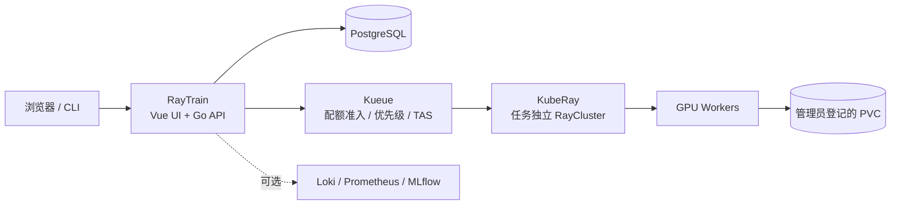

# RayTrain

**A self-hosted, multi-tenant GPU training platform for Kubernetes.**

在一个 Web 控制台中管理团队、GPU 额度、训练任务、运行日志和调试环境。Go API 与 Vue UI 位于同一仓库，构建成一个镜像、一个服务入口；训练计算由 KubeRay 和 Kueue 承担。



## 能力

| 能力 | 设计 |
| --- | --- |
| 多租户 | 平台成员与角色、租户命名空间、事务内 GPU 配额校验 |
| GPU 调度 | 动态物理容量、Kueue 准入、可选 hostname TAS 与全局装箱偏好 |
| 团队与节点 | 团队局部性作为装箱同分偏好；专属节点使用硬约束 |
| 分布式训练 | 任务独立 RayCluster；Ray 编排 DDP；可选受管 Ray Train |
| 可移植存储 | 管理员登记租户 PVC；输入/Checkpoint 只读、结果可写 |
| 身份认证 | 内置账号与 PAT；可选 OIDC，无外部 Portal 强依赖 |
| 调试与观测 | 工作区、JupyterLab、VS Code；可选 Loki、Prometheus、MLflow 接入 |
| 交付 | 同仓前后端、单应用镜像、Helm、GitHub Actions |

装箱用于减少新分配造成的碎片，不会移动运行中的任务，也不承诺碎片为零。优先级影响准入排序，默认关闭抢占。详见 [GPU 调度设计](docs/SCHEDULING.md)。

## 开始使用

需要具备 NVIDIA GPU 驱动与 device plugin、动态存储类、KubeRay 和 Kueue 的 Kubernetes 集群。平台 Chart 不安装这些集群前置组件。

```bash
git clone https://github.com/suAsher/ray-train-platform.git
cd ray-train-platform

# 替换为有权限推送且集群能拉取的仓库。
REGISTRY=registry.example.com/your-project IMAGE_TAG=dev \
  BUILD_TARGETS=platform,source-materializer,workspace,train-pytorch \
  PUSH_IMAGE=true bash build-image.sh
```

然后按 [部署指南](docs/DEPLOYMENT.md) 创建 Secret、填写镜像摘要并安装 Helm。示例不是已经发布的镜像清单，不要直接拉取占位镜像。

基础部署使用 **固定 Git commit + 管理员登记的 PVC + Web 提交**。无需公司服务、IDC 挂载或对象存储。调试工作区、working-dir 上传、快照及逻辑个人/团队/公共数据空间需要额外的存储配置，见 [存储指南](docs/STORAGE.md)。

## 项目边界

- 当前基础存储模式是 Kubernetes PVC；对象存储集成是可选的 TOS/FSX，实现尚未抽象成通用 S3 后端。
- Helm quickstart 的单实例 PostgreSQL 用于开发与评估。生产配置要求外部 PostgreSQL、明确的备份策略和不可变镜像摘要。
- TAS 默认关闭，需要配置兼容的 Kueue 控制器及拓扑资源后验收。
- 公开版本移除了专属 Portal、功能仓同步、管理员数据同步以及自动 IDC 目录挂载。旧数据迁移文件保留用于识别既有 schema，不代表旧功能仍开放。
- 一个集群按当前固定资源名部署一套 RayTrain。平台控制面拥有管理租户资源的集群权限，不是无需授权的普通 namespace 应用。

## 文档与开发

[部署](docs/DEPLOYMENT.md) · [架构](docs/ARCHITECTURE.md) · [存储](docs/STORAGE.md) · [GPU 调度](docs/SCHEDULING.md) · [开发](docs/DEVELOPMENT.md) · [安全](SECURITY.md)

```text
backend/     Go API、认证、任务控制器、CLI、嵌入式 UI
frontend/    Vue 3 + Element Plus 控制台
helm/        平台与可选基础设施 Chart
deploy/      可移植安装示例
images/      训练、调试和辅助镜像
scripts/     验证与集成测试工具
docs/        面向使用者和维护者的文档
```

Go · Vue · PostgreSQL · Kubernetes · KubeRay · Kueue · PyTorch

欢迎提交问题与改进，参见 [贡献指南](CONTRIBUTING.md)。CI 通过只代表对应自动化检查通过，不代替目标 GPU 集群的运行验收。
