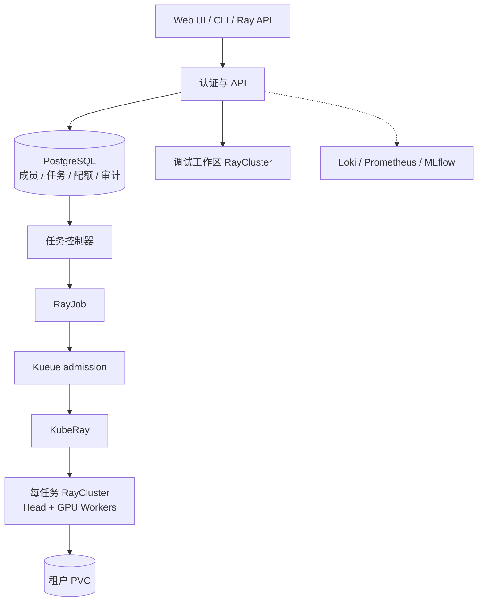

# 架构

RayTrain 是 Kubernetes 上的多租户训练控制面。它管理身份、配额、任务与存储授权，KubeRay 管理计算集群，Kueue 管理训练准入。

## 单应用入口

根目录 Dockerfile 先构建 Vue，再将静态文件复制到 Go 的 `backend/webui/dist` 并嵌入二进制。生产 UI 与 API 共享端口 8080 和同一个镜像版本。前端源码仍按常规放在 `frontend/`，开发时可使用 Vite 热更新；它不需要独立 Portal 仓库。

默认使用本地账号与 PAT。浏览器OIDC由`backend.webOIDCEnabled`显式开启，API的`backend.oidcRequired`单独配置。OIDC 是可选认证来源，平台成员表决定团队和权限；认证成功不等于管理员授权。PAT 只能用于已授予的身份和范围。

## 控制与计算

提交时校验角色、租户队列、镜像允许列表、资源形状和存储资产归属。配额检查与任务持久化在数据库事务内完成。控制器根据持久化期望状态生成 Kubernetes 资源，不依赖单次 HTTP 请求持续在线。

训练代码与镜像分离。基础模式通过固定 Git commit 获取源码，辅助镜像在 submitter 侧准备源码，Ray 再分发工作目录。镜像提供 CUDA、Python、Ray 和平台 launcher；任意上游 Ray 镜像并不保证包含这些入口。

## 数据边界

基础模式中管理员先创建租户 namespace 内的 PVC，再登记资产。用户只提交资产 ID 和受控相对路径，后端解析为卷与挂载位置。数据集和初始 Checkpoint 只读，结果可写。平台不会从任意用户输入创建 hostPath，也不自动挂载公司网络共享盘。

可选 TOS/FSX 数据空间保留个人、团队、公共空间和源码归档等能力，但需要部署者显式配置 CSI、对象存储身份和权限。PVC 基础模式不具有网页目录浏览及同等对象存储功能。见 [存储](STORAGE.md)。

## 调度边界

团队额度、集群物理容量、即时 Worker 槽位分别计量。TAS 和紧凑节点偏好降低碎片，专属节点映射提供硬隔离；当前没有自动跨可用区网络性能发现或运行任务迁移。默认不抢占。详见 [调度](SCHEDULING.md)。

## 可选服务与高可用

Loki 提供历史日志，Prometheus 提供指标，MLflow 提供实验能力。这些服务独立部署并通过配置接入，基础 Helm 安装不自动创建整套可观测性系统。原生 MLflow 的共享权限与平台训练记录过滤是不同边界，启用前需要明确共享策略。

应用可多副本部署，但可靠性还取决于 PostgreSQL、Kubernetes API、队列控制器、镜像仓库及持久存储。quickstart 的单实例 PostgreSQL不提供数据库高可用。生产使用外部 PostgreSQL并配置备份/恢复验证；Helm 回滚不会回滚已经提交的数据库迁移。

平台需要管理租户 namespace、RayJob/RayCluster、Pod、服务和相关存储对象的权限。审阅 Chart RBAC 后再授权安装。训练容器执行用户代码，租户隔离不是面向完全不可信代码的完整虚拟机安全边界。
