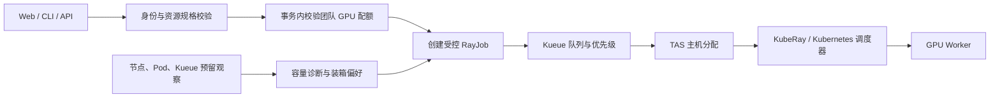

# GPU 调度、碎片与优先级

RayTrain 将调度拆成三个职责：平台检查身份、团队额度和请求形状；Kueue 控制训练工作负载的资源准入与可选拓扑分配；Kubernetes 调度器将 Pod 绑定到节点。KubeRay 管理每个训练任务的 RayCluster 生命周期。



TAS 是可选配置。没有启用 TAS 时，Kubernetes 调度器根据 Pod 资源请求和约束自行选节点；团队配额准入本身不代表进行了 GPU 装箱。

## 配额与物理容量

**团队配额**是管理员授予的提交额度。创建任务的数据库事务使用团队记录行锁，检查既有任务与工作区的 GPU 预留加上新请求是否超额，避免并发提交突破额度。

预留计算包括 active desired state 的非终态训练任务，以及尚未停止或失败的调试工作区。因此排队任务也占团队额度。成功、失败、取消、超时的任务不再占用这部分额度。实现见[配额与事务校验](../backend/repositories/jobs.go)。

**物理容量**来自符合节点选择条件的 Ready、可调度 GPU 节点。平台可按卡型更新 Kueue ClusterQueue 配额与运行时提交上限，避免新增节点后仍受固定 Worker 数量限制。物理池扩容不会自动提高某个团队额度。实现见[自动配额控制器](../backend/k8s/reconciler.go)。

**可立即运行容量**还需要扣除已绑定 Pod 和尚未落成 Pod 的 Kueue 拓扑预留。团队剩余 8 卡，并不表示当前有一台节点能提供 8 张空闲卡。

## 如何减少碎片

训练 Worker 的请求包括 GPU、CPU 和内存。开启 TAS 后，平台向 Worker PodSet 添加 `kueue.x-k8s.io/podset-unconstrained-topology: "true"`，由 Kueue 拓扑调度选择节点，同时移除会与 TAS 分配冲突的 Worker 拓扑分散约束。

平台使用全局容量观察生成软装箱偏好：先过滤装不下一个 Worker 的节点，再依次排序：

1. 已有 GPU 分配或预留的节点优先。
2. 能容纳请求的前提下，剩余 GPU 更少的节点优先。
3. 前两项相同时，本团队已占用 GPU 更多的节点优先。
4. 节点名作为稳定的最终排序。

当前策略是**全局紧凑分配优先，团队局部性作为同分偏好**。团队额度为 8 卡不意味着该团队独占一台 8 卡节点，空闲卡仍可供其他团队使用。

偏好写入 `preferredDuringSchedulingIgnoredDuringExecution`，不构成硬绑定。容量不足、其他约束或调度时状态变化都可能使任务落到其他符合条件的节点。偏好仅在首次创建时计算；读取失败时取消软偏好并继续正常创建。

实现：[训练 PodSet](../backend/k8s/rayjob.go)、[全局节点排序](../backend/k8s/team_node_affinity.go)、[控制器](../backend/k8s/reconciler.go)。

### Worker 槽位示例

对每个节点计算可容纳的 Worker 数量：

```text
WorkerSlots = min(
  floor(空闲 GPU / 每 Worker GPU),
  floor(空闲 CPU / 每 Worker CPU),
  floor(空闲内存 / 每 Worker 内存)
)
```

假设两个节点各有 8 张 GPU，分别剩 6 张和 6 张，CPU、内存足够：

| 新任务规格 | 总空闲 GPU | Worker 槽位 | 当前资源形状判断 |
| --- | ---: | ---: | --- |
| 1 Worker × 8 GPU | 12 | 0 + 0 | GPU 碎片，不能立即满足 |
| 2 Worker × 4 GPU | 12 | 1 + 1 | 可以满足 |
| 1 Worker × 4 GPU | 12 | 1 + 1 | 可以满足，使用节点偏好选择落点 |

第二行可以分布在两台节点，但“2 Worker”本身不要求两台物理机器。如果一台节点能容纳两个 Worker，允许同机放置。需要独立物理节点的算法应显式设计其拓扑约束，不能用 Worker 数推断物理节点数。

容量诊断计入 CPU-only Pod、调试工作区和 terminating Pod 的请求；已完成或失败的 Pod 不计入。Kueue 预留会与对应 Pod 去重。读取不完整时返回容量未知，不伪造空闲容量。观察使用短期缓存，最终准入仍由调度系统决定。

实现：[容量与槽位](../backend/k8s/scheduling_capacity.go)、[预留去重](../backend/k8s/scheduling_capacity_reservations.go)、[观察缓存](../backend/k8s/scheduling_capacity_cache.go)。

### 调试工作区

新建调试工作区也使用全局容量排序生成节点偏好，但不走训练任务的 Kueue 准入链路。Kubernetes 调度器处理其软偏好和实际落点。运行中的工作区不会为了整理碎片被自动迁移。

实现：[工作区落点选择](../backend/api/workspace_placement.go)、[调试 RayCluster](../backend/k8s/raycluster.go)。

## TAS 部署依赖

平台 Helm Chart 不负责代替管理员安装并配置整个 Kueue 控制器。启用 TAS 需要同时满足：

- Kueue 控制器和 CRD 支持平台所用 API、RayJob 集成和 TAS。
- hostname 级 Topology 对象存在，训练 ResourceFlavor 关联正确的 `topologyName`。
- Worker PodSet 发出 TAS 请求；Flavor、训练节点选择器和实际节点标签一致。
- 使用软节点偏好时，Kueue 版本支持并启用 `TASRespectNodeAffinityPreferred`。这是 Kueue 自身的配置，不能只修改平台 values 代替。
- Kueue 实际 placement profile 与期望的紧凑策略一致。

平台配置见 [Helm values](../helm/ray-train-platform/values.yaml)：`kueue.enabled`、`kueue.manageResources`、`kueue.topology.enabled`、`kueue.topology.teamNodeAffinityEnabled`。使用外部管理队列时，管理员负责这些资源对象的一致性。

平台保守默认关闭 TAS 和团队偏好。新安装应按部署说明启用并验证，历史环境启用不代表新集群自动启用。源码能力不能替代目标集群实际落点验收。

实现：[Topology / Flavor / Queue 模板](../helm/ray-train-platform/templates/kueue-resources.yaml)。

## 优先级和抢占

| 名称 | 默认数值 | 提交规则 |
| --- | ---: | --- |
| `production` | 1000 | 团队管理员或超级管理员 |
| `normal` | 0 | 默认等级 |
| `opportunistic` | -1000 | 需要通过抢占与恢复能力门禁 |

这里是 **Kueue WorkloadPriorityClass**，用于排队准入顺序，不是 Kubernetes Pod PriorityClass。高优先级不意味着立即打断低优先级任务。用户不能通过请求参数切换到其他团队队列。

`opportunistic` 要求显式 `preemptible: true`、受管 Ray Train、启用失败恢复、有周期性 Checkpoint 和保留策略，并限制为 1 Worker × 1 GPU。关闭抢占开关时，该类提交直接被拒绝。

**默认保持抢占关闭。** 当前可选模板的 `withinClusterQueue: LowerPriority` 按优先级选择受害者，本身不会依据平台的 `preemptible` 字段筛选。开启后 production 也可能影响 normal，不能解释为“只抢占可恢复的 opportunistic 任务”。在设计受害者隔离、恢复流程并完成故障演练之前，不应将该开关用于保护要求较高的训练环境。

实现：[等级与恢复门禁](../backend/domain/scheduling.go)、[角色和队列校验](../backend/api/submission_service.go)、[优先级资源](../helm/ray-train-platform/templates/training-priorityclasses.yaml)、[抢占配置](../helm/ray-train-platform/templates/kueue-resources.yaml)。

## 专属节点与异构资源

专属节点是独立的硬隔离。管理员通过 `training.dedicatedNodes` 声明团队到 hostname 集合的映射：

- 有专属集合的团队只能进入该集合，使用 required node affinity 的 `In`。
- 其他团队排除所有专属集合，使用 `NotIn`。
- 专属团队获得匹配的 NoSchedule 污点容忍。

这些约束在 Kueue 准入前已存在于 PodSet 中，软装箱不能覆盖它们。NoSchedule 不驱逐已有 Pod，配置变更也不会自动移动旧任务。

可利用不同团队的专属集合，防止任务跨越网络条件差异较大的资源池。当前内置 Topology 只有 hostname 层级，不会自动推断可用区、机房或网络带宽。

不同 GPU 类型通过资源类型与节点标签选择，开启多 Flavor 时分别计算配额。当前内置 AcceleratorClass 为 RTX4090、A100、A800、H20；新增其他卡型需要扩展校验、Flavor 和镜像兼容性验证，不能仅凭任意添加标签认为已经支持。

实现：[专属节点策略](../backend/k8s/dedicated_nodes.go)、[卡型枚举](../backend/domain/scheduling.go)、[队列模板](../helm/ray-train-platform/templates/kueue-resources.yaml)。

## 边界与验证

装箱能减少后续分配产生的碎片，但不保证碎片永远为零。Worker 大小、CPU/内存、存储约束、专属资源池、同时提交和任务结束顺序都会改变可用形状。平台不会自动杀掉或搬迁运行任务来压实节点。

新集群验收应覆盖连续单卡提交、非整机 Worker、整机任务排队、CPU/内存不足、调试与训练混合占用、专属节点排除、扩容后物理额度变化，以及管理员和普通用户的优先级边界。检查 Pod 实际 NODE、资源 requests、Workload topologyAssignment 和准入状态。GPU 利用率不能代替可调度 GPU 数。

已有自动化测试：

- [装箱模板](../backend/k8s/rayjob_packing_test.go)
- [全局装箱与团队同分偏好](../backend/k8s/team_node_affinity_global_test.go)
- [容量与碎片](../backend/k8s/scheduling_capacity_test.go)
- [Pod 与预留计账](../backend/k8s/scheduling_capacity_accounting_test.go)
- [专属节点](../backend/k8s/dedicated_nodes_test.go)
- [优先级与恢复门禁](../backend/domain/scheduling_test.go)
- [提交服务](../backend/api/submission_service_test.go)
- [Helm 调度合同](../backend/config/kueue_scheduling_chart_test.go)

这些测试验证实现合同，不替代目标 Kubernetes 集群上的真实 GPU 调度验收。
