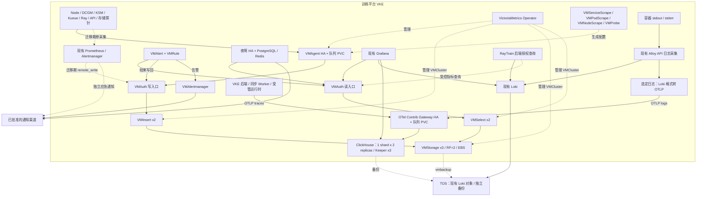

# 训练平台 VKE 可观测性架构：VM Operator、夜莺、OTel 与 ClickHouse

日期：2026-10-08。状态：架构及候选清单已形成；新增 namespace/PC/SC/quota、15 个组件 Secret 与 VM Operator 已创建，数据组件尚未部署到 VKE。16:27 复核 Operator 使用 hub 固定摘要、revision 2、1/1 Ready；原 Pod/控制器/ConfigMap 基线未变。现有采集、告警和训练资源保持原状。实际操作、版本、证据与后续流程见 [部署操作记录](../../../ops/observability/next/DEPLOYMENT_RUNBOOK.md)。

本稿按最新要求采用 **VictoriaMetrics Operator 管理的 VMCluster 全组件架构**。日志保留 Alloy/Loki 的现有查询能力，增加 ClickHouse 分析；OpenTelemetry traces 也写入 ClickHouse。此版本替代前稿的双 VMsingle 和 Tempo 选型。

参考：[用户的 VictoriaMetrics.md](/Users/ashersu/Desktop/go-project/VictoriaMetrics.md)，重点采用其中第 5/6 章 Operator 与采集 CRD、第 10 章组件协作、第 13 章 ClickHouse、第 14 章 OTel 的思路；具体接口、复制、队列和权限语义以当前官方文档核对。示例口令、local-path、镜像标签和性能倍数不直接作为本环境生产配置。

## 1. 范围与目标分工

已确认：**仅覆盖训练平台 VKE，新增服务与数据库都部署在这个 VKE**。common/IDC 不纳入采集与部署，本期不改新 Portal 所在集群，也不改用户 CLI 的提交方式。既有 Loki 使用 TOS 的模式保持；新备份用途使用本云环境独立存储边界并验证兼容性。TOS、统一认证和通知渠道仍是外部服务依赖。

2026-10-08 补充确认：先建设新增体系，旧采集、告警、查询和历史数据保持原状，完成验证后再交接或迁移。允许部署在 GPU 节点，使用其 CPU/内存但不申请 GPU，不硬绑定 CPU 节点；首期使用非抢占优先级、明确 requests/limits、独立存储，只接新组件自监控与合成测试数据。

当前门禁：12 个节点 Cilium 均为 `PolicyEnforcement=never`，NetworkPolicy 不执行；用户确认尚未开通过该能力并要求先保留现状。本轮不启用 CNI 策略、不继续启动依赖网络隔离的数据组件。以下图和拓扑是目标架构，不代表已接通。

| 层次 | 目标组件 | 职责 |
| --- | --- | --- |
| 声明式管理 | VictoriaMetrics Operator | 管理 VM CRD，生成配置，协调部署与升级 |
| 主指标采集 | VMAgent HA | 根据采集 CRD 发现目标、抓取、重标记、缓冲、remote_write |
| 指标写入 | VMAuth → VMInsert | 身份与路径限制；分片、复制、写入 VMStorage |
| 指标存储 | VMStorage | 指标与索引、保留、合并；独立 EBS PVC |
| 指标查询 | VMAuth → VMSelect | 授权路由；汇聚查询与去重 |
| 基础规则 | VMAlert + VMRule | 基础设施告警与 recording rules；查询和结果写回 VMCluster |
| 基础通知 | VMAlertmanager | 分组、路由、静默、通知去重 |
| 训练业务告警 | Nightingale（夜莺） | 平台/GPU/任务/同步规则、责任组、通知和事件处置 |
| 原有指标体系 | Prometheus Operator / Prometheus / Alertmanager | 迁移期保留原能力；稳定后保留小范围独立应急监控 |
| 实时日志 | Alloy → Loki | 现有容器日志、Portal 任务日志、近期排障；保持 LogQL 和历史兼容 |
| 分析日志与链路 | Alloy/OTel SDK → OTel Contrib → ClickHouse | 结构化日志、跨任务统计、trace/span 查询关联 |
| 统一界面 | 现有 Grafana + ClickHouse 数据源 | 指标、日志与 traces；夜莺负责告警工作流 |

**VM 存指标，Loki 提供现有日志查询，ClickHouse 存分析日志与 traces。** 不把 VM 数据再存进 ClickHouse，也不让 VMCluster 直接发送告警。Loki 与 ClickHouse 的双写范围有明确用途和保留期，不默认全量长期存两份。

## 2. 当前基线与问题

以下是 2026-10-08 只读现场快照，不是产品能力上限：

| 项目 | 现场状态 |
| --- | --- |
| 资源观测 | 12 个 Ready 节点、9 个 DCGM 目标、72 条 GPU utilization 序列；仍需与设备/MIG 清单核对 |
| Prometheus | 2 副本，各 50Gi EBS；保留 15 天、容量限制 45GiB |
| 指标规模 | 单副本约 28.6 万活跃序列、1.04 万 samples/s；HA 两副本不能相加为逻辑规模 |
| 指标占用 | 单副本 blocks 约 18.3GB、PVC 已用约 19GB；未核实最早 block，不能当作 15 天实测增长量 |
| Alloy | 2 副本 Kubernetes API 日志采集、集群分工；当前无 CPU/内存 requests/limits |
| Loki | 3 副本；TSDB/chunks 存 TOS `vke-cluster`，保留 30 天；各 50Gi EBS 为 WAL/索引等工作盘 |
| 日志质量 | 运行中系统/调试 Pod 的旧日志反复回读，被 7 天接收窗口拒收；回读根因尚未确认 |
| 指标盲区 | 实际 targets 缺少 Alloy、Loki、平台后端、Kueue、Ray 运行时；已有 `ray_*` 主要是缓存监控 |
| 告警出口 | Alertmanager 仅有 `null` receiver，没有实际外部通知集成 |
| 告警噪声 | 部分托管控制面目标无抓取端点，触发长期缺失告警；不能据此断言组件故障 |
| 存储探针 | FSX DNS 探针 9/11 就绪；需区分 DNS、网络、目标与探针故障 |

两个 Alloy 是否足够应按日志流、吞吐、API 负担与可恢复性判断。当前低 CPU 不代表无丢弃或回读；Loki 7 天接收窗口与 30 天保留期也是不同策略，不宜扩大窗口来掩盖问题。

迁移保护对象包括现有训练、用户数据、团队/任务权限、CLI/Portal 提交及日志历史。现有 Prometheus PVC、Loki 桶、RayJob/RayCluster 不因本次调整删除、搬迁或重启。

## 3. 总体架构

VMAuth 读写是两类逻辑入口，可由同一组 HA 实例提供，但账号、路径与限流分别配置。虚线表示管理、迁移或备份，不表示常态全量重复采集。

ClickHouse 不兼容 LogQL，不能直接替换 Portal 的 Loki URL。首期只给 Grafana 增加分析入口；未来若迁移用户日志查询，需要另做 API、分页、搜索、流式日志与授权合同改造。

## 4. VictoriaMetrics Operator 全组件设计

### 4.1 资源与拓扑

| 资源 | 建议拓扑 | 作用与状态 |
| --- | --- | --- |
| Operator | 首期单控制器；HA 副本需核对 leader election | 管理 CR；控制器短时不可用不等于已有数据服务停止 |
| `VMCluster` | insert 2、select 2、storage 3，`replicationFactor: 2` | 一个顶层 CR 管理三类工作负载 |
| `VMAgent` | 2 副本，`statefulMode: true`，独立 PVC | 同目标 HA 抓取与持久发送队列 |
| `VMAuth` + `VMUser` | VMAuth 2 副本 | 服务身份、固定租户路径、读写权限；禁匿名 |
| `VMAlert` + `VMRule` | VMAlert 2 副本 | 基础告警与 recording rules；输出标签满足 HA 合同 |
| `VMAlertmanager` + `VMAlertmanagerConfig` | 3 副本，各自 PVC | 通知路由、静默与去重 |
| `VMServiceScrape` / `VMPodScrape` | 声明式配置 | exporter、业务服务、Ray Pod、自监控 |
| `VMNodeScrape` / `VMProbe` | 按需配置 | 节点端点及通过 Blackbox Exporter 的探测 |
| `VMStaticScrape` / `VMScrapeConfig` | 明确目标时配置 | 本 VKE 内特殊发现；不扩大 IDC 范围 |
| vmbackup / vmrestore / vmctl | 受控作业 | 备份、恢复、迁移；开源工具不等于自动获得企业版控制能力 |

**VMSelect、VMInsert、VMStorage 是 `VMCluster.spec` 的组件字段，不是三个顶层 CR；VMAgent 是另一个 CR。** [Operator API](https://docs.victoriametrics.com/operator/api/)

选择 standalone VictoriaMetrics Operator chart + 项目显式 CR，与既有 kube-prometheus-stack 共存。若使用 `victoria-metrics-k8s-stack`，必须关闭默认 VMsingle、开启 VMCluster，关闭重复 Grafana/exporter/规则及匿名访问模板，不能照默认整套安装。[官方 chart](https://docs.victoriametrics.com/helm/victoria-metrics-k8s-stack/)

### 4.2 采集与 Prometheus 的角色

最终由 VMAgent 主采集，复用既有 node-exporter、DCGM、kube-state-metrics。

| 阶段 | Prometheus | VMAgent | VMCluster |
| --- | --- | --- | --- |
| 新增建设（当前范围） | 原配置保持 | 仅新组件自监控与合成目标 | 固定 canary 租户；暂不接旧链路 |
| 旁路验证 | 原抓取/规则/15天 TSDB；新增 VM 远写目的 | 新 VM/OTel/CH 自监控及明确验证目标 | 接收旁路数据，供对照 |
| 按组交接 | 逐组退出已交接目标的主采集和规则 | 接管相应目标与标签合同 | 保持逻辑指标身份与查询连续 |
| 稳态 | 小范围抓取 VM/夜莺/关键采集器，独立应急规则 | 常规基础设施、训练平台与受管运行时指标 | 主查询，初始 90 天保留目标 |

交接记录目标、标签、周期、规则依赖与时间。允许有结束时间的影子采集；未验证的数据写隔离验证租户，确认标签与去重后才允许短时同空间重叠，随后停止旧主采集。

Prometheus 完整保留阶段可做原查询回退；**退出某组抓取后，它不再拥有该组持续的新数据**。回退需恢复对应 Monitor/规则并保留 VM 历史，不能继续承诺任意时刻都有完整的新 15 天数据。

### 4.3 CRD 转换和配置治理

初装关闭默认 Prometheus 转换器：`operator.disable_prometheus_converter: true`。按组维护 VM CR，VMAgent 显式限制 namespace/label selectors，`selectAllByDefault: false`，避免无意接管所有指标和规则。

转换器开关不等于对象级白名单。若启用持续转换，原 Prometheus 对象作为配置源，转换结果不应再独立手工维护；删除同步、更新同步、规则执行方分别验收。[转换机制](https://docs.victoriametrics.com/operator/integrations/prometheus/)

仓库 Ray PodMonitor 缺少现网选择器要求的 `release: prometheus`，现场也没有该 PodMonitor。补齐时同时核对旧 Prom 和 VMAgent selectors；YAML 存在不代表被发现。

### 4.4 去重、队列与复制

- HA 抓取副本的业务标签须一致。仅去掉已确认的采集副本身份标签，保留 cluster、namespace、node、pod、instance；不要假定生成的副本标签一定叫 `prometheus_replica`。
- **HA 抓取去重与 RF2 存储复制不同。** vmselect/vmstorage 设置一致的 `dedup.minScrapeInterval`，先盘点 15s/30s/60s 周期并测试 rate、计数器、直方图和规则结果；不直接照抄参考文档的 1s/30s。
- VMAgent 默认临时队列不能满足重建续传；显式 StatefulMode/PVC、队列目录/上限并留文件系统余量。队满、磁盘故障仍可丢失，两个 Pod 的 PVC 不会自动复制彼此队列。[VMAgent 持久与 HA](https://docs.victoriametrics.com/operator/resources/vmagent/)
- 三个 storage + RF2 在正确配置和余量下承受单节点故障，但不保证任意两节点故障可用，也不自动补齐全部历史副本。新增 storage 不自动重平衡旧数据，恢复需核对历史覆盖。[VMCluster 复制语义](https://docs.victoriametrics.com/victoriametrics/cluster-victoriametrics/#replication-and-data-safety)
- 告警查询优先拒绝不完整响应，测试 RF 与 partial-response 策略；数据源不可用不能误报为业务恢复。

旁路期使用 remote_write v1；协议、native histogram、PromQL/MetricsQL 差异按锁定版本验证。Prometheus 保留 15 天不等于自动远写补传 15 天，长中断可超出 WAL 自动重试窗口，需要受控回填。[Prometheus remote_write](https://prometheus.io/docs/practices/remote_write/)、[VM 集成](https://docs.victoriametrics.com/victoriametrics/integrations/prometheus/)

队列容量按 `实际编码后 B/s × 可容忍中断秒数 × 安全系数` 测算。恢复发送必须快于新数据进入；不能删除仍有积压的 PVC，也不能把普通 Service 负载均衡当作队列复制。

### 4.5 升级与备份

storage 使用独立 EBS，不共享目录、不挂 TOS 作为在线数据盘。配置反亲和/PDB，逐节点升级；当前 Operator 的 `OnDelete` 可由控制器逐节点推进，不能误解为一定要人工删除 Pod。[更新策略](https://docs.victoriametrics.com/operator/resources/vmcluster/#update-strategy)

每个 storage 分别备份到独立前缀，保留拓扑、时间范围、配置；不能只备份一个 storage 就认为是全量。vmbackup/restore 与 TOS endpoint、签名、权限须实测，并隔离恢复。副本、快照、备份不可相互替代。[vmbackup](https://docs.victoriametrics.com/victoriametrics/vmbackup/)

## 5. 夜莺与规则所有权

| 规则类型 | 稳态执行方 | 通知 |
| --- | --- | --- |
| recording、通用 Kubernetes/节点/观测基础规则 | VMAlert + VMRule | 告警进入 VMAlertmanager；recording 写回 VM |
| GPU 空转/不足、排队、初始化/回收、同步积压、API/SLO | 夜莺 | 夜莺责任组与已验证通知渠道 |
| VM 查询不可用、夜莺整体不可用等独立应急规则 | 原 Prometheus | 原 Alertmanager 应急出口 |

每组只有一个主执行与通知所有者。先影子求值，再交接；不同时开启相同 PrometheusRule、VMRule 与夜莺规则。VMAlert 查询 VMSelect、向 VMInsert 写结果和所需状态；HA 输出标签一致。向所有 VMAlertmanager 实例发送告警或使用支持的发现，不只随机发送一个实例。[VMAlert HA](https://docs.victoriametrics.com/operator/resources/vmalert/#high-availability)

recording rules 不能只转换 YAML 就交接：VMAlert 结果异步写回，Prometheus 中同一轮“规则 A 生成序列、规则 B 立即读取”的依赖不保证等价。逐组审计依赖图，改写或安排评估时序，测量落库延迟、HA 时间戳和缺数据行为；未通过的组继续由原 Prometheus 执行，不迁一半依赖链。[VMAlert 规则执行](https://docs.victoriametrics.com/victoriametrics/vmalert/)

夜莺直接查询 VMAuth 后的 VMSelect，无需再抓指标或强制经过 Pushgw。首期与 VMAlertmanager 分清规则/通知归属；不假定原生夜莺通知可以完整复用 AM，统一出口需验证 firing/resolved、分组、重试、去重适配。[夜莺架构](https://n9e.github.io/docs/prologue/architecture/)、[通知扩展](https://n9e.github.io/docs/usecase/media/)

夜莺采用 2 实例，共享专用生产 PostgreSQL 或 MySQL、Redis；引擎配置一致，各实例有效心跳地址不同。不用 SQLite/miniredis，不把新增负载直接塞入训练平台业务库。[夜莺配置](https://n9e.github.io/docs/install/configuration/)

VKE 内依赖建议 PostgreSQL 1主2备、独立 PVC/备份，Redis 1主2备 + 3 Sentinel，跨三个合格工作节点。同步/持久化、仲裁、RPO 与故障切换单独验收；双夜莺 Pod 配单库不是完整 HA。资源不足先解决容量，不静默取消反亲和。[Redis Sentinel](https://redis.io/docs/latest/operate/oss_and_stack/management/sentinel/)

先修复现有 `null` receiver、不适合托管 VKE 的缺失告警；台账包含 owner、严重级别、持续时间、抑制、值班组、runbook、触发/恢复测试。

所有组件在同一 VKE，整集群/出口失联时不能保证对外告警。原 Prom 的独立路径只能减少组件级依赖；未来整集群故障探测需云侧或集群外能力，本期不暗中扩大范围。

## 6. Loki 与 ClickHouse 的日志分工

| 数据 | Loki | ClickHouse |
| --- | --- | --- |
| 现有训练 stdout/stderr、Portal 日志 | 原采集查询、30天历史 | 初期不全量再存，按需选结构化错误/阶段事件 |
| 后端、同步 Worker、生命周期日志 | 近期排障 | 首批分析：失败类型、重试、吞吐、团队/任务统计 |
| 系统/组件日志 | 原范围，先治理回读 | 选需要跨服务统计的部分 |
| OTel spans | 通过业务日志 trace_id 关联 | 保存 spans/events/links 与资源属性 |
| 数据集、模型、MLflow 实验指标 | 不新增目录采集 | 不自动导入观测库 |

采用 Loki 保持现有体验，ClickHouse 承担 SQL 分析。允许明确用途的日志双写，但登记白名单、保留期、容量，不默认全量长期复制。

### 6.1 Alloy → OTLP 的实际链路

原链路 `loki.source.kubernetes → loki.process → loki.write` 保持，对选定日志增加：

`loki.process → otelcol.receiver.loki → otelcol.exporter.otlphttp → OTel Contrib Gateway（transform + 可信 resource enrichment）→ clickhouse exporter`

官方 Alloy 有 `otelcol.receiver.loki`，转换采集端格式，不是回读 Loki 历史。现网 v1.18.1 的组件/字段兼容必须以锁定镜像测试；标签、structured metadata、事件时间、Severity、TraceId/SpanId 逐项验证，不自动从任意正文生成 trace 关联。[Alloy 转换组件](https://grafana.com/docs/alloy/latest/reference/components/otelcol/otelcol.receiver.loki/)

已核对 v1.18.1 使用的转换代码：事件时间保留、原行进入 Body、Loki labels 与 structured metadata 进入 LogRecord attributes；同名 metadata 可覆盖 label。它不自动设置标准 TraceId/SpanId/Severity，也不自动形成 service.name 等 ResourceAttributes。因此必须显式解析约定的结构化字段，验证 ID 格式后映射标准 trace/span 字段，并补齐 service/cluster/namespace。team/job 等授权相关属性由可信 Kubernetes/平台映射重建或校验，不允许正文或 metadata 覆盖。无法验证的关联留空，不生成假 trace ID。[Alloy 锁定版实现](https://github.com/grafana/alloy/blob/v1.18.1/internal/component/otelcol/receiver/loki/loki.go)、[OTLP 转换实现](https://github.com/open-telemetry/opentelemetry-collector-contrib/blob/v0.153.0/pkg/translator/loki/loki_to_otlp.go)

官方 Alloy 组件目录未列原生 ClickHouse exporter，所以使用独立 OTel Collector Contrib 网关补足导出能力，不再复制第二套全量节点采集器。[Alloy 组件目录](https://grafana.com/docs/alloy/latest/reference/components/otelcol/)、[ClickHouse exporter](https://github.com/open-telemetry/opentelemetry-collector-contrib/blob/main/exporter/clickhouseexporter/README.md)

分叉不天然隔离回压。OTLP 分支配置有界队列、重试和资源限制，模拟 CH/Gateway 不可达确认 Loki 不被拖住。若该版本不能满足隔离要求，先用应用直接 OTLP 的分析日志，再设计限定 Pod 的独立采集，不贸然全量分叉。

该版桥接组件同步调用下游，失败时记录错误，本身没有逐条持久重试；下游拒收不能让原采集器自动为 CH 重读。初期分析分支以保护原 Loki 路径为先，有限队列耗尽后的丢弃必须计数/告警，结合桥错误与端到端 canary 核对，不能把 Loki 写成功当成两库均成功。要求强持久的记录应走单独验证的可靠入口，不依赖这条分析分支。[桥接实现](https://github.com/grafana/alloy/blob/v1.18.1/internal/component/otelcol/receiver/loki/loki.go)

### 6.2 完整性与重复

- 先定位旧日志回读，再开 CH 分支；否则 Loki 拒收的旧数据会被 CH 重复存储。灰度从测试 Pod/已知新日志开始。
- 保留事件时间，定义最大时差、历史导入通道、丢弃计数与隔离处理；不通过改时间戳伪装新日志。
- API 采集不是每节点读文件；给 Alloy 加 PVC 不等于修复读取游标，需测试重连/目标重新分配/旧运行 Pod。
- canary 使用唯一事件标识，验证 Loki/CH 到达，并覆盖轮转、容器重启、短 Pod、元数据变化。
- `train.log` 文件不会自动进入 stdout 采集。journal/节点文件需要时另设计限定范围 DaemonSet，不遍历个人目录；同容器同后端不长期双采。
- 重试可能重复投递，MergeTree 不保证逐事件 exactly-once。可靠 event_id 优先来自生产者，不能靠正文哈希盲合并本来就相同的日志。

保留现有 job/tenant 标签兼容；新增高基数字段放结构化属性。trace_id/request_id 不变成 Loki 索引标签或 VM 指标标签。

## 7. OpenTelemetry 链路

### 7.1 接入范围

| 对象 | 首批观测 |
| --- | --- |
| VKE Go/Gin 后端 | HTTP、认证/配额、DB、Kubernetes API、MLflow/TOS 客户端 |
| 生命周期控制器 | 创建、准入、初始化、停止、回收阶段与错误 |
| storage-sync Worker | run/attempt、预检、复制批次、校验、检查点与状态提交 |
| 受管 Ray driver/Python | 按需接入准备、初始化、checkpoint/上传，不自动改用户代码 |

首期从 VKE 后端入口开始；CLI、新 Portal 与其集群不增加 SDK。OTel 不会自动得到全部 Ray/torchrun 子进程、NCCL 或 CUDA kernel 性能，这些是专项 profiler 范围。

同步使用 W3C trace context，异步只持久化必要关联字段。长排队/训练拆成短 trace 与 span links，以 job_id/run_id/attempt 关联，不保持数天根 span。状态数据库/事件仍是生命周期事实来源，采样 trace 不替代任务账本。[上下文传播](https://opentelemetry.io/docs/concepts/context-propagation/)

### 7.2 Gateway、队列和采样

OTel Contrib Gateway 2 副本，各有持久队列 PVC；处理链包含有界内存、可信元数据、脱敏、`file_storage` 发送队列与重试。优先使用锁定 exporter 支持的队列内 batching，避免其前面的普通 batch processor 先返回成功、数据却仍只在内存。必须验证队列入盘和 OTLP 成功响应的实际边界；若所选实现存在提前确认窗口，明确可接受丢失量，不能宣称“返回成功即已持久化”。SDK 异步、限时、限内存；遥测故障不得阻塞提交和训练。Service 只分发请求，不复制已接收队列。[Collector 韧性](https://opentelemetry.io/docs/collector/resiliency/)、[发送队列与 batching](https://github.com/open-telemetry/opentelemetry-collector/blob/main/exporter/exporterhelper/README.md)

OTLP 写入口验证服务身份，受管后端、Worker、Alloy 与可选用户运行时分开配置身份/权限，采用 mTLS 或经过验证的等效认证入口。认证扩展或前置网关的验证结果参与可信元数据映射；不只凭 ClusterIP/TLS 加密或客户端 team_id 授权。覆盖或拒绝未验证的同名团队/任务属性，拒绝绕过认证的直连；来自日志桥的原 Pod 信息还需按 Kubernetes/平台归属核对，不能把全部日志归为 Alloy 自身所在 namespace。[Collector 认证](https://opentelemetry.io/docs/collector/configuration/#authentication)

低频关键生命周期先全采，高频 API 按实测选择 parent-based head sampling；头部采样不能保证留全错误。需要错误/慢请求强保留时再引入 tail sampling，并按 TraceId 路由同一处理实例，不能普通轮询。队列持久化不等于 tail sampler 内存持久化。[Gateway 模式](https://opentelemetry.io/docs/collector/deploy/gateway/)

首期不强制 Kafka：先以持久队列覆盖明确的短时故障预算；长中断、恢复吞吐或多消费者需求超过能力时再评估。HTTP RED/GPU/队列告警以完整指标为准；spanmetrics/service graph 由唯一位置生成，若要求采样前流量则在采样前计算，也不能恢复 SDK 已丢弃的 spans。

## 8. ClickHouse 存储与分析设计

### 8.1 拓扑与 Operator

初始 **1 shard × 2 replicas + 3 Keeper**。两 replica 各独立 EBS SSD，跨节点；Keeper 跨三个合格工作节点。初始一个 shard 控制资源投入，达到容量/并发门槛再扩为 2 shards × 2 replicas。增加 shard 不自动重分布历史，需要设计新写入、旧表查询与回填。

ClickHouse 不由 VM Operator 管理。官方 ClickHouse Operator（`ClickHouseCluster`/`KeeperCluster`）与 Altinity（`ClickHouseInstallation` 等）是不同 CRD 体系。建议先评估并锁定 Altinity 候选，通过当前 VKE、Keeper、PVC、升级与恢复演练；如选官方实现，核对 Kubernetes/cert-manager 前提，不能混用清单。[官方 Operator](https://github.com/ClickHouse/clickhouse-operator)、[Altinity Operator](https://github.com/Altinity/clickhouse-operator)

### 8.2 Schema 与数据路径

- logs/traces 分表，采用 exporter 兼容 OTel schema；初期选已验证 Map 属性类型，不以实验 JSON 模式为默认。
- 专用 DDL 身份通过 `ON CLUSTER` 或等效机制一致创建 ReplicatedMergeTree 本地表、Distributed 查询表、trace 辅助表/视图。trace-id 时间范围与聚合查询所需目标表也配置复制，各 replica 建好对应 MV，不能只复制主 spans 表。exporter 设 `create_schema: false`，普通 writer 不授任意 DDL。
- cluster、namespace、service.name、team_id、job_id、run_id、attempt 使用规范属性或验证过的物化列；TraceId/SpanId 与时间类型统一。排序/分区/索引按真实查询设计。
- 单 shard 可路由任一健康 replica 的本地表写入，由复制机制同步；查询一份逻辑数据，不能 UNION 两副本再重复计数。
- 多 shard 若用 Distributed 写入，明确 sharding key 与 `internal_replication=true`。trace 可按 TraceId 分片，无 TraceId 日志另定均匀策略；测试前台确认/后台转发语义，不把入口落队列当最终落盘。[Distributed 引擎](https://clickhouse.com/docs/reference/engines/table-engines/special/distributed)

ClickHouse exporter 当前 logs/traces 为 beta，应锁定 Collector/exporter/CH schema 组合，测试升级回退；只设 `cluster_name` 或 table engine 不能替代完整生产 DDL。[Exporter 合同](https://github.com/open-telemetry/opentelemetry-collector-contrib/blob/main/exporter/clickhouseexporter/README.md)

### 8.3 确认与故障语义

采用批量写入，验证 `async_insert=1`、`wait_for_async_insert=1`，实际 flush 失败要反馈 exporter；不用内存接收即确认来虚报持久化。队列在成功确认后完成发送，队满/重试/磁盘均有告警。[异步写入](https://clickhouse.com/docs/concepts/features/operations/insert/asyncinserts)

ReplicatedMergeTree 默认异步复制，双副本不等于零 RPO。若要求任一存储节点立即丢失仍保全已确认数据，必须验证 insert quorum、异步批量与转发组合，接受 quorum 不足时停止确认写入，短时故障由 Collector 缓冲。[复制语义](https://clickhouse.com/docs/reference/engines/table-engines/mergetree-family/replication)

初期普通遥测采用本地落盘确认、异步复制，显式接受灾难故障中的复制延迟风险；任务状态、计费、审计事实不以观测库为唯一来源。部署前把 RPO 与队列故障预算列入验收，不承诺端到端 exactly-once。

### 8.4 保留、备份与 Grafana

建议起点：分析日志 30 天、原始 traces 14 天、低基数聚合 90 天；7–14 天试采后调整。TTL 覆盖原表/辅助表/聚合表，后台 merge 回收不等于精确到期立刻释放空间。[TTL](https://clickhouse.com/docs/concepts/features/operations/delete/ttl)

首期热数据放 EBS，TOS 冷层后评估；S3-compatible 不能直接证明 TOS disk、multipart、凭据刷新、故障恢复兼容。备份与冷层/副本独立，恢复到隔离表或集群核对；Keeper/本地元数据也纳入恢复方案。[S3 备份恢复](https://clickhouse.com/docs/concepts/features/backup-restore/s3-endpoint)

现有 Grafana 增加官方 ClickHouse datasource，支持 logs/traces 展示。配置 Loki trace_id → ClickHouse trace、trace → 时间段日志跳转。HyperDX/ClickStack 作为后续 UI 选择，首期不叠另一套 UI、MongoDB 和 Collector。[Grafana ClickHouse](https://grafana.com/docs/plugins/grafana-clickhouse-datasource/latest/query-editor/)、[ClickStack 自建](https://clickhouse.com/docs/clickstack/deployment/helm)

目标 VM 的 exemplar 存储/查询尚未验证，不把指标 exemplar→trace 直跳当首期承诺；先用 service、job_id、时间和日志 trace_id 关联。

## 9. 权限和数据合同

VMCluster 原生 tenant 路径不会自动继承平台成员权限。基础设施指标放固定运维租户；团队数据若拆分，由可信入口映射固定路径。VMAuth 区分采集写、Grafana/夜莺读、VMAlert 必要读写，关闭匿名与未授权跨租户访问。[VMAuth/VMUser](https://docs.victoriametrics.com/operator/auth/)

用户经原后端校验成员、角色、团队与 Job 归属，不能自行指定 VM tenant、Loki header 或任意 ClickHouse SQL。team_id 来自可信资源元数据，不以用户进程自报字段授权。

CH 分开 schema 管理、writer、reader。Grafana SQL 数据源账号在数据库端限制库表、只读、查询时长、扫描量和并发；共享凭据配团队变量不是隔离，文件夹/夜莺分组也不是数据授权。自建 CH 不假定继承 Cloud 专属 OAuth identity forwarding。[Grafana 权限配置](https://grafana.com/docs/plugins/grafana-clickhouse-datasource/latest/configure/)

普通用户保持 Portal 受控接口，全量 Grafana 数据源仅运维可见。未来团队直查需额外设计独立身份/row policy，覆盖 Distributed 与底层表，测试伪造头和直接访问。观测权限不改变原生 MLflow 既有共享约定。

禁止记录 PAT、Authorization、Cookie、AK/SK、签名 URL、完整 SQL 参数和源码。SDK/Collector 白名单脱敏；高基数请求/trace ID 不进入指标标签。ClusterIP 配 NetworkPolicy 与所需 TLS，内部地址不是授权。VM 开源组件间安全不能未经确认依赖企业版 mTLS 特性。

## 10. 部署、故障域与容量

保留 `monitoring`/`loki`，建议新建 `observability-metrics`、`observability-otel`、`observability-analytics`、`observability-alerting`。namespace 用于组织/RBAC/配额/网络策略，不提供物理故障隔离。

新增组件可使用 CPU 或 GPU 工作节点的 CPU/内存与独立盘，设置 requests/limits、非抢占优先级、反亲和/PDB，不申请 GPU、不为部署驱逐训练。核对至少三个适合仲裁/存储的节点及故障余量；首批避开高内存水位节点，并保留 algorithm 专属节点污点边界。节点级分散不等于跨 AZ，EBS 绑定和重建受真实云盘约束。IDC Harbor 仍影响拉镜像，本期只记录摘要/缓存/恢复路径，不改 IDC。

下面是**每 Pod requests 工程试配起点**，不是最低要求或已验性能；limits、临时空间、备份与故障余量另计：

| 组件 | 副本 | CPU / 内存起点 | 每 Pod 盘起点 |
| --- | --- | --- | --- |
| VMAgent | 2 | 0.5–1核 / 2Gi | 20Gi 队列 |
| VMInsert | 2 | 1核 / 2Gi | 临时空间，不保存长期指标 |
| VMSelect | 2 | 1–2核 / 4Gi | 按配置 20Gi 可重建缓存 |
| VMStorage | 3 | 2核 / 4–8Gi | 200Gi EBS SSD |
| VMAuth | 2 | 0.25–0.5核 / 512Mi | 无业务盘 |
| VMAlert | 2 | 0.5核 / 1Gi | 状态按远端读写验证 |
| VMAlertmanager | 3 | 0.2核 / 512Mi | 20Gi（本 VKE ESSD_PL0 最小卷） |
| OTel Gateway | 2 | 1–2核 / 2–4Gi | 20Gi 队列 |
| ClickHouse | 2 | 4核 / 8–16Gi | 300Gi EBS SSD，各持完整一分片 |
| Keeper | 3 | 0.5核 / 1Gi | 20Gi |
| 夜莺 | 2 | 1核 / 2Gi | 状态在专用 DB/Redis |
| PostgreSQL / Redis / Sentinel | 1主2备 / 1主2备 / 3成员 | 单独列预算 | 各实例持久策略/备份单列 |
| Operator、原 Grafana/Prom/Loki/Alloy | 按目标与原配置 | 另计，补现有 requests 缺口 | 原盘保持 |

这套组件需要独立核算 CPU 余量和云盘/节点配额；不足时增加 CPU 容量或分阶段落实上述 VMCluster 拓扑。

上表面向后续代表性业务流量。当前仅自监控/canary 的候选预算较小，明确保留完整副本拓扑：VM 合计 250Gi、ClickHouse/Keeper 260Gi、OTel 队列 40Gi、夜莺 PG/Redis 120Gi，共 670Gi；VM 初始保留 30 天，CH canary 保留 7 天。实际配置见 `ops/observability/next/`，不将试配预算当作正式流量定容结果。

VM 按约 1.04万逻辑 samples/s、28.6万活跃序列，实测压缩、churn、RF2、索引/merge 定容；3×200Gi 不是 600Gi 逻辑容量。当前 Prom blocks 的时间覆盖未核实，不直接据此给 VM 压缩倍率。

CH 按 `原始 B/s × 86400 × 天数 ÷ 实测压缩比 × 副本数`，加索引、parts/merge、队列与余量测算。尚无完整日流量/span 数，不承诺 300Gi 一定容纳 30天日志+14天 traces。

| 数据 | 在线存储 / 初始保留 | 保护 |
| --- | --- | --- |
| 主指标 | VMStorage EBS / 90天目标 | RF2、每节点备份、隔离恢复 |
| 原 Prom | EBS / 当前15天不立即改变 | 配置规则版本化；历史自然过渡 |
| 训练/运维日志 | Loki 原 TOS / 30天 | 保持 WAL/索引恢复，验证保留删除 |
| 分析日志 / traces | CH EBS / 30天、14天建议 | 复制、TTL、备份；冷层后评估 |
| 夜莺状态 | VKE 专用数据库/Redis | 复制、备份、恢复与持久化语义 |

保留期、对象生命周期、盘水位、备份与扩容提前量统一核算，不能让底层生命周期早于上层保留期。

## 11. 分阶段实施与回退

| 阶段 | 内容 | 通过条件 | 回退 |
| --- | --- | --- | --- |
| 0 新增建设 | 新 namespace、权限、存储、全组件候选、自监控/canary | 网络隔离实效、资源余量、原系统基线对照 | 仅停新入口；原系统不变 |
| 1 VMCluster | Operator/CR、VMAuth、2/2/3 RF2、持久 VMAgent/备份 | CRD/PVC/权限、单节点故障恢复 | 原 Prom 不变，新盘不自动删 |
| 2 指标交接 | Prom 旁路、查询对照、VMAgent 按组接管 | 7–14天代表性流量，无双计数/盲区 | 按组恢复原抓取，标明历史缺口 |
| 3 告警 | VMAlert/AM、夜莺 HA、规则交接 | 触发/恢复/接管/去重，一个通知 owner | 停新组再恢复旧组 |
| 4 OTel + CH | CH/Keeper/DDL、Gateway、少量后端/Worker 埋点 | 关联、复制、备份，业务不阻塞 | 关新导出，原日志指标不变 |
| 5 分析日志 | Alloy 白名单分支、Grafana CH、关联跳转 | 时间/字段、回压、拒收/重复、权限 | 撤分析分支，Loki/Portal 留原路 |
| 6 容量治理 | 扩大验证范围、SLO、实测定容 | 峰值/故障余量/成本可解释 | 分组件回退 |

本次已获得新增体系建设授权，但当前因网络门禁停留在基础层与候选验证；没有进行业务采集交接。基础设施可独立发布；**Go/Python OTel 埋点需要后端/Worker 测试、构建和滚动发布**。首期不发布 Portal，不要求改 CLI 命令，不触碰运行中训练镜像。旧日志回读、FSX 和原规则修复另按对应问题处理，不借本轮增量建设修改旧链路。

## 12. 验收与自监控

| 项目 | 证据 |
| --- | --- |
| 覆盖 | 权威节点/GPU/服务清单对应真实 targets 与序列，新增节点/任务可发现 |
| 指标 | GPU、队列、HTTP RED、recording 对照，定义采样容差，无 HA 翻倍 |
| 交接 | 一组一个主采集方；converter/selector 不误收；recording 依赖与落库延迟通过，规则不重复执行 |
| VM 故障 | insert/select/storage 单实例失效恢复，剩余容量、partial response、积压清空 |
| 队列 | 测试目的不可达/Pod 重建/盘水位；专门在 OTLP 已返回成功而批次未写入 CH 时中断测试网关，核对确认/持久边界、补传/缺口 |
| 日志 | Loki/CH canary、旧回读、轮转、短 Pod、重连；CH 故障不拖住 Loki |
| CH | replica/Keeper 故障、DDL/TTL、parts/merge、备份恢复；写入 A、复制追平后仅从 B 按 trace-id 查询及聚合，验证辅助表也完整 |
| Trace | 同步/异步关联、跳转、采样与开销；不靠长根 span 记录训练 |
| 告警 | 触发/送达/恢复/静默/接管，数据源故障不误恢复 |
| 权限 | 普通用户不直读全库；伪造 tenant/trace/job/SQL 无效；无凭据泄漏 |
| 用户无感 | 提交不变，遥测故障不影响成功率，既有训练 UID/节点/重启无迁移变化 |

自监控覆盖 VMAgent 积压/丢弃/延迟，VM 写拒绝、storage 水位/只读/不可达、select 超时/不完整结果，VMAlert 求值失败，夜莺心跳/通知失败，Alloy/Loki 拒收原因增量，OTel 接收/发送失败和队列，CH 副本/合并/查询/磁盘、Keeper 仲裁和端到端 canary。关键新组件不可达由原 Prom 小范围规则独立覆盖。

故障测试使用专用资源或批准的维护窗口，不拿用户训练注入故障。整 VKE 故障的独立通知不在当前能力承诺内。

## 13. 实施前锁定项

已确定：仅 VKE、VM Operator + VMCluster 全组件、保留 Alloy/Loki 用户日志链、OTel+CH traces/分析、Grafana 展示、夜莺业务告警。无需再在 VMsingle/VMCluster 间选择。

实施前记录：

1. Operator/chart/CRD、VM、Prometheus、夜莺、Alloy、otelcol-contrib、CH/Keeper/Operator、Grafana 插件版本与 digest，不用浮动 latest。
2. VKE/Kubernetes/CSI 兼容、CPU 容量、云盘配额、真实节点/AZ 故障边界。
3. 抓取周期、去重参数、HA 标签、指标租户、逐组交接与 recording 依赖。
4. 日志白名单、CH schema、事件身份/重复策略、保留、采样、队列中断预算。
5. 遥测异步复制 RPO、需要 quorum 的数据类型、备份恢复实测 RPO/RTO。
6. 规则 owner、值班/通知目的地、PG/Redis HA 控制器与恢复方案。

后续交付应有版本清单、分组件 Helm/CR 配置、采集与规则合同、仪表盘、告警台账、字段规范、容量报告、迁移/回退和恢复手册。本稿描述目标架构；实际已创建资源及未通过的门禁以部署操作记录为准。
