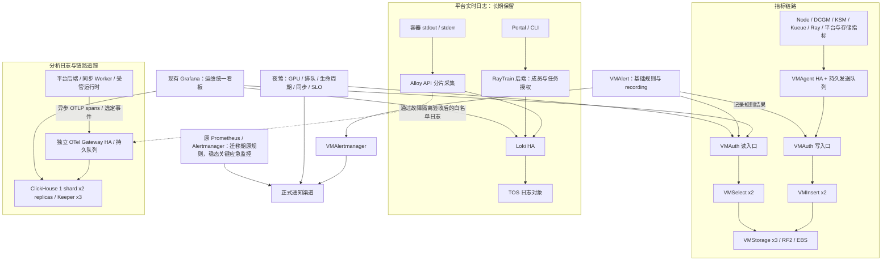

# VKE 可观测性扩展：保留 Alloy/Loki，分开扩展指标、分析日志与追踪

日期：2026-10-09。最初检查点为设计与只读容量核对；用户随后授权推进，首波27个真实指标端点、Grafana看板与日志自监控已上线，未改变Alloy/Loki副本或日志采集配置。实际验收及揭示的持续旧日志拒收见[首波部署记录](../../../ops/observability/next/DEPLOYMENT_RUNBOOK.md#2026-10-09-首波业务指标与日志自监控接入)。用户已明确：平台依赖 Loki + Alloy，二者长期保留并完善，不作为新体系建成后的退场对象。

本文件补充 [总体架构设计](2026-10-08-vke-observability-platform-design.md) 与 [当前部署记录](../../../ops/observability/next/DEPLOYMENT_RUNBOOK.md)。范围仍为训练平台 VKE，不扩展 common/IDC，也不改变用户提交任务的方式。已删除的四个 `observability-*` namespace 是重复建设阶段的旧新增组件，与原 `monitoring`/`loki` 链路不同。

## 1. 当前事实与容量判断

下文容量表与60秒样本为接入前的只读快照，保留原观察窗口；不能将其短窗口“无新增丢弃”泛化为后续持续正常：

| 组件 | 当前配置 | 本次瞬时资源观测 | 判断边界 |
| --- | --- | --- | --- |
| Alloy | StatefulSet 两副本，v1.18.1，Kubernetes API 采日志，集群分片开启 | 每副本 CPU 约 6–9m、内存 414–496Mi | 当前没有 CPU 饱和证据；不代表高峰或单副本接管已通过 |
| Alloy 资源与缓冲 | 实际 `resources={}`，BestEffort；无 PVC，storage.path 在容器 `/tmp/alloy`；没有显式启用 Loki write WAL | 没有持久化的写入恢复保证 | 本地 values 中的 requests/limits 不代表已经在线生效；先补保障再定扩容 |
| Alloy 采集范围 | 发现全部 namespace/Pod；仅做 job/tenant/namespace/pod/container 标签映射，无 keep 范围过滤，无 `loki.process` | 新组件 stdout/stderr 也会增加原链路流量 | 新指标与 spans 不走 Alloy，但新组件自己的日志仍走 Alloy |
| Loki | `loki-cpu` 三副本单体 `target=all`，RF3，每副本 50Gi EBS 工作盘 | 每副本 CPU 约 8–12m、内存 327–675Mi | 三副本不等于容量无限，也不是三个独立数据库 |
| Loki 持久存储 | chunks/索引在 TOS `vke-cluster`，上海内网 endpoint，保留 30 天 | 本地 EBS 用于 WAL、索引和工作目录 | 扩 EBS 与增加长期日志容量不是同一个操作 |
| 新增体系 | VM Operator/VMCluster、夜莺、OTel、ClickHouse 已部署，自监控/canary 验证通过 | 当前新套件 21 PVC、670Gi | 该容量没有按正式全量业务完成定容；不承诺可容纳 30/90 天真实流量 |

两个 Alloy 是采集分片副本，不是每个节点一个 Agent，也不是两份全量日志冗余。其是否足够取决于峰值日志流、单流倾斜、重新分片/重连、API/kubelet 负担、缓冲和故障接管，不取决于组件数量本身。低 CPU 不能排除拒收、丢弃或重复回读。

已有 cAdvisor 序列补充了过去 24 小时的资源历史：Alloy 两副本的 5 分钟平均 CPU 最高约 12.4m/26.1m，working set 最高约 532.3Mi/461.9Mi；Loki 三个主容器相同口径 CPU 峰值约 10.5–14.9m，内存峰值约 343–704.5Mi。三个活动 Loki 50Gi 工作卷实际占用约 15–23MB。该结果支持“当前没有资源饱和证据”，不等同于瞬时峰值压测或故障接管验收。Prometheus 的 84 个 active targets 中仍没有 Alloy/Loki 自监控，吞吐、丢弃及日志时效不能从这份 CPU/内存历史推导。API Server 当时 `pods/log` 五分钟请求率约 0.84/s、状态码均 200，也不能据此推导长连接数量、长连接传输字节或整个 API Server 的容量。

同轮两次指标采样相隔 60.13 秒：Alloy 合计成功发送 2534 条、Loki 合计接收 2534 条，约 42.14 条/秒；Loki 接收字节约 7.56KiB/秒。Alloy 新增 retry/drop/400/429 均为 0，Loki 各 discard reason 的增量均为 0，flush queue 与 WAL disk-full 计数为 0；窗口内 30 次 `query_range` 请求均为 200。两端字节口径不同，不用字节差推断日志丢失；计数相等也不是逐 event_id 完整性验证。Alloy 尚有历史累计 `ingester_error` 丢弃 4,313,269 条，Loki 历史原因包含 `too_far_behind`、`greater_than_max_sample_age`、`line_too_long`、`rate_limited`，不能将累计值当成当前速率，也不能简单相加副本计数。结论是“此短窗口正常，仍需补历史质量监控与重连验收”。私有脱敏证据位于构建机 `/tmp/alloy-loki-capacity-20261009/summary.json` 及同目录两次采样文件；本轮未创建资源或端口转发。

另有早期 `loki` StatefulSet/gateway 已为 0 副本，但 `storage-loki-0/1/2` 三块 50Gi PVC 仍保留。它们不属于已退场的四个 `observability-*` namespace，也不是当前三个活动 `loki-cpu` 工作盘；本次未处理，不把这 150Gi 计入此前释放的 670Gi。若未来清理，必须另核历史恢复用途及精确授权范围。

## 2. 最终职责与数据流

VM Operator 管理 VMCluster、VMAgent、VMAuth、VMAlert、VMAlertmanager 及采集/规则 CR；不是另一层数据转发服务。VMAuth 读写入口可由同一组 HA 实例提供，但身份与允许路径分开。cert-manager 管理新增链路的服务证书；夜莺使用独立 PostgreSQL 三实例和 Redis/Sentinel。

三类信号独立定容：Alloy 负责日志采集，VMAgent 负责指标抓取，OTel Gateway 负责应用遥测处理/导出。组件数量增加不会把全部指标和 spans 自动压到两个 Alloy 上。三条链路仍共享节点 CPU/内存/网络，需合并计算故障余量；仅分 namespace 不等于物理隔离。

Prometheus 在过渡期保持原采集与规则。先向隔离 VM 验证空间旁路数据，再按目标组交接给 VMAgent；稳态保留关键观测组件的独立应急抓取/告警，不把同一条业务规则交给多个引擎同时通知。所有组件在同一 VKE，内部应急监控不能覆盖整集群失联。

## 3. Alloy：先加固，再按瓶颈扩展

### 近期方案

保留现有 API 分片模式及 StatefulSet 形态。先完成：

1. 把 Alloy 自监控接入现有独立监控链路，记录每副本日志行数/字节数、活跃 reader、读取错误/重连、发送成功、重试、丢弃原因、传播延迟、CPU throttling 和内存。
2. 根据代表性高峰设置 requests/limits，摆脱 BestEffort；以实际内存峰值留余量，不能把模板中的较低 limit 直接覆盖到现场。
3. 对当前版本验证持久 Loki write WAL、队列与限流配置。它们保护“已到达发送组件”的数据，不自动持久化 Kubernetes API 的读取游标，两个副本也不复制彼此的队列。
4. 定位旧日志重读和拒收：区分初次发现、容器重启、Pod/元数据变化、Alloy 重启/分片迁移。拒收日志的事件时间、来源、错误原因分别计数。不能改写事件时间或扩大 Loki 接收窗口来掩盖问题。
5. 加入唯一事件 ID 的端到端日志 canary，核对平台查询延迟、缺失、重复、乱序及短任务退出后的可见性；不以 HTTP 204 或 Pod Ready 代替全链路验收。

需要证明 `N-1` 个采集副本仍能承载代表性高峰，并在故障预算内排空积压。先在隔离负载验证分片和重启行为，再安排受控生产变更，不为测试停止用户训练。

### 三种扩展路径

| 路径 | 什么时候选择 | 主要代价 |
| --- | --- | --- |
| API 分片 2→N | Collector CPU/内存、reader 数或接管余量不足，而 API/kubelet 尚有余量 | 改动最小；扩缩容会重新分片，需验证不持续回读；单个热点流不一定随副本均分 |
| 节点 Alloy DaemonSet 读取文件 | API 日志链路成为瓶颈，或需要 journal/节点文件日志 | 增加节点目录读取权限、每节点常驻成本，需持久 position/WAL、轮转与目录白名单 |
| 混合 | 容器日志保留现有路径，特定节点日志由受限 DaemonSet 补充 | 建立目标清单；同一容器不可长期经两条路径重复写到同一 Loki |

**近期推荐第一条，确有节点日志需求再补第三条。** 不因“架构要完整”就在每个 GPU 节点增加第二套全量采集。API 采集无需 DaemonSet，但相对文件采集会增加网络和 kubelet CPU；扩 Alloy 不能直接解决 API 路径本身的瓶颈。[Alloy API 日志采集说明](https://grafana.com/docs/alloy/latest/reference/components/loki/loki.source.kubernetes/)

## 4. Loki：保留三副本，分别治理写入和查询

当前瞬时负载没有证明必须立即增加 Loki 副本。保持现有 TOS、标签和 Portal LogQL 合同，先补齐自监控：写入接收/拒收与原因、ring/RF、WAL、flush、compactor/保留删除、TOS 错误与耗时、工作盘水位、查询错误/排队/p95 延迟、扫描字节与缓存命中。

| 观测到的瓶颈 | 优先处理 |
| --- | --- |
| CPU/内存或单体读写争抢 | 核查查询范围和标签基数，调整资源/缓存；若仍需独立读写扩容再拆组件 |
| Loki 429 / ingestion 限流 | 区分配置限额、热点流和实际后端吞吐；不要仅盲目放大限额或扩采集端 |
| EBS WAL/索引工作盘水位高 | 核查 flush/compactor/TOS 故障及磁盘增长，按卷扩容与恢复预算处理 |
| TOS 慢或不可用 | 优先检查对象存储、网络、认证和重试；增加 Alloy 只会放大积压 |
| 查询慢 | 优先优化 LogQL、时间范围、并发、缓存，必要时独立扩 querier/query-frontend |

当代表性负载证明需要独立扩 distributor/ingester、querier/query-frontend、index-gateway/compactor 时，再规划 **Distributed**。保留原入口或用兼容网关维持平台 API；对原 TOS schema、ring、历史范围和回滚做专门迁移验收。当前官方已标记 Simple Scalable Deployment 弃用，本设计不将 SSD 模式作为新的长期目标，也不因此立即升级当前 Loki。[Loki 部署模式](https://grafana.com/docs/loki/latest/get-started/deployment-modes/)

## 5. 新增分析链路不能拖慢平台日志

首批优先让受管后端/同步 Worker 通过异步 SDK 直发 spans 和少量结构化事件到 OTel。现有 Loki 日志路径保持独立；用户训练程序无须为了这项基础设施建设修改提交命令。接入后端/Worker 埋点需要相应代码测试、构建和发布，部署 Collector 不会自动产生应用调用链。

现有 OTel pipeline 与 CH schema 仍限定 `synthetic-canary`，并含强制字段白名单。接真实数据前，创建独立生产 pipeline、表/保留期、读写身份和可信字段映射；不把 canary 管理证书复制给业务，也不简单放宽全部属性。

后续才考虑 `Alloy → loki/OTLP 转换 → OTel → ClickHouse` 的白名单分支，选平台生命周期、同步统计、结构化错误等有分析用途的日志；不默认复制全部训练 stdout 到两个长期库。当前版本桥接同步调用下游，自身没有逐条持久重试，不能把独立 Gateway 当作天然回压隔离。必须先测试 Gateway/CH 中断、队满、进程重启和恢复期间 Loki 到达率与延迟不恶化；若不满足，继续使用应用直发或严格限域的独立采集入口。独立入口必须有明确 Pod 白名单，不得演变成第二套全量采集。

OTel logs/traces 配独立 exporter 队列、重试和配额；同进程的两条 pipeline 仍共享 CPU/内存。若日志流量挤占 traces，再拆成独立网关工作负载。队列按实际编码后 B/s × 允许中断秒数 × 余量定容，恢复发送速率必须大于新数据进入速率。CH 双副本和队列不能保证端到端零丢失或 exactly-once，计费/任务状态事实继续由平台数据库负责。[OTel 扩容与瓶颈判断](https://opentelemetry.io/docs/collector/scaling/)

## 6. 指标、告警、入口和权限

- VMAgent 主采集复用已有 exporter；两副本同目标 HA 抓取与容量分片是不同设计。HA 标签、去重周期、VMSelect/VMStorage 配置按真实 15s/30s/60s 抓取测试，RF2 存储复制不能代替采集去重。[VMAgent HA](https://docs.victoriametrics.com/operator/resources/vmagent/)
- 根据 10 月 9 日用户确认，夜莺统一负责正式告警、事件与通知，通知渠道和接收人由用户后续在 UI 配置。VMAlert 优先执行 recording rules；新增 Alertmanager 暂不连接正式通知。原 Prometheus 已有规则在迁移对照期间保留，逐组交接后避免重复通知，缺数据不能误判为恢复。
- Grafana 复用现有实例，通过 VM/Loki/ClickHouse 数据源联查。按 cluster/service/job/time、可信 trace_id 关联，不将 trace_id、request_id 变成高基数指标或 Loki 索引标签；保留平台既有 job/tenant 标签兼容。
- Portal/CLI 继续经 RayTrain 后端按真实成员、团队和任务归属授权查询。运维 Grafana 数据源用受限只读身份；普通用户不能通过共享 SQL 账号、变量或文件夹获得全库查询。
- 新内部链路沿用已验证的 mTLS、RBAC 和 cert-manager。原 Loki 内部入口的访问保护需单独兼容性核对，不能仅开启 `auth_enabled` 改变历史 tenant 语义；不因入口看板有 SSO 就认定所有原生端口已隔离。
- 接通正式通知和证书到期/轮转失败告警后，再启用已完成受控验收的原生组件轮转 Cron。cert-manager 的签发续期已经运行，该 Cron 的暂停不代表所有证书续期暂停。

## 7. 分阶段推进与验收

| 阶段 | 工作 | 进入下一阶段的证据 |
| --- | --- | --- |
| A：现有日志加固 | Alloy/Loki 自监控、资源预算、回读/拒收排查、端到端 canary | 覆盖真实训练高峰，区分容量与质量故障，明确日志时效/故障恢复预算 |
| B：持续运维 | 正式通知、证书轮转失败处理、VM/CH/PG/配置与身份恢复方案 | 触发/恢复通知可达；隔离恢复成功；按授权启用定时轮转 |
| C：指标接入 | Prom 旁路对照、按组交接 VMAgent、Grafana 看板和夜莺规则 | 关键序列/规则结果一致，无计划外重复采集或双重通知；HA 抓取副本按合同去重；平台查询正常 |
| D：分析与追踪 | 后端/Worker SDK、独立正式 OTel/CH 数据管线 | 异步业务调用不被导出阻塞，字段/权限/队列/复制与故障恢复验证通过 |
| E：按瓶颈扩容 | Alloy 分片、可选节点采集、Loki/OTel/CH 分别扩展 | 峰值及 N-1 余量满足目标，原平台日志延迟/完整性不退化 |

建议持续采集 7 天以上并覆盖至少一次代表性训练峰值；该窗口用于定容观察，不阻止先补自监控和已有问题治理。初始告警线可以设置在持续 CPU/内存预算 70–80%、队列占用约 60–70%、工作盘水位约 70%，但只是工程起点，不能代替实测容量或作为统一硬上限。任何明确采集丢弃、写入拒收或平台日志时效异常都应先查原因，不必等待资源阈值触发。

变更按链路分批，每批先审阅 Helm/声明式差异，保持 Loki 历史桶、平台查询合同、用户训练与提交方式；备份配置并明确回退到原采集/路由的方法。首次分析分支可以独立关闭，不能要求停掉 Loki 主链路来恢复。
