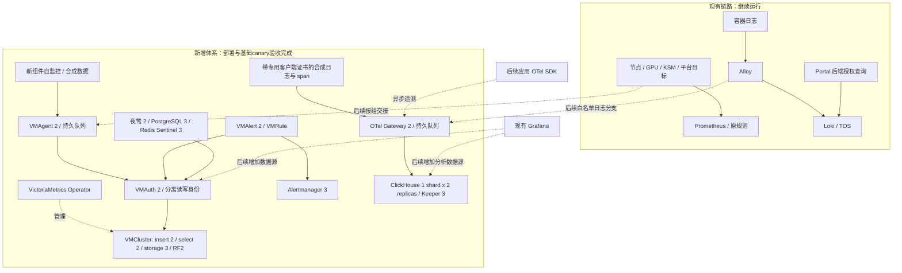

# 训练平台 VKE 可观测性：架构、部署流程与操作记录

更新日期：2026-10-09，时间均为北京时间，另有标注除外。

**当前检查点（2026-10-09）：正常命名空间的新增体系已经部署，并完成 VM、N9E 与 CH/OTel 基础线上验收、真实证书续期和受控轮换验证。** 当前名称是 `cert-manager`、`victoriametrics`、`clickhouse`、`opentelemetry`、`nightingale`。六类原生叶证书续签、13 Pod 逐副本轮换及随后无变更复验通过；持续轮转 CronJob 保持 suspended，待失败通知闭环。受控演练不等于周期性证书消费已经启用。

旧四个 `observability-*` 命名空间、专属组件及 21 块 EBS 云盘已按用户明确授权清理，实际 CSI 驱动逐盘确认底层删除成功；PG 已验证备份和私有配置清单保留，旧 VM/ClickHouse 合成历史未归档，不能再依赖旧卷回退。原训练平台、Prometheus、Alloy、Loki 业务链路未迁移；SSO、业务采集、正式告警接收尚未接入。新位置的实际部署归属、镜像、续期与证据见[10 月 9 日部署记录](#2026-10-09-正式命名部署与验收记录)，本次清理见[旧环境退场记录](#2026-10-09-旧命名空间退场与云盘释放)。

新套件稳态为 **43 Pod、21 PVC、申请 670Gi**；旧套件的 **35 个常驻 Pod、21 块云盘/670Gi** 已清理。两套并行时的 1340Gi 已降至新套件的 670Gi。这是已申请容量，不是实际数据使用量，不包含原监控和训练业务存储；后续扩容另增成本。

**下方第 1–11 节保留 2026-10-08 的历史执行记录。** 其中旧 namespace、Helm revision、174 项测试、35 Pod/670Gi 等数字只代表旧新增体系的对应时点；历史命令不能直接当作新命名空间升级指令，历史通过结果不能替代 10 月 9 日现场验收。

**最终检查点（2026-10-08）：新增观测组件部署与本轮基础 canary 验收完成，临时资源清理和最终旧系统对照完成。** 35 个常驻 Pod 全部 Running/Ready、重启 0；21 个 PVC 全部 Bound，真实 PV 均为 Retain，合计 670Gi；12 节点 Ready 且 Memory/Disk/PIDPressure 均 False。VM revision 3/Operator 5，182 live、33 RBAC、89 Docker PASS。CH/OTel 8 Pod Ready，严格 TLS 60 PASS、13 个 Pod IP 原生端口 ConnectionRefused、无 IPv6；双 gateway 合成 log/span 在双 CH 精确复制。OTel gRPC Export/SIGKILL/file_storage 恢复另在 Docker 通过，不是线上故障注入。PG 提升实例 2 收敛、双 quorum 流追平；N9E 两 Pod 完整应用 44、PG 5432 27、依赖 46、webhook 6，共 123 项明确现场检查及另 1 次真实 admission 均 PASS。业务采集、迁移与持续运维交接仍有后续门禁。

最终依赖候选 `227f5e0` 全量 174 unit PASS（6.844 秒），与现场 123 项检查及 admission 分开计数。8000 对未知 Operator 证书严格要求 503 与固定 `operator certificate not recognized` body，匿名严格要求 401 与 `client certificate required`，没有放宽为任意 503。Redis 已验合法 TLS 后仍需 AUTH，无客户端证书/foreign CA 均返回明确 TLS alert；明文 wire 未作独立肯定结论，reset/timeout 不计 PASS。N9E 唯一临时 probe、ConfigMap 与 monitor 复制叶证书 Secret 已按 UID 删除并确认全部 absent，最终 auxiliaryPods=0。

用户已选择保持 CNI，通过新组件 mTLS 代理及原生认证继续建设；启用 NetworkPolicy 不是本轮前置条件。最终旧系统对照以 `44ddda1 before-cnpg` 为起点：旧 22 控制器 added/removed/changed 均 0；保留 Pod UID/重启变化 0，自然新增 11、删除 0；保留 RayJob/RayCluster UID/spec 变化 0、新增 10；ConfigMap 唯一 hash 变化为 `node-onboarding-state`，原平台 `/healthz` HTTP 200。最终证据 `mtls-validation/final-additive-inventory-20261008.json`；不与更早 baseline 混算，不概括为所有旧对象零变化或性能零影响。以下状态依据根任务现场/构建机证据回报，历史记录仅代表各自时点。

完整架构设计、复制/队列语义、指标交接、日志与 trace 字段合同见 [架构设计](../../../docs/superpowers/specs/2026-10-08-vke-observability-platform-design.md)。本文件集中记录如何落地、做到哪里、如何验证和恢复。

## 1. 范围与运行边界

- 只覆盖训练平台 VKE；新观测计算和数据库位于本 VKE，不扩展 common/IDC 的采集。
- 现有 Prometheus、Alertmanager、Grafana、Alloy、Loki、Portal/后端、训练镜像和运行任务保持原路径。
- 新组件可使用 GPU 节点的 CPU/内存，不申请 GPU；不硬绑定 CPU 节点，不为部署搬迁或停止训练。
- 先建设自监控/canary，再完成备份恢复和代表性验证，之后按组交接采集、规则与查询。历史迁移单独执行。
- 此次不接应用 OTel SDK、不给 Alloy 加日志分支、不修改 Prometheus remote_write、不配置真实通知。
- 标准基础设施镜像使用固定摘要的发行镜像，优先直接引用 Harbor hub；CNPG 使用已验证源码补丁构建的专用 Operator/instance-manager 镜像。N9E 派生镜像仅对原 v9.0.2 Redis 依赖回移三处 caller context 判断，保留原八份嵌入资源和运行镜像；已推送、部署并通过 72 Docker、44 完整应用 live 与本轮依赖现场检查。PostgreSQL 只复制同源 manifest 以恢复镜像可达性，平台后端和 Portal 均未重构建。未来增加应用埋点时，另行验证和发布相应应用。

## 2. 整体架构及组件职责



| 组件 | 负责什么 | 不负责什么 |
| --- | --- | --- |
| VM Operator | CRD、配置生成、工作负载协调 | 不代替指标存储，不直接接管原 Prometheus 对象 |
| VMAgent | 抓取、标签处理、远写缓冲 | 不提供长期历史查询 |
| VMInsert / VMStorage / VMSelect | 写入分片、复制存储、查询汇聚 | 不自行决定平台用户权限 |
| VMAuth / VMUser | 固定租户与读写路由、服务身份 | 后端还须回环绑定及按角色 mTLS，不能单靠入口 token 阻止 Pod IP 绕过 |
| VMAlert / Alertmanager | recording rules、基础告警、路由/去重 | 不与夜莺重复拥有同一规则 |
| 夜莺 | GPU/任务/业务告警、责任组、事件与通知治理 | 不作为指标数据库 |
| Alloy / Loki | 保留现有实时日志、LogQL、Portal 历史 | ClickHouse 不直接替换这条用户链路 |
| OTel Contrib | 受认证接收、字段治理、持久队列、导出 | 接收确认不等于 CH 两副本都已提交 |
| ClickHouse / Keeper | 分析日志与 traces、复制协调、SQL 关联 | 不存 VM 指标，不承诺 exactly-once 或零 RPO |

当前 canary 固定 VM tenant `1001`；CH 使用 `observability_canary`。正式数据的租户身份必须由可信入口确定，不能相信客户端自行声明的 team/job 标签。

## 3. 命名空间、节点与存储

| 新 namespace | 目标拓扑 | 初始 PVC 合计 |
| --- | --- | --- |
| observability-metrics | Operator 1；VMStorage 3、VMInsert 2、VMSelect 2、VMAgent 2、VMAuth 2、VMAlert 2、AM 3 | 250Gi |
| observability-analytics | Altinity Operator 1；CH 2、Keeper 3 | 260Gi |
| observability-otel | OTel StatefulSet 2 | 40Gi |
| observability-alerting | CNPG Operator 2；PG 3、Redis/Sentinel 3、夜莺最终 2 | 120Gi |

最终实际清点为 **21 个 PVC、全部 Bound、合计 670Gi，真实 PV 回收策略均为 Retain**，与初期容量目标一致。CH/Keeper/OTel 组 7 个 PVC/300Gi，其中 CH 两卷各 100Gi；PG 三实例已 Ready。35 个常驻 Pod 全部 Running/Ready、重启 0，GPU 申请为 0、priority 为负值且 preemptionPolicy=Never、无 hostNetwork，均未落在 `172.28.1.222` 或 `172.28.3.32`。12 节点 Ready，Memory/Disk/PIDPressure 均 False，auxiliaryPods=0。VMStorage 每卷 50Gi；队列、Keeper、AM、PG、Redis 的卷至少 20Gi，满足当前 ESSD_PL0 的最小卷约束。证据见最终库存；后续业务规模仍需实测定容。

- 新 StorageClass：`ebs-ssd-observability-retain`，EBS ESSD_PL0、Retain、WaitForFirstConsumer、允许扩容；不改现有 StorageClass。
- 新 PriorityClass：`raytrain-observability-additive`，优先级 -1000、`preemptionPolicy: Never`。资源不足时等待，不抢占训练。
- 每个 namespace 有独立 CPU/内存/存储/Pod 配额，GPU request quota 为 0；Pod 仍需明确 requests/limits。
- 持久副本按 hostname 强制分散；namespace 与 hostname 分散不等于跨 AZ 容灾。
- 首批排除高内存水位 `172.28.1.222`；不容忍 algorithm 专属节点污点，不修改其标签和隔离配置。
- EBS 是可用区资源，Pod 重建须满足卷拓扑；共享节点仍消耗网络、CPU、内存和磁盘资源，不能承诺绝对零影响。

## 4. 镜像来源：为什么直接用 Harbor hub

本次标准开源镜像优先使用：

```text
上游发行仓库 → Harbor 已配置的代理缓存 → VKE 拉取固定 digest
```

例如已核验的 OTel 引用：

```text
harbor.wellspiking.ai/hub/otel/opentelemetry-collector-contrib:0.162.0@sha256:39923a8e431bd1f57be82411999d389fcfe40857492e4365456d97a4c1f74be6
```

`hub` 是代理缓存项目，不需要先手工下载再推送到另一个项目。部署引用它的路径即可；首次或缓存缺失时由 Harbor 获取上游，后续按缓存机制服务请求。实际 `hub` 的上游、权限、清理策略须按现场配置核对，不能把它当成任意注册表的万能代理。Redis 最初 ECR 拉取超时，核对 index 与 linux/amd64 manifest 摘要均一致后改用 `hub/library/redis`，三个副本随后就绪。PG 的 GHCR blob TLS 超时通过向 Harbor 复制同源 manifest 处理；复制校验成功后，根任务只 patch `imageName`，随后删除从未启动的旧 join Job、保留 PVC。这个删除步骤留下无法自动重建 replica join Job 的 initializing PVC，造成后续阻塞；官方恢复路径及当前进度另记于第 6 节，不能把镜像复制与删除 Job 视为自动恢复流程。

普通私有项目如 `guofeng.su` 的独立副本适用于自定义构建、独立版本留存、受控晋级、权限或离线供应链。CNPG 的原生 8000/9187/9443 认证加固与 N9E 的最小 Redis 补丁使用专用派生镜像；两组当前均已部署。遇到原注册表可达性问题时，精确内容镜像须先核对 index/架构 manifest，不将搬运称为重编译。固定 digest 保证内容身份，但不保证缓存永不被清理、上游永远可用或镜像已经通过安全扫描。

本轮实际发生过的同步路径为：构建机拉取代理中的官方发行镜像，保留 linux/amd64 manifest，改内部仓库标签后推送 `guofeng.su`。未重新编译、未修改镜像内容；目标 manifest 与来源对应架构的摘要一致。多架构 index 摘要与 amd64 子 manifest 摘要可以不同，不能因此认定内容被改动。

已推送副本先保留，不在本次删除。候选转为直接引用 hub；用户要求继续后，新 VM Operator 已连同禁用 VTAgent 的修改一起滚动到 hub，实际 imageID 与原私有副本的 amd64 摘要一致。该升级未重新推送镜像。随后为 CNPG 安全补丁构建并推送专用镜像；它同时替换 Operator 与 bootstrap 注入的 instance manager，保持官方 PostgreSQL 镜像。

已交付的 CNPG 派生镜像：

```text
harbor.wellspiking.ai/guofeng.su/cnpg-observability:1.30.1-mtls-c741e72@sha256:53be5d2201b1502aae329b3f64f4b342c897772fb88edde2838e7f7750bc8875
```

上游 commit 为 `2a35abb4628f209d149825ef3c38011e0701ff2f`。源码锁、补丁、双架构 manager 构建和原生端口兼容边界见 [CNPG 加固设计](nightingale/cnpg-hardening/DESIGN.md)。18:41 已确认两个 CNPG Pod 的实际 imageID 与派生镜像匹配；后续 PG 三实例与提升实例 2 已收敛，数据库完整备份恢复和其他故障场景仍独立验收。

后续已推送并核对内容的引用如下。N9E 的 Harbor raw manifest SHA 与本次推送一致；PostgreSQL mirror 的 manifest 与官方来源一致，没有重编译数据库。

```text
harbor.wellspiking.ai/guofeng.su/nightingale-observability:9.1.1-sentinel-01abc76@sha256:2e544213530f914b961e05d9fbab2ddcbbb995402379496a34815f0d61da6315
harbor.wellspiking.ai/guofeng.su/postgresql-observability:17.11-202608170816-source-6b7e6a12@sha256:6b7e6a1267254902840efa9936bbeb0a398a79b5b9cb2e82218e4a92b602e97c
```

参考：[Harbor Proxy Cache 官方行为](https://goharbor.io/docs/2.14.0/administration/configure-proxy-cache/)。本次未修改 Harbor/Ceph 配置，也未宣称验证了缓存长期留存策略。

## 5. 版本与状态

| 组件 | 本次版本 | 状态/依据 |
| --- | --- | --- |
| VM Operator | chart 0.68.1 / controller v0.75.0 | hub 镜像已运行，Helm revision 5 |
| VM 各应用 | v1.153.0 | `raytrain-next` revision 3；17 个组件 Pod 滚动完成后现场 182 PASS；idle health/no_traffic 5s 和每角色 config SHA 已部署；RBAC 33 PASS 及旧绑定删除记录保留 |
| Alertmanager | v0.34.1 | 已随 VM 组部署，黑洞通知；窄 SA 切换和最终权限验收已完成，不接真实通知 |
| Altinity Operator | chart/controller 0.27.4 | 已部署并完成本轮生成资源验收；watch regex 曾回退 all，被 RBAC 拦截；`b4e8b1d` 改 literal namespace 并关闭默认 scrape annotations |
| ClickHouse / Keeper | 26.8.20.9 LTS | 与 OTel 合计 8 Pod Ready/重启 0、7 PVC/300Gi；CH 双副本每副本 7 表、复制正常；严格 TLS 60 PASS、13 个 Pod IP 原生端口拒绝、无 IPv6 监听，Keeper 误判已纠正 |
| OTel Contrib | 0.162.0 | 两 gateway 各 1 log+1 span 在线双 CH 精确 runID/lookup 一致，属性治理与队列 0 已验；独立 `7cd5e01` Docker gRPC Export+SIGKILL/file_storage 恢复通过，未对线上注入该故障 |
| 夜莺 | 9.1.1 / 派生 9.1.1-observability.1 | `01abc76` 固定 digest、72 Docker PASS；双 Pod Ready/重启 0，44 完整应用 live PASS、not_tested=[]，含双 Pod VM vector(1)；依赖 46 live 与 PG 5432 严格协议 27 PASS |
| CloudNativePG | chart 0.29.1 / 专用 operator 1.30.1-mtls-c741e72 | revision 1 两 Pod 各 2/2 Ready，imageID 匹配；入口/RBAC/admission 验收通过，最终两 Operator 来源检查 6 PASS、真实 API server admission PASS；源码 helper 覆盖率 94.05% |
| PostgreSQL | 17.11-202608170816-standard-trixie | 官方恢复后提升实例 2 收敛 PASS：current=target=2、Healthy/ClusterReady=True；3 Pod 不同节点 Ready/重启 0，1/3 recovery standby，两 streaming/quorum 流 flush=replay、ANY 1；备份恢复另验 |
| Redis | 8.8.0-alpine / chart 4.39.0 | 同 index/amd64 摘要的 hub 来源；revision 3 `deployed`，三副本各 3/3 Ready、重启 0；本轮 TLS/AUTH/证书拒绝通过，明文 wire 无独立肯定结论；VKE 故障恢复另验 |

Chart 版本、controller 版本、业务组件版本、镜像 index/平台 manifest 和部署 release revision 是不同概念。完整引用以各目录 `versions.yaml`、values 和最终渲染结果为准，不使用浮动 `latest` 标签。

版本资料：[VM 1.153.0](https://github.com/VictoriaMetrics/VictoriaMetrics/releases/tag/v1.153.0)、[Operator 0.75.0](https://github.com/VictoriaMetrics/operator/releases/tag/v0.75.0)、[ClickHouse LTS](https://github.com/ClickHouse/ClickHouse/releases/tag/v26.8.20.9-lts)、[OTel](https://github.com/open-telemetry/opentelemetry-collector-contrib/releases/tag/v0.162.0)、[夜莺](https://github.com/ccfos/nightingale/releases/tag/v9.1.1)。VM 1.153.0 已知 pure-Go 构建回归不影响官方 linux/amd64 CGO 构建；仍需实际镜像参数和运行验证，不因版本新而跳过门禁。

## 6. 本轮已经执行的操作

下表按阶段保留历史检查点；其中“启动中”“补测中”“待收尾”仅描述当时状态。最终状态以本节最后一行、顶部最终检查点和第 9 节为准。

| 时间 | 实际操作与结果 |
| --- | --- |
| 14:57 | 构建机保存非敏感基线：184 个活动 Pod、22 个控制器、51 个 ConfigMap 摘要、787 个 RayJob、4 个 RayCluster、787 个 Kueue Workload；不保存完整 Secret |
| 15:09–15:13 | 下载固定 chart 并核对官方 index checksum；namespace/PC/SC server-side dry-run 通过 |
| 15:14 | 原只读审阅子任务误创建 4 namespace、PC、SC 和各 namespace 配额；此操作未按根任务部署门禁集中执行 |
| 15:21 起 | 候选 6827d038 通过 Git bundle 进入构建机隔离 worktree；原 24 项 scope 测试通过；组件 Helm/schema/离线验证并行进行 |
| 15:24 | 同一子任务镜像化 VM 系列，复制既有 Harbor 拉取凭据到新 metrics namespace，安装 `raytrain-vm-operator`；根任务随后发现、停止其写操作并逐项审计 |
| 15:31 | 原控制器/ConfigMap 摘要无变化；原平台和训练 Pod UID/重启数无变化 |
| 后续只读核查 | 12/12 节点 Cilium 均为 `PolicyEnforcement=never`；现有 MLflow 规则会在开关开启后匹配运行中的服务；未更改开关 |
| 后续候选验证 | 修复 null 可选字段误报、增加安全凭据工具；bb9f2ac 隔离候选 36 项测试通过（含真实 OpenSSL，kubectl 全部 mock）；仅执行 Secret --plan |
| 镜像策略确认后 | VM1.153.0 新候选改为直接使用 hub 固定摘要；Operator 候选同0.75.0改hub、禁VTAgent、收紧集群只读权限；离线专项验证通过，当时未应用到集群 |
| 文档收尾 | 新增两项 scope 回归后共38项测试通过；明确 CNPG ClusterImageCatalog CRD 例外与 Redis test hook 边界。15:56只读快照仍仅一个Operator Pod，无新PVC和VM数据面 |
| 最终候选归档 | `b9dd3b5` 的38项测试、全组件Helm/Kustomize重渲染、VM专项合同和综合scope结构合同均通过（0 errors）；仅离线验证，仍保留live ownership/生成资源与网络门禁 |
| 用户确认后 | 网络能力未开通过，先保持现状；数据组件部署停止在门禁前，继续文档和离线候选验证 |
| 16:14–16:17 继续建设 | 先备份新 Operator release/Deployment/Role，完整 server-side dry-run 差异审阅后升级至 revision 2：直接 hub、禁 VTAgent、VM 默认候选版本 1.153.0。首轮 55 秒 rollout 等待超时，节点拉取镜像用时约 1 分 43 秒；随后确认 1/1 Ready，没有把超时误报为成功 |
| 继续建设：凭据与权限 | `b9dd3b5` 凭据工具创建 15 个新 Secret，仅输出名称/键，不覆盖旧凭据；Operator Ready 后单独应用收紧的只读 ClusterRole，未扩大命名空间 watch 范围 |
| 16:27:54 现场复核 | 12/12 节点 Ready；与初始基线比较，184 个原活动 Pod 的 UID/节点/状态/重启数、22 个原控制器 UID/spec hash、51 个 ConfigMap UID/data hash 全部未变；新 namespace 仍只有 Operator Pod，0 个 PVC |
| 夜莺真实初始化验证 | `b9dd3b5` 在构建机内部 Docker 网络通过 PG UTF8/TLS、首次 seed/重复 seed 拒绝、47→57 表迁移、随机 root 密码哈希、验证码→登录→Bearer profile；单 PG/Redis/Sentinel，仅验证初始化与客户端链路，不是 VKE/HA 验收。测试容器、网络、假凭据与临时数据已清理 |
| 后续方案选择 | 用户明确选择“保持 CNI，改造新组件 mTLS 代理”；进入仅新组件代理方案设计与验证，不修改旧网络模式 |
| mTLS 中间候选 | `44ddda1` 的 115 项静态测试通过；VM、CH/Keeper/OTel、夜莺运行验证分组推进，未写成整体通过 |
| CNPG 源码与镜像交付 | 官方锁定源码的 RED/GREEN、受影响包上游回归与 vet 通过，新认证 helper 覆盖率 94.05%；专用镜像 `1.30.1-mtls-c741e72` 已构建推送并锁定 digest |
| CNPG 安装前核对 | 26 个渲染对象检查为 absent、scope 0 errors、server-side dry-run 通过；这不是 Helm 安装或运行健康结果 |
| 18:41 CNPG 现场验收 | `n9e-cnpg` revision 1，两 Pod 在 `172.28.1.118` / `172.28.1.150`，各 2/2 Ready，派生 imageID 匹配；两 Pod IP 的合法 vmagent metrics 200、错误角色/路径/方法 403、无证书 TLS 拒绝、原生 8080 关闭、非 API 来源 webhook 403；7 项有效 RBAC 正反检查及真实 PG admission dry-run 通过 |
| 新 mTLS 凭据完成 | 26 个身份 Secret 与 3 个附加 Secret 共 29 个创建已确认；持久 CA 材料只保留在受限 builder 目录 |
| 新 PG 开始初始化 | 已创建目标为三实例的 `n9e-postgres` CR；60Gi 为目标卷容量，实际实例/PVC 数量随后按现场核对，不能由 CR 目标推断全部已生成；当时 Ready/复制尚未确认 |
| 中间隔离候选（历史） | `a8827b5` 的 117 项静态测试通过；当时 VM 核心 72 项运行检查通过，AM cluster 仍未完成；夜莺故障后验证码问题仍在调查 |
| 后续 VM 运行与部署检查点（历史） | Docker VM 完整 88 项检查通过；VM Operator revision 4 Ready，组件 release revision 2 已部署；发现 Auth/AM 自动生成的宽 Secret Role 后，改为两个显式窄 SA，开始滚动，旧自动 Role/Binding 当时尚待清理 |
| 后续 PG/Redis 检查点（历史） | PG 一主 Ready，join 曾被 GHCR blob TLS 超时阻塞；Redis ECR 拉取超时后，核对 index/amd64 摘要一致再改 hub，三个副本各 3/3 Ready、重启 0；Helm revision 2 当时等待超时，不能凭后续 Pod 就绪改写历史 status |
| 后续独立运行验证（历史） | `1165276` 全部 137 项单元测试通过；N9E go-redis 三处 caller context 补丁在 `00f6f02` 隔离 TLS 回归中 RED/GREEN 通过，23 项 N9E 合同通过；当时 `01abc76` 派生镜像与 `ce436eb` CH 验证仍进行中 |
| 较早旧系统基线复核（历史） | 12 节点 Ready；原控制器 0 变化，仍保留的原 Pod UID/重启数 0 变化；相对当时起始 baseline，任务自然新增/删除，`ray-cache-local` / `node-onboarding-state` hash 变化；此组统计不与后续 before-cnpg 对照混用 |
| 前一 VM 现场与权限检查点 | 现场 182 PASS、最终 RBAC 33 PASS；17 Pod Ready、重启 0、新 SA 全切；实际 name-fieldselector LIST/WATCH 允许，未筛选 list 和其他 Secret key 拒绝；四个旧 Role/Binding 按 owner/UID 核对删除 |
| 前一 Redis/PG 检查点 | Redis 同 manifest 升级至 revision 3 `deployed`，三副本各 3/3 Ready、重启 0；PG mirror 校验后 patch imageName，并删除旧 join Job、保留 PVC；当时尚未识别删除后 replica initializing PVC 不自愈的问题 |
| 前一 CH/N9E 检查点 | CH `b145e23` Docker 脚本全部 PASS：两副本 log/trace/lookup 各 1、health 200→503→200，未测完整 gRPC Export/队列崩溃回放；N9E `01abc76` 已推送固定 digest，72 Docker PASS，原 HTML/JS 与同进程故障前后真实登录通过，尚未部署 |
| 前一全量回归检查点 | `fa75f6e` 全部 148 项单元测试通过，含 VM no-traffic 5s GREEN；新的暂停后健康行为当时仍在 Docker 验证 |
| 当前 VM 健康与配置滚动 | 真实 Docker 89 PASS，暂停故障后健康失败检测 10.042 秒，小于 20 秒门限；旧 proxy 无配置 checksum 不会自动 reload，已补每角色 config SHA。`66b5461` 全量 153 PASS；13 个对象精确差异只含 8 个 ConfigMap 的 idle health/no_traffic 5s 与 7 个角色的 podMetadata config SHA。`raytrain-next` revision 3、Operator revision 5，17 个组件 Pod 滚动后 182 项现场复测 PASS |
| PG 恢复阶段检查点 | 删除旧 join Job 造成 replica initializing PVC 孤立；CNPG 1.30.1 该自动重建路径只处理 primary，不能指望 replica 自愈。根任务使用官方 JoinReplicaInstance 恢复，helper SHA 前缀 `31aced22…`、新 Job UID 前缀 `f4ca…`；实例 2 加入成功，Operator 自动创建实例 3 join，当时尚待三 Ready 与 ANY 1 quorum 核验 |
| CH 生成资源门禁与误判纠正 | CH Operator watch regex 回退 all 被 RBAC 拦截，`b4e8b1d` 改 literal namespace 与默认 scrape annotations=false。曾将额外 listen_host 误记为 wildcard 并保持 replicas 0；后续确认 `listen_host[1]` 也是 `127.0.0.1`、index 2 不存在，没有通配旁路，也没有修改 XML，此前“wildcard 修复中”的判断不成立 |
| 当前 CH/Keeper 启动检查点 | Keeper 3 Ready、重启 0，实际 socket 白名单通过；CH 2 Ready、重启 0、两个 100Gi PVC；新 canary 每副本 7 表，复制 2/2、无积压。`a74c9c9` 移除与 Operator 生成对象重复的两个手写 PDB，删除前有备份且以 UID/RV 核对 |
| PG 提升请求检查点 | PG 三实例 Ready、两条 quorum 复制流已追平；根任务以官方四字段及 UID/RV 乐观 status merge 请求 promote 实例 2。此时只记录请求已发出，没有提前将请求成功写成提升 PASS |
| PG 提升收敛前的 OTel/N9E 检查点 | `a74c9c9` 全量 159 项单元测试 PASS；OTel 启动中，新恢复脚本 `1052a65` 11 项 RED 尚待 GREEN。N9E `01abc76` 固定派生镜像已推且 72 Docker PASS，当时等待 PG 提升收敛及实际部署验收 |
| 后续 PG 收敛与 N9E 启动检查点 | PG current=target=2、Healthy、ClusterReady=True；3 Pod 不同节点 Ready、重启 0；实例 1/3 recovery=true，两条 streaming/quorum 流 flush=replay，ANY 1，提升收敛 PASS。N9E `dependency-gate.json` 已保存并开始 bootstrap，尚未取得应用现场 PASS |
| VM 最后临时探针清理 | UID 前缀 `5d9f88dd…` 的最终临时 probe 已 Succeeded；按 UID precondition 删除成功，回执 `66b5461-render/final-probe-deleted.json` |
| 最新旧系统对照（以 44ddda1 before-cnpg 为起点） | 12 节点 Ready；旧 22 控制器 added/removed/changed=0；保留 Pod UID/重启变化=0，自然新增 11/删除 0；保留 RayJob/RayCluster UID/spec 变化=0、新增 10；ConfigMap 唯一 hash 变化为 node-onboarding-state；不与先前 baseline 统计混算 |
| 后续 CH/OTel 线上验收 | `a74c9c9` 线上范围完成：8 Pod Ready/重启 0、7 PVC/300Gi；CH 两副本各 7 表、复制正常。严格 TLS 60 PASS，13 个 direct Pod IP 原生端口 ConnectionRefused，无 IPv6 监听；两 gateway 各 1 log+1 span 在双 CH 精确 runID/lookup 一致，非白名单属性丢弃、服务字段按策略覆盖、队列 0 |
| CH/OTel 临时资源清理 | 5 个临时 Pod 与 1 个 ConfigMap 以 UID/RV 核对删除并确认 absent，没有额外 Secret；schema Job Complete，保留 TTL 86400 秒，不能把 TTL 内存在写成清理失败 |
| OTel 独立恢复验证 | `7cd5e01` 全量 170 unit PASS；真实 gRPC Export 与 SIGKILL/file_storage 恢复在隔离 Docker PASS。每个 CH 副本各 12 log+12 trace，精确 IDs 无丢失/重复；sender 不重试、应用 PID 改变、proxy anchor 不变，queue/inflight 全 0，cleanup verified。早期 `1052a65` 的 11 RED 保留历史；本结果不代表线上故障注入已验 |
| 后续 N9E 现场检查点 | bootstrap/迁移完成，双 Pod Ready/重启 0；42 live probe PASS，含原 HTML/JS、登录/JWT cross-Pod 和三个 Redis/Sentinel 检查；VM 数据源及 PG 端口负向仍补测中，未记录整体完成 |
| N9E 数据源验证检查点 | 唯一 canary `vke-additive-canary-20261008`，ID 1/plugin 1，verification=verified；经受保护夜莺代理查询 vector(1) PASS。前两次尝试因 metadata API 的 data/error 与认证 API 的 dat/err envelope 不同而断言失败，尚未 upsert，属于验证脚本问题，不是服务故障；双 Pod 完整 probe 复跑及依赖端口补测继续 |
| N9E 完整应用复跑检查点 | 双 Pod 完整 live probe 44 PASS，not_tested=[]，结果含 VM query vector(1)；PG/Redis 依赖协议负向是另一个检查范围，仍在补测，不能据应用结果把整组标为全 PASS |
| 后续 PG 原生与依赖检查点 | `14ffc79` 全量 174 unit PASS；PG 5432 线上严格协议矩阵 27 PASS。管理状态接口对 unknownOperator 证书的官方行为是 503/固定拒绝 body，旧 probe 误期 401；正在补 RED 并修 probe，服务配置无需改变。匿名仍须 401、合法 ready 仍须 200，不可泛化接受任意 503；依赖整组尚未全 PASS |
| 最终 N9E 依赖验收 | `227f5e0` 全量 174 unit PASS/6.844 秒；依赖 46 live PASS、PG 5432 严格协议 27 PASS；两 Operator webhook 来源 6 PASS，ready 200、普通 Pod/伪造 headers 403，真实 API server admission PASS。8000 未知 Operator 证书严格 503/固定拒绝 body、匿名 401/固定缺证书 body；Redis TLS/AUTH/明确证书 alert 通过，明文 reset/timeout 不计 PASS。临时 probe/CM/monitor 复制叶 Secret 的 UID 清理与最终对照待收尾 |
| 最终清理与库存 | N9E 唯一临时 probe/CM/monitor 复制叶 Secret 按 UID 删除且全部 absent；auxiliaryPods=0。35 常驻 Pod Running/Ready/0 restart、无 GPU/hostNetwork、负 priority/Never、未落禁用节点；21 PVC Bound/670Gi、PV 全 Retain；12 节点 Ready/三项 Pressure False。旧 22 控制器全不变，保留 Pod UID/重启和保留任务 UID/spec 不变；自然新增 Pod 11/任务 10，仅 node-onboarding-state CM hash 变化，原平台 healthz 200。本轮部署与基础 canary 验收完成，业务迁移未执行 |

只读子任务越界写入属于本次协作失误，已明确记录，不能将它包装成正常审批/验收流程。未发现它修改旧 Prometheus/Alloy/Loki 或停止用户任务；现场基线复核支持这一结论。

已核实私有项目镜像包括 Operator、config-reloader、vmstorage、vmselect、vminsert、vmagent、vmauth、vmalert 和 Alertmanager；VM 应用副本为原 v1.152.0。config-reloader 最终摘要已只读确认，推送完整。当前不继续推送 v1.153.0 副本。

新增工作负载 `observability-metrics/raytrain-vm-operator` 当前为 Helm revision 5；16:27 的 revision 2、1/1 Ready、节点 `172.28.1.150`、重启数 0 仅为历史快照。CNPG、VM 数据面及 Redis 已陆续部署，CH Operator/生成资源也进入现场门禁，不能再将历史 VM Operator 快照称为唯一运行工作负载。VM Operator 镜像：

```text
harbor.wellspiking.ai/hub/victoriametrics/operator:v0.75.0@sha256:0f6b319db05d2774cb79a1955783275fa2a83dd0abb62d4fba0fe4ec295c993e
```

实际参数已核对：`WATCH_NAMESPACE=observability-metrics`、Prometheus converter 全关闭、`--controller.disableReconcileFor=VTAgent`。集群权限仅 nodes/namespaces/storageclasses 只读发现、CRD get/list；命名空间内权限另由 Role 控制。`vm-auth-reloader` 仅可 get/list/watch `vmauth-config-raytrain-next`，`vm-am-reloader` 仅可 get/list/watch `vmalertmanager-raytrain-next-config`；新 SA 已全部切换，旧四个自动 Role/Binding 已按 owner/UID 删除。最终 33 项 RBAC 检查包含实际名称过滤 LIST/WATCH，以及未筛选 list 和其他 Secret key 拒绝；不再以早期空业务 CR 阶段日志作为权限验收依据。

先前已确认创建的基础凭据为 15 个：metrics 2、analytics 5、otel 4、alerting 4；不含 Harbor 拉取与 Helm release Secret。本轮额外 26 个 mTLS 身份 Secret、CH 副本传输凭据及 2 个公开 CA 投射 Secret，共 29 个，已确认创建。持久签发目录为 builder 的 `/root/raytrain-observability-pki-20261008`；只记录此管理路径，不输出 CA 私钥、叶私钥、密码或完整 Secret。CNPG 服务端 CA 仍由 CNPG 自己管理。再次运行创建工具会因目标存在而停止，不能删除或覆盖目标来重跑。

**本轮已完成：** 部署、组件与依赖验收、基础 canary、临时资源 UID 清理、最终库存与旧系统对照。Redis 明文 wire 无独立肯定结论，不能将 reset/timeout 计为拒绝通过。**后续业务与运维门禁：** 业务采集、告警规则 firing→resolved、真实通知、SSO、历史迁移、全套备份恢复及自动续期尚未完成；适用应用故障场景另行验收。CH/OTel 本轮线上 canary、TLS/旁路、属性治理、复制与清理已经完成；OTel SIGKILL/file_storage 恢复另在 Docker 完成，未对线上注入该故障。不能把本轮基础组件验收扩大为整个观测体系接管或所有 HA 场景通过。

PG 这次额外阻塞由根任务删除旧 replica join Job 的步骤造成，不能归因成镜像仓库仍不可达。保留 PVC 是必要的，但 CNPG 1.30.1 对 orphan initializing replica PVC 不会像 primary 一样重建 Job。此次使用官方 `JoinReplicaInstance` 恢复且保留原 PVC；恢复 Job 回执见第 11 节。后续任何 join Job 处理都须先核对该版本的恢复逻辑和 PVC 状态，不能把删除 Job 当作通用重试按钮。promote 实例 2 使用官方四字段及 UID/RV 乐观并发约束提交 status merge；之后另行确认 current=target=2、Healthy/ClusterReady=True，三个不同节点 Pod Ready/重启 0，1/3 为 recovery standby、两条 streaming/quorum 流 flush=replay。该提升收敛检查已通过；`ANY 1` quorum 不要求每个副本显示字面 `sync`，数据库备份恢复与 N9E 应用恢复仍须单独验收。

Keeper 监听核查的历史结论在此更正：重复 `listen_host[1]` 仍是回环 `127.0.0.1`，不存在 index 2；未发现额外通配监听，未修改 XML。保留当时停在零副本门禁的过程，但不能把误判写成已修复的安全漏洞。启动后的实际 socket 白名单检查已通过。另移除两个与 Operator 生成对象重复的手写 PDB，保留删除前备份及 UID/RV 约束记录，不影响后续以 Operator 生成 PDB 作为权威对象的核查。

## 7. 保持 CNI 的认证边界与当前门禁

用户已明确选择保持 `PolicyEnforcement=never`，不修改 Cilium/Cello、不滚动 CNI、不启用旧 NetworkPolicy。原先“必须先开启 NetworkPolicy 才能继续”的路径已被本轮 mTLS 方案替代；现有 NetworkPolicy 清单只作为未启用的附加防护，不能计作当前隔离证据。

本轮实际边界是：匿名原生后端关闭或只监听回环；跨 Pod 入口必须验证专用客户端证书、角色及适用 HTTP 路径；合法但错误角色的证书同样拒绝。VM 的 OSS 内部 RPC 通过代理保护，CH/Keeper 分开限制 client/Raft/副本/查询角色，Redis 和 PostgreSQL 使用原生 TLS/客户端证书及数据库授权。CNPG 8000 详细状态沿用 Operator 公钥 pin，9187 只接受精确 vmagent URI；9443 admission 是服务端 TLS 加真实 API server 来源 IP 例外，不称为 mTLS。匿名健康只能返回最小固定响应。

服务网络仍可连接，mTLS 不提供网络不可达、流量洪泛防护或整个 VKE 的隔离保证。不能用删除 Service、不配 Ingress 或 SQL 密码代替裸 Pod IP 旁路拒绝测试。

具体合同见 [mTLS 设计](../../../docs/superpowers/specs/2026-10-08-observability-mtls-design.md) 和 [实施计划](../../../docs/superpowers/plans/2026-10-08-observability-mtls.md)。逐组完成认证、兼容性、作用域和部署审阅后推进；某组未通过时保留其门禁，不要求修改旧 CNI 来绕过。

### 7.1 已确认的隔离验证与剩余问题

| 组别 | 已确认结果 | 尚待完成 |
| --- | --- | --- |
| 共用/静态 | 最终依赖验证候选 `227f5e0` 全量 174 unit PASS/6.844 秒；29 个新身份/附加 Secret 已创建；历史候选结果单列 | 证书运维交接；后续候选按实际 SHA 重验，不能将测试脚本候选等同于所有线上组件版本 |
| VM | Docker 89 PASS，暂停健康检测 10.042 秒；idle health 和 per-role config SHA 已部署，17 Pod 滚动后现场 182 PASS；RBAC 33 PASS 与旧四个 Role/Binding 删除记录保留 | 后续采集/业务接入、容量及恢复门禁独立完成，不将自监控/canary 验收泛化为生产接管 |
| Keeper/CH/OTel | 线上 8 Pod Ready/0 restart、7 PVC/300Gi；60 TLS PASS、13 native ConnectionRefused、无 IPv6；双 gateway 到双 CH 精确复制及属性治理通过，队列 0，临时资源清理确认；独立 Docker gRPC/SIGKILL 恢复通过 | Docker 恢复与线上验收分开；不将该结果泛化为全量生产负载或线上故障注入证明 |
| 夜莺/PG/Redis | N9E 双 Pod Ready/0 restart，44 完整应用 live PASS、not_tested=[]，含双 Pod VM query；依赖 46 live、PG 5432 严格协议 27、webhook 来源 6 与真实 API server admission 均 PASS；Redis revision 3 deployed；UID 清理确认 | Redis 明文 wire 未作肯定结论；后续应用故障恢复/备份与业务接入另验 |
| CNPG 加固 | Operator 现场验收通过；官方 JoinReplicaInstance 恢复后，PG 实例 2 提升收敛 PASS；current=target=2、Healthy/ClusterReady=True、三不同节点 Pod Ready/0 restart、两 streaming/quorum 流 flush=replay、ANY 1 | 保留 join Job 删除导致阻塞及恢复记录；数据库备份恢复与应用恢复须独立验收 |

表中标注 Docker 的测试使用 builder 隔离网络、临时 CA、假凭据与数据，不借用生产数据库；其 SIGKILL/file_storage 结果不能写成线上故障注入通过。VKE 的 Operator、数据面和应用检查各自列出范围；单次提升、Ready 或登录通过不等于所有 HA 场景通过。测试脚本修正按新候选重跑，失败和 RED 记录保留为历史。CNPG 与 N9E 派生镜像均已部署，本轮组件与依赖检查、清理及最终对照均完成。

N9E 派生候选固定官方源码、原 runtime digest 和八份原嵌入资源哈希，保留 `sandbox_embed,qa_code_embed`，以 `-mod=readonly` 构建，只在最终镜像覆盖 `/app/n9e`。go-redis 仍为 v9.0.2，仅回移三处 `ctx.Err()` 判断：caller 取消/超时仍返回，单个 Sentinel TLS 握手超时可继续尝试健康成员；不关闭 CA/DNS 校验、不升级依赖、不生成生产密钥。原发行 binary 记录为 dirty，工具链也单独固定，因此不声称字节级可复现或完整功能等价。派生镜像的 72 项 Docker 检查已通过，包含 mTLS 前端 HTML/引用 JS 哈希，以及同一 N9E 进程故障前后的真实验证码/登录；这仍不是两实例 N9E 或 VKE PostgreSQL HA 证明。

### 7.2 证书维护与续期边界

`mtls/credentials.py` 固定 `LEAF_DAYS=90`、`CA_DAYS=1095`，当前只支持首次创建，目标 Secret 已存在时拒绝覆盖；**尚无自动续期或到期通知**。持久 CA 位于 builder 的受限目录 `/root/raytrain-observability-pki-20261008`，不能因目录持久存在就认为备份恢复已验证。CNPG 原生 CA 和相关原生证书由 CNPG 自行管理，其续期机制、有效期与本工具签发的证书分开核查。

持续运维须维护每个 CA/叶证书的身份、用途、到期时间、所属 Secret 和使用组件清单，在到期前预留足够签发、审阅、分批更新及回退窗口。业务交接前要完成受限 CA 私钥备份与恢复验证；只记录证书指纹、有效期和证据路径，不将私钥或完整 Secret 放入文档、日志或 Git。

同 CA 的叶证书续签必须保留原信任域、URI、SAN、EKU 和角色授权边界。先核验新证书链、身份/角色与有效期，再对精确 Secret 执行经审阅的更新，按组件逐批滚动或使用已经验证的 reload 机制；每批确认 Ready、实际呈现的新证书、合法身份通信和错误角色/无证书拒绝后再继续。挂载 Secret 已更新不代表进程已经加载新证书。不得删除 Secret 后重跑 `--create`，也不得全栈同时重启。

跨 CA 轮换需要先部署双信任、再逐批换发叶证书、确认全部使用方切换后移除旧 CA；双信任期间仍保持原角色/URI 限制。该流程以及各组件证书 reload/轮换的现场演练尚未完成，不能把现有首次签发和 mTLS 验收描述为自动轮换能力。

## 8. 按组门禁推进的部署流程

### 8.1 候选与构建机

本机只编辑、审阅和 `git diff --check`。编译/测试/Helm lint/镜像验证都在既有构建机 `14.103.49.106` 执行；不要修改正式构建目录当前 checkout。只将本次新增文件通过 Git bundle 放入 isolated detached worktree，并记录明确 SHA，不能跨 worktree 依赖不明确的 `FETCH_HEAD`。

固定 context：`cd9q3b7rf9aidnnbd0je0@81533555-kd9q3q0frjmp21sk5lklg`；现场 Kubernetes 为 `v1.36.1-vke.3`。任何写操作前重新核对 context、候选 SHA、资源冲突和原系统基线。

```bash
# 构建机；obs_candidate 指向已审阅隔离 worktree
obs_root=/root/raytrain-observability-additive-20261008T065709Z
: "${obs_candidate:?设置已审阅、明确 SHA 的隔离候选目录}"
git -C "$obs_candidate" rev-parse HEAD
python3 -m unittest discover -s "$obs_candidate/ops/observability/next/tests" -v
python3 "$obs_candidate/ops/observability/next/mtls/credentials.py" \
  "$obs_candidate/ops/observability/next/victoriametrics/mtls-identities.json" \
  "$obs_candidate/ops/observability/next/clickhouse/mtls-identities.json" \
  "$obs_candidate/ops/observability/next/otel/mtls-identities.json" \
  "$obs_candidate/ops/observability/next/nightingale/mtls-identities.json" \
  --include-clickhouse-interserver --include-n9e-ca-projections
```

线上 CH/OTel 对应 `a74c9c9` 的 159 unit PASS；独立 OTel 恢复候选 `7cd5e01` 全量 170 unit PASS，真实 Docker gRPC Export/SIGKILL/file_storage 恢复与清理均通过。VM `66b5461`、CH/OTel 线上检查和 N9E 应用检查按各自证据记录，不能互相替代。早期 `1052a65` 11 RED 是历史证据，不抹去也不再写为当前阻塞。上面的凭据命令默认仅列计划；基础凭据 15 个目标与 mTLS/附加 29 个目标均已创建，不覆盖重跑。

### 8.2 渲染与审阅

1. `00-bootstrap.yaml` 是基础对象，不重复接管未知已有资源。
2. VM Operator：固定 chart，加 `victoriametrics/operator-values.yaml`；审阅新 namespace Role 和必要的 cluster 只读权限，禁 Prometheus converter，禁不使用的全局控制器。
3. VM 资源：本地 Helm chart `victoriametrics/resources`，叠加 `resources-hub-values.yaml` 的固定摘要；运行专项 `validate_component_contract.py`。
4. CH：固定 Altinity chart，加 `clickhouse/operator-values.yaml`，每次安装/升级使用 `clickhouse/operator-post-render.py` 注入受限出站代理；只处理锁定版本四个 CH/CHK CRD；Kustomize 渲染 `clickhouse/`。原始 chart 不能代替此 post-rendered 候选。
5. OTel：Kustomize 渲染 `otel/`，使用真实固定镜像执行离线 `validate`。
6. CNPG：固定 chart 和已推送派生 digest，加 `nightingale/10-cnpg-values.yaml`，**每次**安装/升级都使用 `scope-cnpg-webhooks.py` post-renderer。所有 webhook 限新 namespace、Namespaced scope；Operator image 与 `OPERATOR_IMAGE_NAME` 必须同一派生摘要，不能填回 stock 镜像。保留原生服务端 CA，并现场验证真实 API server 来源。
7. Redis：固定 chart，加 `nightingale/30-redis-values.yaml`；审阅 init container、Sentinel、PVC 和权限。该 chart 的 test hook 缺少本轮资源预算，安装不会运行它；渲染正式工作负载时显式 `helm template --skip-tests`，本轮不执行其 `helm test`。不能误以为普通 post-renderer 会处理 Helm 单独保留的 test hook。
8. 对全部最终渲染执行 `verify_scope.py`。CRD/ClusterRole/Binding/webhook 逐项审阅后列精确 allowlist，不能自动把所有对象加入白名单就认为权限通过。
9. server-side dry-run 需要已存在相应 namespace/CRD；缺少 CRD 的资源不能通过跳过验证来认定可部署。

CNPG 的固定 chart 还包含集群级 `ClusterImageCatalog` CRD，namespace watch 不代表所有读权限均限制在 namespace。该定义及其只读 RBAC 必须独立审阅，不能泛化允许所有集群级 CR；本次 PG 使用固定 `imageName`，不创建或引用任何 ImageCatalog 实例。webhook 仍限定 Namespaced scope，不因此扩大。

```bash
helm template raytrain-next "$obs_candidate/ops/observability/next/victoriametrics/resources" \
  -n observability-metrics \
  -f "$obs_candidate/ops/observability/next/victoriametrics/resources-hub-values.yaml" > metrics-rendered.yaml
kubectl kustomize "$obs_candidate/ops/observability/next/clickhouse" > clickhouse-rendered.yaml
kubectl kustomize "$obs_candidate/ops/observability/next/otel" > otel-rendered.yaml
```

### 8.3 凭据与应用顺序

新增 mTLS 身份及协议门禁通过后，按组件 README 执行，不对本目录 `kubectl apply -R`。

1. 复核基础对象和新资源所有权。NetworkPolicy 仍不执行；以专用客户端验证 mTLS 身份、路径和原生端口拒绝，不能伪称网络隔离已启用。
2. 保留既有 15 个基础 Secret；核对本轮 26 个 mTLS 身份与 3 个附加 Secret 的逐项创建回执、角色、DNS、键和有效期。`mtls/credentials.py --create` 必须使用受限持久 `--pki-dir`；已有任一目标时停止，不覆盖重跑。CA 私钥留在受限签发目录，Pod 只得到该身份叶证书/私钥和公开信任材料；CNPG 的服务端 CA 由 CNPG 管理。
3. VM：保留已通过现场检查的部署、生成 Pod 和最小 RBAC。Auth/AM 独立显式 SA、旧四个自动 Role/Binding 删除及最终 33 项权限记录保持；后续重验覆盖 SA 直接身份及三个默认组。新健康与 per-role config SHA 已经 Docker 故障验证、精确差异审阅、滚动及现场复验；后续 ConfigMap 变更必须触发对应角色 Pod 更新，不能依赖旧 proxy 自动 reload。
4. CH：生成资源门禁使用 literal namespace watch，保持 RBAC、默认 scrape annotations=false，并核对实际 socket；Keeper 额外 listen_host 已证实仍为回环，没有 XML 修改。Keeper 3/3、CH 2/2 和新 canary schema/复制已确认；两个重复手写 PDB 已备份并按 UID/RV 删除，后续核对 Operator 生成 PDB。继续完成适用 DDL/MV/授权和端到端验证，不能只看 Job 或表数。
5. OTel：线上两个 gateway 已验 mTLS、属性白名单/服务字段覆盖、精确复制及队列 0；五个临时 Pod 和一个 CM 已按 UID/RV 删除并确认 absent，没有额外 Secret，schema Job Complete/TTL 86400 秒。独立 `7cd5e01` 在 Docker 验真实 gRPC Export、SIGKILL 后 file_storage 恢复；sender 无重试、PID 变化而 proxy anchor 不变、每副本精确 12 log/12 trace 无丢失重复、queue/inflight 0、清理确认。后续线上故障场景若执行须另记，不能复用 Docker 结论。
6. 夜莺：PG 提升收敛、依赖门禁、bootstrap/迁移已完成，双 Pod Ready/重启 0，完整应用现场 probe 44 PASS、not_tested=[]，含唯一 VM canary verified/双 Pod 保护代理 vector(1)。依赖 46 live、PG 5432 严格协议 27、两 Operator webhook 来源 6 与真实 API server admission 均 PASS；保留精确拒绝 body 与 Redis 明文 wire 未作肯定结论的边界。临时 probe/CM/复制叶 Secret 的 UID 清理回执和最终库存已齐；业务采集、规则 firing→resolved、真实通知及应用故障恢复后续单独验收。
7. 本轮部署、基础 canary、清理与最终库存已完成；后续故障和恢复验收仍按新组件独立执行，不对现有用户训练注入故障，并保留每次 release、imageID、PVC、拓扑和测试结果。

细节入口：[VM](victoriametrics/README.md)、[CH](clickhouse/README.md)、[OTel](otel/README.md)、[夜莺](nightingale/README.md)。

## 9. 本轮验收与后续门禁

| 检查 | 当前证据 | 剩余 |
| --- | --- | --- |
| 安全合同/凭据工具 | 最终 `227f5e0` 全量 174 unit PASS/6.844 秒；29 个新身份/附加 Secret 已创建；临时复制叶 Secret 清理确认 | 自动续期、到期通知与轮换演练未实现/未完成；不混淆组件、环境和测试计数 |
| Helm / CRD | CNPG revision 1 admission、VM Operator 5/组件 3、Redis revision 3；CH/OTel 与双 Pod N9E 已部署；重复 PDB 受控删除，本轮部署与基础验收完成 | 后续升级继续逐项审阅；业务迁移与接管不在本轮完成范围 |
| 镜像 | CNPG imageID 匹配；Redis ECR→hub 摘要一致；PG 同源 manifest mirror 核验成功；N9E 固定 digest 已推送且 raw manifest SHA 一致，部署与现场验收完成 | 后续镜像升级继续复核摘要与实际 imageID；不能只凭推送成功推断应用就绪 |
| 旧系统保护 | 相对 44ddda1 before-cnpg：12 节点 Ready，旧 22 控制器全不变；保留 Pod UID/重启与保留任务 UID/spec 全不变；新增 Pod 11、任务 10；仅 node-onboarding-state CM hash 变 | 按各自起始快照解释变化，不与早期 baseline 混算；不能宣称所有旧对象零变化或性能零影响 |
| 认证边界 / CNI | CNI 保持 never；VM 182 live/33 RBAC；CH/OTel 60 TLS、13 native 拒绝/无 IPv6；N9E 应用 44、PG 27、依赖 46、webhook 6 与真实 admission 全 PASS | Redis 明文 wire 无独立肯定结论，reset/timeout 不计 PASS；不要求先启用 NP |
| 存储 / HA | 全部 21 PVC Bound、670Gi、实际 PV 全 Retain；PG 实例 2 提升收敛、CH 复制正常；Docker SIGKILL/file_storage 恢复无丢失重复、队列归零/清理确认 | 数据库全套备份恢复及其他应用故障场景另验；Docker 恢复不是线上故障证据 |
| 用户体验 | N9E 双 Pod Ready/0 restart，44 完整应用 live PASS、not_tested=[]，含 HTML/JS、跨 Pod JWT 和双 Pod VM vector(1) | 后续业务采集、SSO、规则 firing→resolved、通知与历史迁移单独验收 |
| 指标 / 日志 / trace / 告警 | VM 182 live PASS；两 gateway 各 1 log/span 在双 CH runID/lookup 精确一致，属性治理和队列 0；独立 Docker 每副本 12 log/12 trace 恢复通过 | 后续告警/业务接入独立验收；无真实通知，Docker 故障不等于线上故障 |
| CNPG / 夜莺 | N9E 72 Docker PASS；应用/PG/依赖/webhook 共 123 明确现场检查及另 1 次真实 admission PASS，UID 清理确认；35 常驻 Pod 全 Ready/0 restart、辅助 Pod 0 | 全套备份恢复与其他故障验收另记；不扩大已测范围 |

离线测试中发现并修复：夜莺不能使用候选中最初的 PostgreSQL URI DSN，上游错误路径可能把 URI 当 dbname 打日志。现改官方 `key=value` DSN，随机密码字符集受控；仅使用假凭据测试，未发生生产密码暴露。记录该问题是为避免未来重复使用旧候选。

## 10. 回退与清理边界

- 本轮没有业务采集交接，因此现有 Prom/Loki/Portal 无需切回。
- 当前新增范围已有基础层、VM/CNPG/CH Operator、凭据、VM/Redis/PG/CH/Keeper/OTel 数据面及双 Pod N9E；不自动卸载、删除 CRD/namespace、删除已推镜像或轮换凭据。
- 将来回退先停新增入口、确认持久队列状态，再按组件缩容；保留卷、Secret、配置、版本和恢复元数据。
- Helm rollback 不回滚数据库/schema变化；不得把退 Helm revision 当成完整数据库恢复。
- 仅新 canary 数据和测试资源可按登记范围清理，不能使用跨 namespace 的广泛 delete 或删除用户数据。

## 11. 证据位置和后续维护

构建机根目录：`/root/raytrain-observability-additive-20261008T065709Z`，仅管理员可访问。

| 路径 | 内容 |
| --- | --- |
| baseline.json / baseline-recheck.json | 原系统基线和15:31对照，不含完整配置/Secret |
| charts/ | 固定四个 chart 包，校验和已对官方 index |
| candidate/ | 6827d038 初始隔离候选；不代表最终可部署 |
| prerequisites-bb9f2ac/ | 36项测试对应的明确候选 |
| prerequisites-bb9f2ac-test.log | 更新后合同/凭据测试结果 |
| reviewed-b9dd3b5/ | mTLS 改造前的历史候选，不代表当前可部署版本 |
| reviewed-validation/summary.json | 历史 b9dd3b5 的38项测试、重渲染、VM/scope合同结果；不替代当前 mTLS 验证 |
| validation-vm/ | VM render、schema、正负合同、摘要与离线校验 |
| validation-vm/v1.153.0/validation-summary.json | 直接hub、VM1.153、禁VTAgent与收紧Role的新候选验证 |
| validation-ch/ | CH/OTel render、schema、scope、OTel validate |
| validation-n9e/ | CNPG/Redis render、固定seed、摘要、DSN与binary校验 |
| validation-credentials/ | RED/GREEN、mock/真实OpenSSL验证 |
| networkpolicy-runtime-audit.json | 12节点模式与旧规则匹配对象 |
| live-new-operator-rbac.json | 已部署新Operator权限审计快照 |
| current-additive-status.json | 15:56历史快照：仅Operator、无新数据卷/数据面 |
| continue-20261008/ | Operator 升级前备份、server dry-run、完整差异审阅及升级日志；文件仅管理员可读 |
| continue-20261008/final-live-recheck.json | 16:27新快照：hub Operator revision 2、最小Role、Secret名称/键、原系统基线对照；无Secret值 |
| runtime-n9e-20261008/ | 构建机内部Docker网络的PG/Redis/夜莺真实运行验证；只用临时假凭据，不连接VKE库 |
| mtls-validation/ | 各明确 SHA 的 mTLS RED/GREEN、真实 Envoy 配置校验及隔离协议结果；失败日志不代表已部署 |
| mtls-validation/cnpg-8c5cd3e/baseline/ | CNPG 原始上游安全断言 RED，不是编译失败 |
| mtls-validation/cnpg-8c5cd3e/patched-2bbf8b5/ | CNPG 协议/上游回归/vet/覆盖率证据；后续格式修正后构建派生镜像 |
| mtls-validation/44ddda1-render/cnpg-live-acceptance.json | 18:41 CNPG Operator 现场验收，实际文件路径已只读确认 |
| mtls-validation/vm-live-20261008/result-full.json | VM 前一部署版本现场 182 PASS，保留历史范围 |
| mtls-validation/66b5461-render/vm-final-live-result.json | idle health/no_traffic 5s 与 per-role config SHA 滚动后现场 182 项复验 PASS |
| mtls-validation/66b5461-render/final-probe-deleted.json | VM 最后临时 probe Succeeded 后以 UID precondition 删除成功，UID 前缀 5d9f88dd |
| mtls-validation/old-system-post-database-20261008.json / mtls-validation/old-system-post-database-diff.json | 以 44ddda1 before-cnpg 为起点的最新旧系统只读快照和对照；不能与最初 baseline.json 统计混用 |
| mtls-validation/am-hash-all-unit.log | `66b5461` 全量 153 项单元测试 PASS |
| mtls-validation/fa75f6e-vm-runtime.json | VM 真实 Docker 89 PASS；暂停故障健康检测 10.042 秒，小于 20 秒门限 |
| mtls-validation/vm-rbac-final-20261008.json | VM 最终 33 项有效 RBAC 正反检查，含实际名称过滤 LIST/WATCH；17 Pod Ready、重启 0，新 SA 全切 |
| mtls-validation/1165276-render/removed-generated-rbac.json | 按 owner/UID 核对删除四个旧自动 Role/Binding 的回执 |
| mtls-validation/5e51aa4-render/redis-ready-upgrade.log | 相同 manifest 恢复 Redis Helm 状态，revision 3 `deployed` |
| mtls-validation/postgres-mirror-verification.json | PostgreSQL Harbor mirror 与 GHCR 同源 manifest 一致；不等于 PG join 已成功 |
| mtls-validation/n9e-pg-join-recovery-20261008/join-job-created.json | 官方 JoinReplicaInstance 恢复 Job 创建回执，UID 前缀 f4ca；保留旧 PVC，不代表三副本最终已 Ready |
| mtls-validation/b4e8b1d-ch-operator-fix/final-live-state.json | CH/OTel 线上最终快照：8 Pod Ready/0 restart、7 PVC/300Gi、双 CH 每副本 7 表/复制正常，schema Job Complete/TTL 86400 秒 |
| mtls-validation/b4e8b1d-ch-operator-fix/tls-live-matrix.json | CH/OTel 严格 TLS 60 PASS |
| mtls-validation/b4e8b1d-ch-operator-fix/native-bypass-live.json | 13 个 direct Pod IP 原生端口 ConnectionRefused，无 IPv6 监听 |
| mtls-validation/b4e8b1d-ch-operator-fix/otel-live-replication.json | 双 gateway 各 1 log/span 在双 CH 精确 runID/lookup 复制，非白名单属性丢弃、服务字段覆盖、队列 0 |
| mtls-validation/b4e8b1d-ch-operator-fix/temporary-probes-absent.json | 5 临时 Pod+1 CM 按 UID/RV 删除并确认 absent，无额外 Secret |
| mtls-validation/7cd5e01-otel-recovery/result.json | 独立 Docker 真实 gRPC Export+SIGKILL/file_storage 恢复 PASS：每副本 12 log/12 trace 精确 IDs、无丢失重复，sender 不重试、PID 改变/proxy anchor 不变，queue/inflight 0，cleanup verified；不是线上故障结果 |
| mtls-validation/fa75f6e-n9e-live-prepare/dependency-gate.json | N9E bootstrap 前依赖门禁记录，不替代后续协议负向检查 |
| mtls-validation/a74c9c9-n9e-live/full-n9e-live-result.json | N9E 双 Pod 完整应用 44 live PASS、not_tested=[]，含双 Pod VM query vector(1) |
| mtls-validation/a74c9c9-n9e-live/pg-native-v2-result.json | PG 5432 线上严格协议矩阵 27 PASS |
| mtls-validation/a74c9c9-n9e-live/dependency-final-live-result.json | 依赖 46 live PASS；8000 未知 Operator/匿名精确状态与固定拒绝 body，Redis TLS/AUTH/明确 alert 检查；明文 reset/timeout 不计 PASS |
| mtls-validation/a74c9c9-n9e-live/webhook-source-result.json / pg-admission-server-dryrun.json | 两 Operator 来源 6 PASS：ready 200、普通 Pod/伪造 headers 403；另 1 次真实 API server admission PASS |
| mtls-validation/a74c9c9-n9e-live/cleanup.json | 唯一临时 probe、CM、monitor 复制叶 Secret 按 UID 删除并确认全部 absent |
| mtls-validation/final-additive-inventory-20261008.json | 35 常驻 Pod 全 Running/Ready/0 restart、0 GPU/负 priority/Never/无 hostNetwork/不在禁用节点；21 PVC Bound/670Gi、PV Retain；12 节点 Ready/压力 False、辅助 Pod 0；最终旧系统对照及原平台 healthz 200 |
| mtls-validation/ 内其余候选运行记录 | `227f5e0` 全量 174 unit PASS/6.844 秒；`7cd5e01` OTel Docker 恢复、PG 提升收敛及数据源验证各保留独立证据，不能把静态/现场/Docker 检查数混为整体覆盖率 |

目录中的早期失败日志保留为排障记录，不能用某一次 PASS 覆盖不同 SHA/配置的未验结果。恢复建设时重新核对现场，更新本记录中的实际版本、审批范围、执行时间与验收结论，不把这次快照当作长期事实。

持久 mTLS 签发目录另为 `/root/raytrain-observability-pki-20261008`。它包含恢复所需的敏感 CA 材料，不能作为普通日志归档、提交 Git 或复制到 Pod；本手册只保留目录元数据与 Secret 名称/键的核验结论。


## 2026-10-09 正式命名部署与验收记录

本节记录退场前的新命名空间部署及独立验收；其中旧资源“保留回退”的描述属于当时状态，已被下方[旧环境退场记录](#2026-10-09-旧命名空间退场与云盘释放)替代。前面的 2026-10-08 资源名、镜像摘要和现场结果保留为历史证据；新位置已重新验收，没有沿用旧位置 PASS 作为上线结论。构建机证据根目录为 `/root/raytrain-observability-certmanager-20261009T014000Z`。原生组件受控轮转另行验证，持续轮转 CronJob 保持 suspended；下面明确列出已完成和待完成的边界。

| 组件 | 原 namespace | 新 namespace | 新主要资源名 |
| --- | --- | --- | --- |
| VictoriaMetrics | `observability-metrics` | `victoriametrics` | Operator `victoriametrics-operator`；VM CR/资源 Helm release `victoriametrics-cluster` |
| ClickHouse / Keeper | `observability-analytics` | `clickhouse` | Operator `clickhouse-operator`；CHI 和 CHK 各自名为 `clickhouse` |
| OpenTelemetry | `observability-otel` | `opentelemetry` | `otel-gateway` |
| Nightingale | `observability-alerting` | `nightingale` | 应用 `nightingale`；PG `nightingale-postgres`；Redis `nightingale-redis`；Operator `cloudnative-pg-operator` |

Kubernetes namespace 只能使用小写 DNS 名称。`n9e-cnpg` 原来指的是 Nightingale 专用的 CloudNativePG Operator，不是夜莺应用，也不是数据库实例。应用数据库与 SQL owner 继续叫 `n9e`，mTLS role 和 Secret 中的兼容身份保持原名，避免把基础设施命名调整变成应用数据迁移。

声明式输入同步更新了 namespace、Service DNS、SPIFFE URI、Operator watch 范围、代理路由、固定 hostAliases、配置引用与验证夹具。ClickHouse Operator 按 CR 名生成 `chi-clickhouse-telemetry-0-{0,1}` 和 `chk-clickhouse-keeper-0-{0,1,2}`；默认服务名为 `clickhouse-clickhouse` / `keeper-clickhouse`。ClickHouse `observability_canary` 数据库和查询用户保留。Keeper 中的复制表路径属于新位置，不能将旧卷直接改 claimRef 后当作已完成迁移。

CloudNativePG 派生镜像中的监控客户端精确 URI 已改为 `spiffe://observability.raytrain.local/victoriametrics/vmagent`，并重新验证、构建和部署专用镜像。新引用为 `harbor.wellspiking.ai/guofeng.su/cnpg-observability:1.30.1-mtls-names-3ca43d7@sha256:71e30bd615ad4811099d6141c787c172f3e4f16f9ab0bf673146bd1d1e020c6f`；只改 YAML 并复用旧镜像摘要不能完成新 namespace 的授权。

### CNPG 命名空间级 Operator 共存

[锁定 CNPG 1.30.1 源码](https://github.com/cloudnative-pg/cloudnative-pg/blob/2a35abb4628f209d149825ef3c38011e0701ff2f/internal/configuration/configuration.go) 提供官方 `ENABLE_WEBHOOK_NAMESPACE_SUFFIX=true`，使两个 admission 配置名附加 Operator namespace。新 values 通过 `additionalEnv` 显式启用；后处理器只接受 chart 原始固定输入名，并输出 `cnpg-mutating-webhook-configuration-nightingale` / `cnpg-validating-webhook-configuration-nightingale`。原 `n9e-cnpg` release 的两个无后缀 webhook 不修改，因此无需为迁移先停止旧新增 Operator。

后处理器同时要求 `OPERATOR_NAMESPACE` 来自 `metadata.namespace` downward API、后缀开关严格为 `true`、环境变量无重复；新 webhook Service 和 namespace selector 只指向 `nightingale`，rules scope 为 `Namespaced`。ClusterRole 仅可 `get/patch` 两个新后缀名称，没有旧 webhook 的 patch 权限。Service `cnpg-webhook-service`、webhook Secret 和选主 Lease 都已是 namespace 级资源，保持官方默认名字。

[chart 0.29.1 的 CRD 模板](https://github.com/cloudnative-pg/charts/blob/cloudnative-pg-v0.29.1/charts/cloudnative-pg/templates/crds/crds.yaml) 位于 `templates/` 且由 `crds.create` 控制，仅设置 Helm `--skip-crds` 不足。新 values 明确 `crds.create: false`，后处理器遇到任何 CRD 会拒绝。现有 CRD 的 Helm ownership 和 schema 均保持原状；部署前单独只读核对锁定版本 schema 兼容性。CRD 是共享集群基础资源，后续旧 release 退场时也不得删除。

新 Operator 与新 PG 集群本轮已独立部署。旧夜莺数据库备份在构建机无网络、无宿主端口的临时 PG 17 容器中验证恢复后，已恢复到确认为空的新数据库，57 张应用表核对通过；旧数据库保持原状。两套 Operator 只 watch 各自 namespace，分别维护自己的 webhook 与 CA bundle；真实 API Server dry-run 分别验证了旧/新 namespace admission。旧 Operator、PG 与 PVC 留作回退，后续数据变更和退场另行处理。新部署失败时只停止/回退本次新 release，不必夺回旧 webhook ownership。

其它组件的新 namespace 独立部署与基础验收也已完成，旧新增组件的数据与 PVC 仍只在已验证恢复方案和明确清理范围后处理。任何迁移都不能改名覆盖旧 Secret、抢占 PVC、修改训练任务或将历史测试结果记成新部署的结果。


### 当前组件由谁部署、由谁持续协调

以下是 10 月 9 日只读核对的 Helm release 状态；全部为 `deployed`。Helm revision 是本 release 的历史次数，不等于源码 SHA、应用版本或 imageID。

| namespace | 安装入口与当前 revision | 持续管理边界 |
| --- | --- | --- |
| `cert-manager` | Helm `cert-manager` v1.21.2 / revision 2；`cert-manager-approver-policy` v0.28.0 / revision 1 | cert-manager 协调 Certificate/Secret；approver-policy 审核精确身份，Issuer/Certificate/Policy/RBAC 来自本仓库受审渲染 |
| `victoriametrics` | Helm `victoriametrics-operator` chart 0.68.1 / revision 1；本地 chart `victoriametrics-cluster` 0.1.0 / revision 1 | Operator v0.75.0 协调 VMCluster、VMAgent、VMAuth、VMAlert、Alertmanager 等 CR；VM 应用 v1.153.0 |
| `clickhouse` | Helm `clickhouse-operator` chart 0.27.4 / revision 1 | Kustomize 提交 CHI/CHK、代理配置与 Service；Altinity Operator 创建 CH 两副本、Keeper 三副本及其状态资源。schema Job 单独提交并已完成 |
| `opentelemetry` | Kustomize；没有 OTel Helm release | 本仓库 StatefulSet/ConfigMap/Service 管理两个 Gateway 及持久队列，不由 OTel Operator 创建 |
| `nightingale` | Helm `cloudnative-pg-operator` chart 0.29.1 / revision 1；`nightingale-redis` chart 4.39.0 / revision 1 | CNPG 协调 `nightingale-postgres` Cluster；Redis/Sentinel 由 chart 管理。夜莺双副本、配置与 bootstrap/HA 清单由本仓库渲染后提交，并不是另一个夜莺 Helm release |

Operator 的 Helm 安装不等于它管理的数据集群已初始化；schema/bootstrap、数据库就绪和端到端写查都另行验证。已有 CRD 保留原 ownership，新 release 不 `--take-ownership`，不删除或重建共享 CRD。

当前部署顺序和完整渲染命令见[本轮迁移操作手册](../../../docs/superpowers/plans/2026-10-09-observability-migration-runbook.md)。复用时必须选择已验证 SHA 的构建机隔离候选，不能直接递归 apply 本目录。核心顺序为：

1. 只读核对旧系统、CRD schema/ownership、现有资源名和备份恢复边界；固定 chart 包与镜像 digest。
2. 创建新基础对象、cert-manager/approver-policy，受控导入 CA，生成 Issuer、身份策略与 Certificate；非 PKI 凭据仅按明确映射通过内存/stdin 创建，不把旧叶证书复制冒充 cert-manager 管理。
3. 对最终 Helm/Kustomize 结果做作用域检查、完整 diff 和 server-side dry-run；安装仍使用同一 values 与 post-renderer，不能把 Helm 渲染结果另行 apply。
4. VM 先提交资源 chart 以提供 Operator 所需代理配置，再安装 Operator；CH 先提交 CHI/CHK/配置再安装 Operator，等待 Keeper 3/CH 2 就绪及 schema Job 完成；OTel 随后接入新 CH；CNPG、PG、Redis 依赖就绪后完成夜莺 bootstrap 和双副本部署。
5. 在新地址执行下面的独立验收、真实续期和旧系统对照，保留旧 `observability-*` 资源回退。旧数据/业务迁移与最终退场没有在本轮自动执行。

SDS 必须位于每条代理渲染链末端：CH 的 `operator-post-render.py`、CNPG 的 `scope-cnpg-webhooks.py` 先注入代理，再由 `mtls/sds_post_render.py` 处理；VM Helm、CH/OTel Kustomize 和夜莺配置清单也经过 SDS。Redis 使用原生 TLS，只经过自己的作用域处理器。不能仅保留 SDS 而丢掉专用作用域/认证 post-renderer。证书 SDS 文件随同一 ConfigMap 挂载，叶密钥仍只从 Secret 读取；没有新增 SDS 服务。

### cert-manager、续期和权限为何仍必要

本轮只读快照显示 **27/27 个正常 Certificate Ready**：`victoriametrics` 11、`clickhouse` 5、`opentelemetry` 2、`nightingale` 9。CA 私钥仅位于 `cert-manager` namespace；工作负载得到本角色叶证书及公开信任材料。默认自动批准器关闭，approver-policy 按 namespace、issuer、URI/DNS SAN、EKU、有效期与密钥形状约束申请。证书签发拒绝矩阵和当前运行脚本见 [cert-manager 说明](cert-manager/README.md)，独立记录结果，不能用 Certificate Ready 替代负向策略验收。

当前 CNI 仍为不执行 NetworkPolicy 的既定状态，因此组件权限不能省略：Kubernetes RBAC 约束 Operator 和轮转控制器的可操作对象；mTLS 约束跨 Pod 服务身份；HTTP 路由/RBAC、VM 读写身份、SQL 只读/写入角色、Redis AUTH 各自保留。没有因为采用 Helm 或内部 Service 而开放匿名数据面。此边界不等于网络层不可达或抗流量洪泛。

cert-manager 更新 Secret 不自动证明每个进程已消费新证书。目前实际完成两类现场续期：

| 消费端 | 实际结果 | 不扩大为 |
| --- | --- | --- |
| PostgreSQL 服务端 | 三实例均在 PostgreSQL TLS 握手中返回新的相同 serial，协商 TLSv1.3；Pod UID 未变，重启 0，两条复制流仍 `streaming:quorum` | 不代表整个 PG 客户端/Operator 身份、CA 根轮换和所有 HA 场景都已验证 |
| VMStorage Envoy | 三副本均在实际握手返回新 serial，协商 TLSv1.3；Pod UID 未变，重启 0 | 不代表所有使用原生 TLS 的组件都会自动热加载 |

Envoy 采用 filesystem SDS 监视 Kubernetes Secret 投射目录的原子更新；纯转换保留原有 TLS 参数、SAN、require_client_certificate 和 HTTP RBAC，新增必要的本地 node 标识。隔离真实 Envoy v1.39.3 验证共 10 项通过，包含上下游新 serial、原连接保持、错误身份拒绝、坏证书/密钥保留上一有效身份并在修正后恢复。CA 根轮换需要独立双信任过渡，本次没有把静态 CA 文件读取泛化为自动根轮换。

**原生组件持续自动轮转尚未启用，CronJob 保持 `suspend: true`。** 本轮已按 [原生轮转说明](mtls/ROTATION.md) 对 Keeper、CH、Redis/Sentinel、N9E、Alertmanager 完成六类叶证书同 CA 强制续签、13 Pod 受控轮换和随后 no-op；19 个原生服务端 TLS 端点均观测到新 serial，PG 也观测到两个新 N9E 实例的真实新客户端 serial。复制与成员状态通过，无变更复验中 13 Pod UID/annotation 不变、重启 0。AM 服务端在 Pod 替换前已观测到热加载；没有将服务端观测泛化为全部客户端热加载。失败通知闭环尚未接通，不据此解除周期任务暂停。cert-manager 自动签发/续期、Envoy SDS、PG 热加载与这个定时轮转开关是不同能力。新 Alertmanager 仍为 `blackhole-canary`，没有实际告警接收通道。

### 本轮镜像来源

标准镜像继续优先使用 Harbor `hub` 代理缓存的官方发行内容并固定 digest；不要求所有镜像先拉到构建机再推 `guofeng.su`。VM、Envoy、CH/Keeper、OTel、Redis 按各 values/versions 中锁定路径使用。`guofeng.su` 有两类明确用途：

- **源码派生镜像**：CNPG 的认证/新 namespace 身份补丁和夜莺 Redis 客户端兼容补丁，需要构建和独立验证。当前 CNPG 新摘要见上文；夜莺仍使用 `9.1.1-sentinel-01abc76@sha256:2e544213530f914b961e05d9fbab2ddcbbb995402379496a34815f0d61da6315`。
- **内容不变的可达性镜像**：PostgreSQL 与此次 Jetstack 镜像因原注册表/blob 访问问题做同源复制。cert-manager 的 controller/webhook/cainjector/startupapicheck/acmesolver 保留官方多架构 index digest；approver-policy 固定官方 index 中的 linux/amd64 子 manifest `sha256:e6547e9ff58c3fcb1bc70ef9f42dfe9297de385cfd22aa1d6754f06cb50d7cc9`。父 index 和子 manifest 不同属于层级不同，不能称为改过镜像内容。

Jetstack chart/应用固定为 cert-manager v1.21.2、approver-policy v0.28.0。来源、完整 digest 和 Harbor override 见 [cert-manager 版本锁](cert-manager/versions.yaml) 与 [镜像说明](cert-manager/README.md)。固定版本和摘要用于可复现，不等于承诺永远最新或已做完供应链安全扫描。本轮没有修改 Harbor/Ceph 策略，也没有重构建训练平台后端或 Portal。

### 新位置独立验收与证据

下表路径均相对本节的 10 月 9 日构建机证据根目录。不同环境和检查类别不相加为整体覆盖率。

| 检查 | 已确认结果 | 证据 |
| --- | --- | --- |
| 源码与真实渲染 | 候选 `4768871` 全量 **286 unit PASS**；**7 条真实 Helm/Kustomize 渲染链 PASS**，14 个代理 ConfigMap 转换幂等，非叶证书 TLS/SAN/RBAC 保持，非代理对象不变；修复真实 chart 的可选 `data: null`/`initContainers: null` 兼容性 | `sds-render-green-4768871-full-unit.log`、`sds-chain-green-4768871/result.json` |
| SDS 真实进程 | 10 项通过；双向证书轮换、明确身份拒绝、原连接、坏 pair 恢复与隔离资源清理 | `sds-runtime-v5.json` |
| 新 VM | **182 项现场 PASS**；新 namespace 的认证写入、查询、自监控和身份边界 | `new-vm-live/result.json` |
| 新夜莺应用 | **44 项现场 PASS**，not_tested 为空；双 Pod 登录/跨 Pod JWT、原 HTML/JS、VM `vector(1)`、Redis/Sentinel 实际状态 | `new-n9e-live/app-result.json` |
| 新夜莺依赖 | **46 项现场 PASS**；CNPG/PG 管理与指标身份、Redis/Sentinel TLS 后仍须 AUTH、明确证书拒绝。报告仍列 PG 5432 独立 probe、Operator 9443 admission 独立 probe、Redis 明文无明确认证响应 3 项 not_tested，不以旧 namespace 的 27/6 项覆盖本轮范围 | `new-n9e-live/dependencies-result.json` |
| 新 CH/OTel 端到端 | 两个 Gateway 各写 1 log/1 span；每个 CH 物理副本均精确 **2 logs、2 traces、2 trace lookup**，稳定复查一致；run/trace/span ID、服务字段及属性白名单精确一致；两个 Gateway 的 logs/traces queue 和 in-flight 实际 gauge 齐全且全部 0；**20 次明确 TLS alert 拒绝、17 个原生端口 ECONNREFUSED** | `new-ch-otel-live/result.json`、`inventory.json`、`created-resource-uids.json` |
| PostgreSQL 实际续期 | 三实例已提供新证书，无 Pod 替换或重启，复制保持 | `pg-renewal-result.json` |
| VMStorage 实际续期 | 三副本 SDS 已提供新证书，无 Pod 替换或重启 | `envoy-renewal-result.json` |
| 证书负例工具回归 | 候选 `741b7f2` 全量 **296 unit PASS**；创建超时后按本轮身份恢复 UID 的遗漏先由 `98caed2` 有效 RED 复现，再修复通过 | `negative-timeout-valid-red.log`、`negative-timeout-green-unit.log` |
| 签发负例 | 错误 URI、错误 DNS 均 Denied；错误 namespace 在控制器健康且无匹配策略时持续 45 秒不获批准；均未生成目标 Secret，临时 Certificate、owned request/key Secret 清理完成 | `certificate-negative-live.log` |
| 原生轮换与 no-op | 六叶 revision 2、13 新 UID、19 原生 TLS 服务端新 serial、实际 PG 客户端 serial、复制/quorum 通过；后续无变更任务 13 UID 不变 | `rotation-deployment/native-acceptance-result.json`、`rotation-deployment/noop-result.json` |
| 轮换后功能复验 | VM 182、N9E 应用 44/依赖 46 再次通过；CH 原合成数据双副本精确读回，OTel 队列 0，没有重复写入合成日志/span | `new-vm-live/post-result.json`、`new-n9e-live/post-app-result.json`、`new-n9e-live/post-dependencies-result.json`、`new-ch-otel-live/post-result.jsonl` |

CH/OTel `result.json` 保存逐项 JSONL，**最后一行**为 `status=passed`、`stage=completed` 的整体结果。run ID 为 `chotel-12ba0563e19947a3b30aee8aa29164b8`。查询用 `observability_query` 只读数据库账号，HTTPS transport 使用仅本次挂载的 schema-admin 叶证书；没有取得 SQL 管理员密码、改 proxy 或增加 SQL grants。TLS 负测拒绝 generic EOF/reset/timeout；原生端口必须明确 ConnectionRefused。该探针最低协议为 TLS1.2，没有单独记录全部连接协商版本，因此不能把这 20 项写成“全矩阵强制 TLS1.3”；表中 PG/VMStorage 的 TLSv1.3 则有实际握手证据。

本轮 15 个临时 Pod/ConfigMap/复制叶 Secret/验收 Job 已按创建 UID 和当前 resourceVersion 清理，并逐项确认 absent，回执为 `acceptance-cleanup-result.json`。三项证书负例由验收工具独立清理。正式 schema Job 已完成并保留其 86400 秒 TTL；既有 canary/source Secret 与业务资源不在清理范围。合成记录遵循现有 7 天 TTL，不 truncate 共享表。

最终库存 `final-inventory-20261009.json`（04:11:27 UTC）确认：43 个常驻 Pod 全部 Running/Ready、重启总数 0，21 个 PVC 全部 Bound、真实 PV 全 Retain，共 670Gi；12 节点 Ready、无 Memory/Disk/PIDPressure。15 个清理目标、临时探针和负例证书均 absent，原生轮转 Cron 仍暂停。63 个旧控制器 UID/spec、216 个旧非训练 Pod 的 UID/就绪/重启状态及 114 个旧 PVC 均与基线一致；原平台 `/healthz` 在开启 TLS 校验时返回 200。

训练区有两项删除和一项新增失败任务，有限审计记录不足以将删除归因为自然完成；不写成所有训练对象完全未变。新增失败任务已进入训练程序，实际报错为 `AttributeError: 'dict' object has no attribute 'custom_keys'`，随后 torchrun 退出；保留证据未见 OOM、抢占、调度或证书/webhook 拒绝。相关只读摘要为 `failed-job-676a0183-readonly.json`，没有修改用户任务。

### 仍未交接的业务范围

部署验收时旧 `observability-*` 仍保留；随后经用户授权已执行下节记录的退场，专属资源与旧云盘均已删除，41 个共享 CRD 保留。原 Prometheus/Alertmanager、Alloy/Loki、Grafana、Portal/训练后端和用户任务维持既有入口。本轮新增部署和 canary 不等于现网采集接管或业务数据迁移。

后续仍须分别验收：SSO 与人员授权入口、真实业务指标/日志/trace 接入、规则 firing→resolved 和实际告警接收、完整备份恢复及历史迁移、适用组件故障恢复、原生证书自动轮转的最终启用与持续监控。原业务监控链路的退场不属于本次旧新增体系清理。共享节点仍有 CPU/内存/磁盘/网络消耗；“不改业务提交方式、不停止用户任务”不能扩大为性能绝对零影响。

## 2026-10-09 旧命名空间退场与云盘释放

用户明确授权“清理吧，相关云盘也释放”。清理范围仅为 `observability-metrics`、`observability-analytics`、`observability-otel`、`observability-alerting` 四个旧新增命名空间及其专属资源，不包括原 `monitoring`/Alloy/Loki 或训练平台。执行窗口为 04:41–04:50 UTC，证据目录是构建机 `/root/raytrain-observability-retire-20261009T043000Z`（私有目录，不能整体上传或提交 Git）。

### 存储清单与恢复边界

| 旧命名空间 | 已释放 EBS 数量 | 申请容量 |
| --- | ---: | ---: |
| `observability-metrics` | 8 | 250Gi |
| `observability-analytics` | 5 | 260Gi |
| `observability-otel` | 2 | 40Gi |
| `observability-alerting` | 6 | 120Gi |
| 合计 | **21** | **670Gi** |

删除前保存 namespace/PVC/PV UID、claimRef、CSI volumeHandle、VolumeAttachment、Helm 存储 manifest 及共享对象基线。旧 PG dump 已在隔离容器验证恢复，并恢复到新 PG，57 张应用表核对通过；备份位于前述 cert-manager 部署证据根目录的 `backup/nightingale.dump`。旧 VM/ClickHouse 数据没有做独立历史归档，这一点在清理授权前已说明；配置清单不是数据库备份。用户此次授权立即释放旧盘，取代原计划的 24 小时并行和 7 天留盘窗口。

### 实际执行顺序

1. 逐 UID/resourceVersion、claimRef 和精确 volumeHandle 核对 21 个旧 Bound PV，只把这些 PV 的回收策略从 `Retain` 改为 `Delete`，等待 **21/21** 都出现 `external-provisioner.volume.kubernetes.io/finalizer`；不修改 StorageClass、新 PV 或保护锁。
2. 删除旧 VMAgent/VMAlert owning CR、旧 Nightingale Deployment 和旧 OTel StatefulSet，确认写入 Pod 退出；VMUser 先于 VMAuth 删除，旧 Operator 保持运行到数据 CR finalizer 全部完成。
3. 删除旧 VM 数据 CR；旧 ClickHouse CR 和实际 Pod 全部消失后再删 Keeper；删除旧 PG Cluster、Redis StatefulSet。PG 的三个 PVC 由 Cluster owner GC 自动删除，其余 18 个 PVC 在确认无 Pod 引用后逐 UID 删除。
4. 等 CSI 正常卸载和删除底层 EBS，不手动删 PV 或移除 finalizer。实际 `ebsplugin:v1.5.0` 对每个精确卷都有 `WaitVolumeBeStatus(expected deleted)`、`Successful delete volume` 与 DeleteVolume 完成日志；21 个 PVC、PV、VolumeAttachment 均 absent。验收是 **实际 CSI 驱动确认底层删除成功**，没有另行调用云 API/控制台查询。
5. 卸载旧 `raytrain-next`、`n9e-redis`、`raytrain-vm-operator`、`n9e-cnpg` 四个 Helm release。CNPG 存储 manifest 中的 11 个共享 CRD 均有 `helm.sh/resource-policy: keep`；每次卸载后核对全部 41 个共享 CRD 的 UID/schema 不变。
6. 核对并清理 4 个旧 ClusterRole、2 个 ClusterRoleBinding、2 个旧 CNPG WebhookConfiguration：其中 7 个由 Helm 删除，手工管理的 `raytrain-vm-operator` ClusterRole 在确认无 binding 后按 UID/resourceVersion 单独删除。最后按原 namespace UID 删除四个旧 namespace；ClickHouse Operator 正常退出后，四个 namespace 全部 absent。

没有强制删除 Pod、强拆卷挂载或移除 finalizer。CSI 早期出现的“仍 attached”删除重试随后正常成功，未据此绕过保护。仅本次只读日志采集器已停止，证据冻结为 0600 文件并记录 SHA256。

### 保留资源与证据

- 新 `cert-manager`、`victoriametrics`、`clickhouse`、`opentelemetry`、`nightingale` 全部保留；新卷继续 `Retain`。
- **41 个共享 CRD**（VM 26、CH/Keeper 4、CNPG 11）、`ebs-ssd-observability-retain` StorageClass、`raytrain-observability-additive` PriorityClass 均保留。名称中带有旧前缀不代表闲置，新套件仍在使用；不能按名称前缀批量删除。
- CNPG CRD 的旧 Helm ownership 注解仍保留，但旧 release 已卸载；本次没有转移 ownership。后续 CRD 生命周期升级需单独评估，不能让新 chart 自动重建或抢占共享 CRD。
- 核心回执：`retirement-plan.json`、`volume-policy-patches.json`、`volumes-delete-protected.json`、`deletion-receipts.jsonl`、`helm-uninstall-receipts.json`、`csi-deletion-verification.json`、`csi-delete-evidence.jsonl`、`csi-evidence-index.json`、`csi-collector-stopped.json`、`retirement-final.json`。基线与退场后比较使用 `readonly-baseline.json` / `readonly-final.json`，不与上一轮部署快照混算。

04:52:04 UTC 最终只读对比通过：排除已授权退场的四个旧 namespace 后，67 个控制器、731 个 Pod、804 个 RayJob/RayCluster、115 个 PVC 和 112 个共享对象的记录均与 04:38 基线一致，非预期差异为 0。新 43 个常驻 Pod 全 Ready、重启 0、GPU 申请 0，21 个新 PVC 均 Bound/Retain、共 670Gi；41 个目标共享 CRD 的 UID/schema 保持一致。12 个节点 Ready 且无压力，原平台在启用 TLS 校验时 `/healthz` 返回 200。原生证书轮转 Cron 继续暂停，未在清理中启用。

退场后补充只读功能检查见 `final-readonly-assessment.md`：27 张新 Certificate 全 Ready；新 PG 三实例正常，primary 有两条 `streaming/quorum` 复制流、replay lag 为 0；两个夜莺应用的本地 `/ping` 均返回 `pong`；VMSelect 本地查询和 VMSelect/VMStorage/VMAuth 指标读取成功；现有 OTel gateway 0 的 logs/traces 导出队列均为 0。ClickHouse 两副本和三 Keeper Ready、Keeper 指标可读；无密码的 SQL 客户端被 `AUTHENTICATION_FAILED` 拒绝，本次没有提取 Secret 或重新执行带凭据的 `system.replicas` 查询，因此不把 Ready 状态计作本次 SQL 复验。只读端口转发已停止，没有新增测试 Pod 或修改运行配置。
