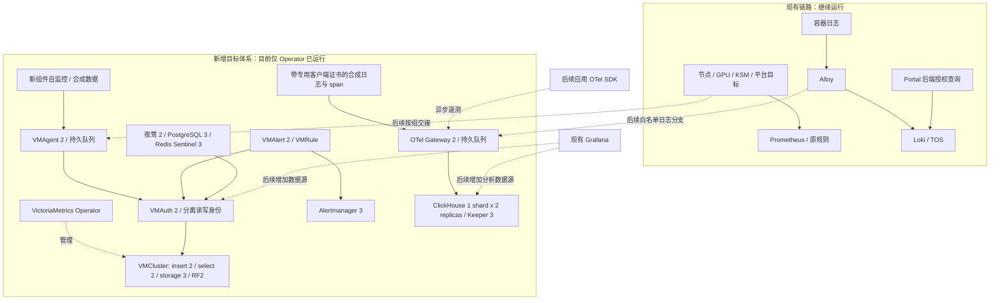

# 训练平台 VKE 可观测性：架构、部署流程与操作记录

更新日期：2026-10-08，时间均为北京时间，另有标注除外。

**当前状态：基础资源、一个 VM Operator 和 15 个新组件 Secret 已创建；VMCluster、ClickHouse、OTel、夜莺及其数据库尚未部署到 VKE。** Operator 已直接使用 Harbor hub 固定摘要，Helm revision 2、1/1 Ready。网络隔离门禁未满足，用户已要求保持现状，不开启集群 NetworkPolicy。本文后半部分的数据面部署命令属于未来执行流程，不是已执行记录。

完整架构设计、复制/队列语义、指标交接、日志与 trace 字段合同见 [架构设计](../../../docs/superpowers/specs/2026-10-08-vke-observability-platform-design.md)。本文件集中记录如何落地、做到哪里、如何验证和恢复。

## 1. 范围与运行边界

- 只覆盖训练平台 VKE；新观测计算和数据库位于本 VKE，不扩展 common/IDC 的采集。
- 现有 Prometheus、Alertmanager、Grafana、Alloy、Loki、Portal/后端、训练镜像和运行任务保持原路径。
- 新组件可使用 GPU 节点的 CPU/内存，不申请 GPU；不硬绑定 CPU 节点，不为部署搬迁或停止训练。
- 先建设自监控/canary，再完成备份恢复和代表性验证，之后按组交接采集、规则与查询。历史迁移单独执行。
- 此次不接应用 OTel SDK、不给 Alloy 加日志分支、不修改 Prometheus remote_write、不配置真实通知。
- 基础设施使用现成发行镜像，无需重构建平台后端/Portal。未来增加后端或 Worker 埋点时，才测试、构建和滚动发布相应应用。

## 2. 整体架构及组件职责



| 组件 | 负责什么 | 不负责什么 |
| --- | --- | --- |
| VM Operator | CRD、配置生成、工作负载协调 | 不代替指标存储，不直接接管原 Prometheus 对象 |
| VMAgent | 抓取、标签处理、远写缓冲 | 不提供长期历史查询 |
| VMInsert / VMStorage / VMSelect | 写入分片、复制存储、查询汇聚 | 不自行决定平台用户权限 |
| VMAuth / VMUser | 固定租户与读写路由、服务身份 | 不能阻止绕过入口直连后端，需要真实网络隔离 |
| VMAlert / Alertmanager | recording rules、基础告警、路由/去重 | 不与夜莺重复拥有同一规则 |
| 夜莺 | GPU/任务/业务告警、责任组、事件与通知治理 | 不作为指标数据库 |
| Alloy / Loki | 保留现有实时日志、LogQL、Portal 历史 | ClickHouse 不直接替换这条用户链路 |
| OTel Contrib | 受认证接收、字段治理、持久队列、导出 | 接收确认不等于 CH 两副本都已提交 |
| ClickHouse / Keeper | 分析日志与 traces、复制协调、SQL 关联 | 不存 VM 指标，不承诺 exactly-once 或零 RPO |

当前 canary 固定 VM tenant `1001`；CH 使用 `observability_canary`。正式数据的租户身份必须由可信入口确定，不能相信客户端自行声明的 team/job 标签。

## 3. 命名空间、节点与存储

| 新 namespace | 目标拓扑 | 初始 PVC 合计 |
| --- | --- | --- |
| observability-metrics | Operator 1；VMStorage 3、VMInsert 2、VMSelect 2、VMAgent 2、VMAuth 2、VMAlert 2、AM 3 | 250Gi |
| observability-analytics | Altinity Operator 1；CH 2、Keeper 3 | 260Gi |
| observability-otel | OTel StatefulSet 2 | 40Gi |
| observability-alerting | CNPG Operator 2；PG 3、Redis/Sentinel 3、夜莺最终 2 | 120Gi |

合计 **670Gi** 是初期申请容量，当前尚未创建这些 PVC。VMStorage 每卷 50Gi；CH 每卷 100Gi；队列、Keeper、AM、PG、Redis 的卷至少 20Gi，满足当前 ESSD_PL0 的最小卷约束。后续业务规模需实测定容。

- 新 StorageClass：`ebs-ssd-observability-retain`，EBS ESSD_PL0、Retain、WaitForFirstConsumer、允许扩容；不改现有 StorageClass。
- 新 PriorityClass：`raytrain-observability-additive`，优先级 -1000、`preemptionPolicy: Never`。资源不足时等待，不抢占训练。
- 每个 namespace 有独立 CPU/内存/存储/Pod 配额，GPU request quota 为 0；Pod 仍需明确 requests/limits。
- 持久副本按 hostname 强制分散；namespace 与 hostname 分散不等于跨 AZ 容灾。
- 首批排除高内存水位 `172.28.1.222`；不容忍 algorithm 专属节点污点，不修改其标签和隔离配置。
- EBS 是可用区资源，Pod 重建须满足卷拓扑；共享节点仍消耗网络、CPU、内存和磁盘资源，不能承诺绝对零影响。

## 4. 镜像来源：为什么直接用 Harbor hub

本次标准开源镜像优先使用：

```text
上游发行仓库 → Harbor 已配置的代理缓存 → VKE 拉取固定 digest
```

例如已核验的 OTel 引用：

```text
harbor.wellspiking.ai/hub/otel/opentelemetry-collector-contrib:0.162.0@sha256:39923a8e431bd1f57be82411999d389fcfe40857492e4365456d97a4c1f74be6
```

`hub` 是代理缓存项目，不需要先手工下载再推送到另一个项目。部署引用它的路径即可；首次或缓存缺失时由 Harbor 获取上游，后续按缓存机制服务请求。实际 `hub` 的上游、权限、清理策略须按现场配置核对，不能把它当成任意注册表的万能代理。GHCR/ECR 镜像目前使用已核验的官方 digest，未验证对应代理映射前不机械改写路径。

普通私有项目如 `guofeng.su` 的独立副本适用于需要自定义构建、独立版本留存、受控晋级、权限或离线供应链的情况。本轮没有这些额外要求，因此重复 tag/push 不是部署必要步骤。固定 digest 保证内容身份，但不保证缓存永不被清理、上游永远可用或镜像已经通过安全扫描。

本轮实际发生过的同步路径为：构建机拉取代理中的官方发行镜像，保留 linux/amd64 manifest，改内部仓库标签后推送 `guofeng.su`。未重新编译、未修改镜像内容；目标 manifest 与来源对应架构的摘要一致。多架构 index 摘要与 amd64 子 manifest 摘要可以不同，不能因此认定内容被改动。

已推送副本先保留，不在本次删除。候选转为直接引用 hub；用户要求继续后，新 Operator 已连同禁用 VTAgent 的修改一起滚动到 hub，实际 imageID 与原私有副本的 amd64 摘要一致。此次未重新推送镜像。

参考：[Harbor Proxy Cache 官方行为](https://goharbor.io/docs/2.14.0/administration/configure-proxy-cache/)。本次未修改 Harbor/Ceph 配置，也未宣称验证了缓存长期留存策略。

## 5. 版本与状态

| 组件 | 本次版本 | 状态/依据 |
| --- | --- | --- |
| VM Operator | chart 0.68.1 / controller v0.75.0 | hub 镜像已运行，Helm revision 2；官方版本核对时 latest v0.75.0 |
| VM 各应用 | 原候选 v1.152.0 → 新候选 v1.153.0 | 数据面未部署；新候选 Helm、CR schema、6项反例合同、镜像参数和告警 dryRun 已通过 |
| Alertmanager | v0.34.1 | 固定候选；黑洞通知配置已离线检查 |
| Altinity Operator | chart/controller 0.27.4 | 未安装；Helm/schema 检查通过 |
| ClickHouse / Keeper | 26.8.20.9 LTS | 未部署；26.9.12.8 是官方较新的普通 stable，候选选 LTS 分支 |
| OTel Contrib | 0.162.0 | 官方当前 latest；真实镜像离线 validate 通过 |
| 夜莺 | 9.1.1 | 官方当前 latest；实际 binary 为 v9.1.1-4e056150142b2e1ed6966c9317a9e08442c399f7 |
| CloudNativePG | chart 0.29.1 / operator 1.30.1 | 候选，按其 Kubernetes 1.36 支持矩阵核对 |
| PostgreSQL | 17.11-202608170816-standard-trixie | 官方 digest 固定；构建机临时库验证，不涉及 VKE 数据库 |
| Redis | 8.8.0-alpine / chart 4.39.0 | 固定 digest，未执行真实 Sentinel 故障验收 |

Chart 版本、controller 版本、业务组件版本、镜像 index/平台 manifest 和部署 release revision 是不同概念。完整引用以各目录 `versions.yaml`、values 和最终渲染结果为准，不使用浮动 `latest` 标签。

版本资料：[VM 1.153.0](https://github.com/VictoriaMetrics/VictoriaMetrics/releases/tag/v1.153.0)、[Operator 0.75.0](https://github.com/VictoriaMetrics/operator/releases/tag/v0.75.0)、[ClickHouse LTS](https://github.com/ClickHouse/ClickHouse/releases/tag/v26.8.20.9-lts)、[OTel](https://github.com/open-telemetry/opentelemetry-collector-contrib/releases/tag/v0.162.0)、[夜莺](https://github.com/ccfos/nightingale/releases/tag/v9.1.1)。VM 1.153.0 已知 pure-Go 构建回归不影响官方 linux/amd64 CGO 构建；仍需实际镜像参数和运行验证，不因版本新而跳过门禁。

## 6. 本轮已经执行的操作

| 时间 | 实际操作与结果 |
| --- | --- |
| 14:57 | 构建机保存非敏感基线：184 个活动 Pod、22 个控制器、51 个 ConfigMap 摘要、787 个 RayJob、4 个 RayCluster、787 个 Kueue Workload；不保存完整 Secret |
| 15:09–15:13 | 下载固定 chart 并核对官方 index checksum；namespace/PC/SC server-side dry-run 通过 |
| 15:14 | 原只读审阅子任务误创建 4 namespace、PC、SC 和各 namespace 配额；此操作未按根任务部署门禁集中执行 |
| 15:21 起 | 候选 6827d038 通过 Git bundle 进入构建机隔离 worktree；原 24 项 scope 测试通过；组件 Helm/schema/离线验证并行进行 |
| 15:24 | 同一子任务镜像化 VM 系列，复制既有 Harbor 拉取凭据到新 metrics namespace，安装 `raytrain-vm-operator`；根任务随后发现、停止其写操作并逐项审计 |
| 15:31 | 原控制器/ConfigMap 摘要无变化；原平台和训练 Pod UID/重启数无变化 |
| 后续只读核查 | 12/12 节点 Cilium 均为 `PolicyEnforcement=never`；现有 MLflow 规则会在开关开启后匹配运行中的服务；未更改开关 |
| 后续候选验证 | 修复 null 可选字段误报、增加安全凭据工具；bb9f2ac 隔离候选 36 项测试通过（含真实 OpenSSL，kubectl 全部 mock）；仅执行 Secret --plan |
| 镜像策略确认后 | VM1.153.0 新候选改为直接使用 hub 固定摘要；Operator 候选同0.75.0改hub、禁VTAgent、收紧集群只读权限；离线专项验证通过，当时未应用到集群 |
| 文档收尾 | 新增两项 scope 回归后共38项测试通过；明确 CNPG ClusterImageCatalog CRD 例外与 Redis test hook 边界。15:56只读快照仍仅一个Operator Pod，无新PVC和VM数据面 |
| 最终候选归档 | `b9dd3b5` 的38项测试、全组件Helm/Kustomize重渲染、VM专项合同和综合scope结构合同均通过（0 errors）；仅离线验证，仍保留live ownership/生成资源与网络门禁 |
| 用户确认后 | 网络能力未开通过，先保持现状；数据组件部署停止在门禁前，继续文档和离线候选验证 |
| 16:14–16:17 继续建设 | 先备份新 Operator release/Deployment/Role，完整 server-side dry-run 差异审阅后升级至 revision 2：直接 hub、禁 VTAgent、VM 默认候选版本 1.153.0。首轮 55 秒 rollout 等待超时，节点拉取镜像用时约 1 分 43 秒；随后确认 1/1 Ready，没有把超时误报为成功 |
| 继续建设：凭据与权限 | `b9dd3b5` 凭据工具创建 15 个新 Secret，仅输出名称/键，不覆盖旧凭据；Operator Ready 后单独应用收紧的只读 ClusterRole，未扩大命名空间 watch 范围 |
| 16:27:54 现场复核 | 12/12 节点 Ready；与初始基线比较，184 个原活动 Pod 的 UID/节点/状态/重启数、22 个原控制器 UID/spec hash、51 个 ConfigMap UID/data hash 全部未变；新 namespace 仍只有 Operator Pod，0 个 PVC |
| 夜莺真实初始化验证 | `b9dd3b5` 在构建机内部 Docker 网络通过 PG UTF8/TLS、首次 seed/重复 seed 拒绝、47→57 表迁移、随机 root 密码哈希、验证码→登录→Bearer profile；单 PG/Redis/Sentinel，仅验证初始化与客户端链路，不是 VKE/HA 验收。测试容器、网络、假凭据与临时数据已清理 |
| 后续方案选择 | 用户明确选择“保持 CNI，改造新组件 mTLS 代理”；进入仅新组件代理方案设计与验证，尚未据此部署数据面 |

只读子任务越界写入属于本次协作失误，已明确记录，不能将它包装成正常审批/验收流程。未发现它修改旧 Prometheus/Alloy/Loki 或停止用户任务；现场基线复核支持这一结论。

已核实私有项目镜像包括 Operator、config-reloader、vmstorage、vmselect、vminsert、vmagent、vmauth、vmalert 和 Alertmanager；VM 应用副本为原 v1.152.0。config-reloader 最终摘要已只读确认，推送完整。当前不继续推送 v1.153.0 副本。

当前唯一新增运行工作负载：`observability-metrics/raytrain-vm-operator`，Helm revision 2，1/1 Ready，节点 `172.28.1.150`，16:27 快照重启数 0。镜像：

```text
harbor.wellspiking.ai/hub/victoriametrics/operator:v0.75.0@sha256:0f6b319db05d2774cb79a1955783275fa2a83dd0abb62d4fba0fe4ec295c993e
```

实际参数已核对：`WATCH_NAMESPACE=observability-metrics`、Prometheus converter 全关闭、`--controller.disableReconcileFor=VTAgent`。集群权限仅 nodes/namespaces/storageclasses 只读发现、CRD get/list；命名空间内权限另由 Role 控制。收紧后最近日志未见 forbidden/unauthorized/error，此时没有业务 CR，不能替代未来协调实际 CR 的验收。

已创建的新组件 Secret 共 15 个：metrics 2、analytics 5、otel 4、alerting 4；另有原先复制的 Harbor 拉取 Secret 和 Helm 自己的 release Secret，不计入这 15 个。CNPG CA 仍由未来的 CNPG 管理。生成工具再次执行 `--create` 会因已存在目标而停止，不应删除或覆盖来重跑；证书启用前复核有效期。

**尚未创建到 VKE：** VMCluster/VMAgent/VMAuth/VMAlert/VMAlertmanager、CH/Keeper、OTel Gateway、CNPG/Redis/夜莺、数据 PVC、真实通知与业务采集接入。

## 7. 当前阻塞及恢复建设前置条件

`PolicyEnforcement=never` 表示即使 NetworkPolicy 选择了 Pod，也不实施隔离。VM 的 insert/select 原生入口和 Keeper 协调端口无法只靠 VMAuth/SQL 密码兜底；不能在此状态下把候选宣称为安全隔离的数据面。

当前用户要求保持网络现状，本轮不执行以下动作：修改 Cilium 全局模式、滚动 Cello、调整旧 NetworkPolicy 或为绕过门禁开放新后端。

后续需要独立计划：与 VKE 确认受支持的启用方式和滚动影响；审查旧 MLflow/ingest/数据库/DNS/FSX/TOS 等允许路径；制定测试与回退；验证允许/拒绝流量后，再继续本文件的部署步骤。开启全局开关会使已有规则开始执行，不能把它作为本轮的一个普通参数顺手打开。

依据：[Cilium policy enforcement 模式](https://docs.cilium.io/en/stable/security/policy/intro/)、[VKE NetworkPolicy 使用约束](https://docs.volcengine.com/docs/vke/Using-NetworkPolicies-for-network-access-control?lang=zh)。

### 7.1 不修改 CNI 的替代路径评估

已核查组件原生认证能力，现有候选不能只加一个 TLS 开关便解除门禁：

- VM OSS 1.153.0 的 HTTP 接口可加 TLS/Basic，但 vmstorage 的 8400/8401 内部 RPC 原生 `cluster.tls` 属于 Enterprise 功能；VMAuth 也不能阻止其他 Pod 直连后端。[VM 官方内部 mTLS 说明](https://docs.victoriametrics.com/victoriametrics/cluster-victoriametrics/#mtls-protection)
- ClickHouse 可增加 TLS、独立副本传输凭据；Keeper 需要分别保护客户端和 Raft。仅 `secure=true` 不等于验证客户端身份；客户端与 Raft 共用信任配置也不能自动区分两类角色。当前清单仍依赖 NetworkPolicy 限制这些入口。[ClickHouse Keeper](https://clickhouse.com/docs/guides/oss/deployment-and-scaling/keeper)、[Altinity 0.27.4 安全配置](https://github.com/Altinity/clickhouse-operator/blob/release-0.27.4/docs/security_hardening.md)
- 保持 CNI 不变的备选设计是：原匿名端口关闭或仅监听回环，跨 Pod 通信通过双向 mTLS 代理，按证书身份放行各端口；HTTP 管理、metrics、health 同样需要逐项处理。只删 Service、使用 ClusterIP 或不配 Ingress，都不能阻止 Pod IP 绕过。

用户已选择该代理方案，正在设计实现；它涉及新增组件和证书运维，须先形成清单并验证无凭据/错误身份拒绝、合法链路、故障恢复和无回环绕过。当前已部署资源尚不具备这套代理能力，CNI 保持原状，数据面仍在门禁前。

## 8. 后续部署流程（当前门禁未解除，不执行）

### 8.1 候选与构建机

本机只编辑、审阅和 `git diff --check`。编译/测试/Helm lint/镜像验证都在既有构建机 `14.103.49.106` 执行；不要修改正式构建目录当前 checkout。只将本次新增文件通过 Git bundle 放入 isolated detached worktree，并记录明确 SHA，不能跨 worktree 依赖不明确的 `FETCH_HEAD`。

固定 context：`cd9q3b7rf9aidnnbd0je0@81533555-kd9q3q0frjmp21sk5lklg`；现场 Kubernetes 为 `v1.36.1-vke.3`。任何写操作前重新核对 context、候选 SHA、资源冲突和原系统基线。

```bash
# 构建机；obs_candidate 指向已审阅隔离 worktree
obs_root=/root/raytrain-observability-additive-20261008T065709Z
obs_candidate="$obs_root/reviewed-b9dd3b5"
python3 -m unittest discover -s "$obs_candidate/ops/observability/next/tests" -v
python3 "$obs_candidate/ops/observability/next/bootstrap_credentials.py" --plan
```

上例 b9dd3b5 是本轮已验证的代码/清单快照；后续文档记录不改变该快照。新修改必须重新提供明确 SHA 和适用验证，不能把静态检查通过当成网络门禁解除。

### 8.2 渲染与审阅

1. `00-bootstrap.yaml` 是基础对象，不重复接管未知已有资源。
2. VM Operator：固定 chart，加 `victoriametrics/operator-values.yaml`；审阅新 namespace Role 和必要的 cluster 只读权限，禁 Prometheus converter，禁不使用的全局控制器。
3. VM 资源：本地 Helm chart `victoriametrics/resources`，叠加 `resources-hub-values.yaml` 的固定摘要；运行专项 `validate_component_contract.py`。
4. CH：固定 Altinity chart，加 `clickhouse/operator-values.yaml`；只处理锁定版本四个 CH/CHK CRD；Kustomize 渲染 `clickhouse/`。
5. OTel：Kustomize 渲染 `otel/`，使用真实固定镜像执行离线 `validate`。
6. CNPG：固定 chart，加 `nightingale/10-cnpg-values.yaml`，**每次**安装/升级都使用 `scope-cnpg-webhooks.py` post-renderer。所有 webhook 限新 namespace、Namespaced scope。
7. Redis：固定 chart，加 `nightingale/30-redis-values.yaml`；审阅 init container、Sentinel、PVC 和权限。该 chart 的 test hook 缺少本轮资源预算，安装不会运行它；渲染正式工作负载时显式 `helm template --skip-tests`，本轮不执行其 `helm test`。不能误以为普通 post-renderer 会处理 Helm 单独保留的 test hook。
8. 对全部最终渲染执行 `verify_scope.py`。CRD/ClusterRole/Binding/webhook 逐项审阅后列精确 allowlist，不能自动把所有对象加入白名单就认为权限通过。
9. server-side dry-run 需要已存在相应 namespace/CRD；缺少 CRD 的资源不能通过跳过验证来认定可部署。

CNPG 的固定 chart 还包含集群级 `ClusterImageCatalog` CRD，namespace watch 不代表所有读权限均限制在 namespace。该定义及其只读 RBAC 必须独立审阅，不能泛化允许所有集群级 CR；本次 PG 使用固定 `imageName`，不创建或引用任何 ImageCatalog 实例。webhook 仍限定 Namespaced scope，不因此扩大。

```bash
helm template raytrain-next "$obs_candidate/ops/observability/next/victoriametrics/resources" \
  -n observability-metrics \
  -f "$obs_candidate/ops/observability/next/victoriametrics/resources-hub-values.yaml" > metrics-rendered.yaml
kubectl kustomize "$obs_candidate/ops/observability/next/clickhouse" > clickhouse-rendered.yaml
kubectl kustomize "$obs_candidate/ops/observability/next/otel" > otel-rendered.yaml
```

### 8.3 凭据与应用顺序

网络门禁和审批范围确认后，按组件 README 执行，不对本目录 `kubectl apply -R`。

1. 复核基础对象与新的网络策略，只选中新 namespace Pod；用专用 Pod 验证真实执行效果。
2. 本环境 15 个新 Secret 已创建，继续时只核对名称/键及证书有效期，不重跑创建。新环境才使用 `bootstrap_credentials.py --create`；已存在任一目标则停止，不自动覆盖。随机值经 stdin 传递；不打印或归档完整 Secret；CNPG 的 CA 由 CNPG 自己管理。
3. VM：确认 Operator 及最小 RBAC，再创建 VMCluster、VMAuth/User、VMAgent、VMAlert/AM/selfscrape。检查生成 Pod、卷和 token 路径，禁止后端绕过认证。
4. CH：安装只 watch 新 namespace 的 Operator → Keeper 3/3 → CH 2/2 → 仅一次 schema bootstrap Job。两副本分别验 DDL/MV/授权/复制，不能只看 Job 成功。
5. OTel：确认 CH schema 后启动两个带持久队列的 gateway，专用 mTLS 合成客户端测试日志/trace，验证无证书拒绝、schema权限、队列与复制。
6. 夜莺：CNPG/Redis → PG/Redis 健康 → 固定官方 PostgreSQL seed 检验与导入 → 单实例夜莺迁移/密码/登录验证 → `50-ha-patch.yaml` 扩两实例 → VM canary 只读数据源和无外部通知的触发/恢复测试。
7. 按新组件独立验证故障和恢复，不对现有用户训练注入故障。全部通过后记录最终 release、imageID、PVC、拓扑和测试结果。

细节入口：[VM](victoriametrics/README.md)、[CH](clickhouse/README.md)、[OTel](otel/README.md)、[夜莺](nightingale/README.md)。

## 9. 验收清单与尚缺证据

| 检查 | 当前证据 | 剩余 |
| --- | --- | --- |
| 安全合同/凭据工具 | 最终 b9dd3b5 的38项测试及综合scope结构合同通过；真实OpenSSL、mock kubectl | live权限/所有权检查；未测得覆盖率，不宣称80% |
| Helm / CRD | 初始版本lint/schema通过，最终 b9dd3b5 全组件重新渲染通过 | 最终 server dry-run 与生成资源检查；静态 schema 不等于 CEL/运行通过 |
| 镜像 | 固定版本/摘要、N9E binary、OTel validate；VM1.153 Helm/schema/反例/参数/rule检查和固定AM配置检查通过 | 数据组件节点真实拉取与imageID |
| 旧系统保护 | 16:27 基线对照：184 原 Pod、22 控制器、51 ConfigMap 均无变化 | 任何后续部署后都重新对照；这不等于负载性能已全面验收 |
| 网络隔离 | 已确认 12/12 为 never | 实际 allow/deny 测试，当前不通过 |
| 存储/HA | 候选 Retain/WFFC/反亲和配置 | PVC Bound、复制、故障接管、备份与隔离恢复 |
| 用户体验 | 未改提交/日志入口或训练 Pod | 数据组件正式接入后再验用户链路与查询一致性 |
| 指标/日志/trace/告警 | 自监控与合成测试配置已准备 | 完整端到端、HA去重、触发/恢复、队列回放，无真实通知 |
| 夜莺真实初始化/登录 | 构建机固定镜像单 PG、单 Redis + Sentinel 测试通过，保持验证码启用；临时资源已清理 | VKE 部署、三副本选主/故障切换、两实例夜莺和 VM 数据源/告警验收 |

离线测试中发现并修复：夜莺不能使用候选中最初的 PostgreSQL URI DSN，上游错误路径可能把 URI 当 dbname 打日志。现改官方 `key=value` DSN，随机密码字符集受控；仅使用假凭据测试，未发生生产密码暴露。记录该问题是为避免未来重复使用旧候选。

## 10. 回退与清理边界

- 本轮没有业务采集交接，因此现有 Prom/Loki/Portal 无需切回。
- 当前只保留已有新基础层与 Operator；不自动卸载、删除 CRD/namespace、删除已推镜像或轮换凭据。
- 将来回退先停新增入口、确认持久队列状态，再按组件缩容；保留卷、Secret、配置、版本和恢复元数据。
- Helm rollback 不回滚数据库/schema变化；不得把退 Helm revision 当成完整数据库恢复。
- 仅新 canary 数据和测试资源可按登记范围清理，不能使用跨 namespace 的广泛 delete 或删除用户数据。

## 11. 证据位置和后续维护

构建机根目录：`/root/raytrain-observability-additive-20261008T065709Z`，仅管理员可访问。

| 路径 | 内容 |
| --- | --- |
| baseline.json / baseline-recheck.json | 原系统基线和15:31对照，不含完整配置/Secret |
| charts/ | 固定四个 chart 包，校验和已对官方 index |
| candidate/ | 6827d038 初始隔离候选；不代表最终可部署 |
| prerequisites-bb9f2ac/ | 36项测试对应的明确候选 |
| prerequisites-bb9f2ac-test.log | 更新后合同/凭据测试结果 |
| reviewed-b9dd3b5/ | 最终代码/清单候选，后续文档状态补充不改变该验证快照 |
| reviewed-validation/summary.json | 最终38项测试、各组件重渲染、VM合同与scope合同结果，全0退出码 |
| validation-vm/ | VM render、schema、正负合同、摘要与离线校验 |
| validation-vm/v1.153.0/validation-summary.json | 直接hub、VM1.153、禁VTAgent与收紧Role的新候选验证 |
| validation-ch/ | CH/OTel render、schema、scope、OTel validate |
| validation-n9e/ | CNPG/Redis render、固定seed、摘要、DSN与binary校验 |
| validation-credentials/ | RED/GREEN、mock/真实OpenSSL验证 |
| networkpolicy-runtime-audit.json | 12节点模式与旧规则匹配对象 |
| live-new-operator-rbac.json | 已部署新Operator权限审计快照 |
| current-additive-status.json | 15:56历史快照：仅Operator、无新数据卷/数据面 |
| continue-20261008/ | Operator 升级前备份、server dry-run、完整差异审阅及升级日志；文件仅管理员可读 |
| continue-20261008/final-live-recheck.json | 16:27新快照：hub Operator revision 2、最小Role、Secret名称/键、原系统基线对照；无Secret值 |
| runtime-n9e-20261008/ | 构建机内部Docker网络的PG/Redis/夜莺真实运行验证；只用临时假凭据，不连接VKE库 |

目录中的早期失败日志保留为排障记录，不能用某一次 PASS 覆盖不同 SHA/配置的未验结果。恢复建设时重新核对现场，更新本记录中的实际版本、审批范围、执行时间与验收结论，不把这次快照当作长期事实。
