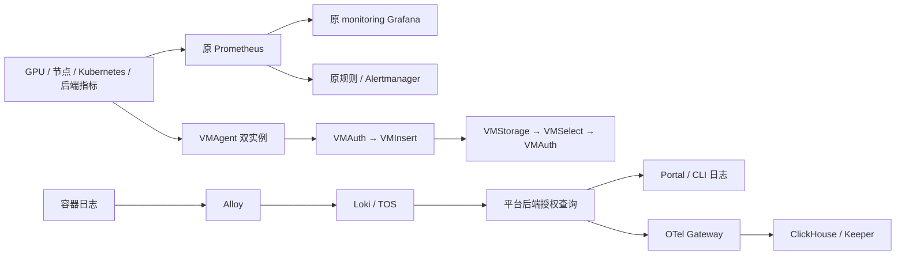
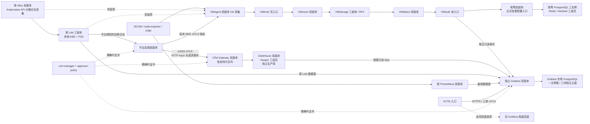

# VKE 可观测性部署与运维手册

本文面向训练平台维护人员。当前状态为 **2026-10-23 夜莺与独立 Grafana 整组卸载完成**；最终结果和逐盘释放证据见 [退场记录](RETIREMENT_20261023.md)。

用户明确不保留夜莺、独立 Grafana 的专用数据库和云盘。退场范围包含两个应用、两套专用 PostgreSQL、夜莺 Redis/Sentinel、两个专用 CNPG Operator 及 `observability-ui`。临时 NodePort **31700 / 31701 已随 UI release 移除，不再作为运维入口**。原 `monitoring` Grafana、Prometheus、Alloy、Loki、VMCluster、OTel、ClickHouse 与平台 HTTP 遥测保留。原 Grafana不自动继承被删除独立实例的用户、看板、数据源或数据库内容。

已释放的专属存储为 **9 PVC/PV、180Gi**：夜莺 PostgreSQL 3 × 20Gi、Redis 3 × 20Gi、Grafana PostgreSQL 3 × 20Gi。精确九块 PVC/PV 已消失，CSI EBS 驱动对对应九块云盘均返回 `Successful delete volume`，本次未另行查询云 API。`nightingale`、`grafana` 两个 namespace 已消失，两个专用 Operator、Redis/UI release 和三个 Grafana VMServiceScrape 均已移除。共享 CNPG CRD 保留；两个作用域独立的 Operator 及 webhook 随各自专用数据库退场。

当前保留链路如下，实际验收见退场记录：



旧 Grafana 两副本健康，ClusterIP Service 为 `monitoring/prometheus-grafana`，`/api/health` 返回数据库正常、版本 13.1.1；本次没有新增对外入口。保留 VM、ClickHouse 和 OTel 的数据接入不等于旧 Grafana 已配置对应数据源。夜莺退场后不再提供夜莺规则管理或通知入口；现有 Prometheus/Alertmanager 保留，新告警治理方案尚未重新选定，不宣称已完成替代。后续不得直接照旧安装命令重建退场组件。

**以下第 1–8 节保留 2026-10-13 的部署与维护历史。** 其中夜莺、独立 Grafana、31700/31701、79 Pod/1130Gi、专用数据库恢复和告警配置等描述只适用于当时；相关命令不是当前执行入口。旧架构图片也停留在 10 月 13 日。仍保留组件的配置源可参考下方表格，但每次变更必须重新核对实际运行配置、所有权与当次授权。

## 1. 从哪里维护

本轮集成工作树仍位于独立分支 `codex/observability-additive`：

```text
/Users/ashersu/.codex/worktrees/observability-additive/ray-train-platform
```

不要把本机原主目录中的未提交文件当作线上版本。后端候选 **`2b2f38e0b20056761d64639bd23f392382cab6e3`** 已通过完整门禁并同步本地 main、GitHub main、内部 GitLab main 和正式构建目录。主目录原有用户改动保留。随后 Grafana 基础设施修正有独立提交，最终同步状态与各组件实际部署版本见本轮部署记录；源码 SHA、组件镜像 digest、Helm revision、线上 CR 配置必须分别记录。

测试、渲染和构建在既有构建机 `root@14.103.49.106` 执行。正式构建目录是 `/opt/guofeng/vke-cluster/ray-platform-main`；候选先经 Git bundle 进入隔离 detached worktree 验证，通过后才进入正式目录构建。当前私有证据根目录 `/root/raytrain-observability-completion-20261013`；其中凭据、数据库与恢复材料不可整体分享或纳入 Git。资源基线只保存非敏感 UID、spec hash、镜像和重启信息，不导出旧 Secret。

以下路径均相对上述源码根目录。`ops/observability/next/` 是新体系配置根目录；旧监控仍在 `ops/observability/` 下对应产品目录。

## 2. 部署归属、Chart 与配置文件

并非所有组件都是一个 Helm release。Helm 管理的资源用同一 release 升级；Operator 管理的工作负载应修改上层 CR；Kustomize/独立清单则通过其原声明式入口维护。不要手改 Operator 生成的 StatefulSet、ConfigMap 或 Secret，下一次协调可能覆盖手改。

| 组件 / namespace | 安装和持续管理方式 | 固定 Chart / 应用版本 | 主要维护文件 |
|---|---|---|---|
| 原 Prometheus、Grafana、Alertmanager、KSM、node-exporter / `monitoring` | Helm release `prometheus`；Prometheus Operator 协调 CR | `kube-prometheus-stack 87.18.1`；Prometheus `3.13.1`、Grafana `13.1.1`、Alertmanager `0.33.1` | `helm/vendor/kube-prometheus-stack-87.18.1.tgz`；`ops/observability/prometheus-operator/20-values-production.yaml`；同目录 `deploy.sh` / `render-test.sh` / `verify.sh` |
| 原 Alloy / `monitoring` | Helm release `alloy`，两副本 StatefulSet，Kubernetes API 日志采集 | `grafana/alloy 1.11.1`；Alloy `v1.18.1` | `ops/observability/alloy/20-values-cpu-ha.yaml`、`deploy-ha.sh`；采集规则在 values 的 `alloy.configMap.content` |
| 原 Loki / `loki` | Helm release `loki-cpu`；3 个 single-binary 副本和网关 | `loki 18.7.5`；Loki `3.7.6` | `ops/observability/loki/20-values-cpu-ha.yaml`、`deploy-ha.sh`；脚本默认 Chart 包 `/opt/guofeng/vke-cluster/loki/loki-18.7.5.tgz` |
| cert-manager / `cert-manager` | Helm `cert-manager` 和 `cert-manager-approver-policy`；单独声明 Issuer/Certificate/审批策略 | `v1.21.2`、`v0.28.0` | `next/cert-manager/{versions.yaml,cert-manager-values.yaml,harbor-values.yaml,approver-policy-values.yaml,approver-policy-harbor-values.yaml,render.py}` |
| VM Operator / `victoriametrics` | Helm `victoriametrics-operator`；仅协调该 namespace | `victoria-metrics-operator 0.68.1`；Operator `v0.75.0` | `next/victoriametrics/{versions.yaml,operator-values.yaml,operator-cluster-read.yaml}`；必须使用完整 post-renderer 链 |
| VM 数据面 / `victoriametrics` | Helm `victoriametrics-cluster`，生成 VMCluster/VMAgent/VMAuth/VMAlert/VMAlertmanager 等 CR；Operator 再生成 Pod | 本地 `victoriametrics-cluster 0.1.0`；VM `v1.153.0`、新 Alertmanager `v0.34.1` | `next/victoriametrics/resources/{Chart.yaml,values.yaml,templates/}`；叠加 `resources-hub-values.yaml`；线上须保留 `businessScrape.enabled=true`、`grafanaRead.enabled=true` |
| ClickHouse Operator / `clickhouse` | Helm `clickhouse-operator` | `altinity-clickhouse-operator 0.27.4` | `next/clickhouse/operator-values.yaml`、`operator-post-render.py`；镜像和拓扑也在该目录清单内 |
| ClickHouse / Keeper / `clickhouse` | Kustomize 提交 CHI/CHK、配置和 Service；Altinity Operator 协调 CH 2 副本、Keeper 3 副本 | ClickHouse / Keeper `26.8.20.9` LTS | `next/clickhouse/kustomization.yaml`、`clickhouse.yaml`、`keeper.yaml`、`proxy-*.yaml`、`schema.sql`；`bootstrap-job.yaml` 是独立一次性 schema 操作 |
| OTel / `opentelemetry` | Kustomize 管理 `otel-gateway` StatefulSet；没有 OTel Operator 或 OTel Helm release | OTel Contrib `0.162.0` | `next/otel/{kustomization.yaml,gateway.yaml,collector.yaml,proxy-otel.yaml,network-policy.yaml}` |
| PostgreSQL Operator / `nightingale` | Helm `cloudnative-pg-operator`，只协调夜莺的专用数据库 | `cloudnative-pg 0.29.1`；基于 `1.30.1` 的受审认证派生镜像 | `next/nightingale/{10-cnpg-values.yaml,scope-cnpg-webhooks.py,versions.yaml,cnpg-hardening/}` |
| PostgreSQL / `nightingale` | 独立 Cluster CR `nightingale-postgres`，CNPG 协调 1 主 2 备 | PostgreSQL `17.11` | `next/nightingale/20-postgres.yaml`；数据库不是训练平台的 PostgreSQL |
| Redis / Sentinel / `nightingale` | Helm `nightingale-redis`，3 个 Redis/Sentinel Pod | `redis-ha 4.39.0`；Redis `8.8.0-alpine` | `next/nightingale/30-redis-values.yaml`、`scope-redis.py` |
| 夜莺 / `nightingale` | 受审 ConfigMap + Deployment/Service/PDB 清单；不是单独的夜莺 Helm release | Nightingale `9.1.1` 的 Sentinel 兼容派生镜像 | `next/nightingale/{40-nightingale.yaml,50-ha-patch.yaml,45-networkpolicy.yaml,config/}`；`35-bootstrap.yaml` 只用于全新空库初始化 |
| 首波业务监控声明 / 多 namespace | 本地 Chart 渲染后创建的 **15 个声明对象**；当前没有对应 Helm release | 本地 `raytrain-business-metrics 0.1.0` | `next/business-metrics/{Chart.yaml,values.yaml,templates/,dashboard.yaml}`；包括 VMServiceScrape、ServiceMonitor、发现 RBAC 和 Grafana 看板 |
| 临时浏览器入口 / `nightingale` | 独立 Helm release `observability-ui`；11 个新增声明、2 个代理 Pod，无 PVC | 本地 `observability-ui 0.1.0`；Envoy `v1.39.3` | `next/ui-access/{Chart.yaml,values.yaml,templates/,README.md}`；本 chart 直接声明 SDS，不额外叠加 VM/CNPG post-renderer |
| 独立 Grafana / `grafana` | `render.py` 声明式输出管理应用、数据源、看板、证书与采集；不是 Grafana Helm release | Grafana `13.1.1` + 官方签名 ClickHouse 插件 `4.22.1` | `next/grafana/{values.yaml,render.py,workloads.py,grafana.ini,proxy.py,README.md,image/}`；发布必须传入已验证镜像 digest |
| Grafana 专用 CNPG Operator / `grafana` | 独立 Helm `cloudnative-pg-operator`；只 watch `grafana`，复用现有共享 CRD | `cloudnative-pg 0.29.1`；受审 `1.30.1` 派生镜像 | `next/grafana/{cnpg-values.yaml,scope_cnpg.py}`；不可省略作用域/认证 post-renderer |
| Grafana PostgreSQL / `grafana` | `grafana-postgres` Cluster CR，独立 1 主 2 备；独立服务端/客户端 CA | PostgreSQL `17.11`；3 × 20Gi Retain | `next/grafana/{render.py,workloads.py,values.yaml,README.md}`；应用配置保存在此库，不是训练平台或夜莺数据库 |
| 后端私有 HTTP 遥测 / `ray-train-platform`、`victoriametrics` | 后端由 `ray-platform` Helm 管理；独立 `platform-telemetry` Helm release 管理证书、9091 Service、VM 发现授权与采集声明 | 本地 `raytrain-platform-telemetry 0.1.0` | `helm/ray-train-platform` 的 `backend.telemetry`；`next/platform-telemetry/{Chart.yaml,values.yaml,templates/}`；源码 `backend/telemetry/` |
| 正式 HTTP log/trace 表与账号 / `clickhouse`、`opentelemetry` | 复用 CH/OTel 原管理入口；单独生产 schema 初始化 Job；不覆盖旧 canary 表 | 与现有 CH / Collector 版本一致 | `next/production-pipeline/{schema.sql,README.md,ROLLOUT.md}`；日志 7 天、trace / lookup 30 天 TTL，过期清理由后台合并执行 |
| 证书消费与续期 | cert-manager + Envoy filesystem SDS；另有受控原生组件轮转 Job | Envoy `v1.39.3`，镜像以清单 digest 为准 | `next/mtls/{sds_post_render.py,rotation-cronjob.yaml,rotation-policy.json,rotation.py,ROTATION.md}` |

表中 `next/` 是 `ops/observability/next/` 的简写。完整镜像摘要见版本文件、values 和最终渲染结果，不能仅凭 Chart `appVersion` 推断实际运行镜像。标准镜像优先使用 Harbor `hub` 缓存；CNPG / 夜莺是专用派生镜像，Jetstack / PostgreSQL 的部分镜像因源站可达性使用保留源摘要的独立副本。

2026-10-09 本轮核对的 release revision：`prometheus=4`、`alloy=7`、`loki-cpu=4`；旧零副本 `loki=3` 仍保留其三个 PVC。新 `cert-manager=2`，`cert-manager-approver-policy`、`victoriametrics-operator`、`victoriametrics-cluster`、`clickhouse-operator`、`cloudnative-pg-operator`、`nightingale-redis` 均为 revision 1；本轮独立安装 `observability-ui` revision 1。这是历史快照。2026-10-13 已更新 `victoriametrics-cluster=2`，新增 `victoriametrics/platform-telemetry=1`、`grafana/cloudnative-pg-operator=1`；后端 `ray-platform=274`。入口已于 12:04:38 升为 `observability-ui=2`，`grafana.independent=true`。

新体系四个外部 Chart 包已锁定并保留在构建机：

```text
/root/raytrain-observability-additive-20261008T065709Z/charts/
  victoria-metrics-operator-0.68.1.tgz
  altinity-clickhouse-operator-0.27.4.tgz
  cloudnative-pg-0.29.1.tgz
  redis-ha-4.39.0.tgz
```

cert-manager 的仓库、Chart 名、版本与镜像摘要见 [cert-manager/versions.yaml](cert-manager/versions.yaml)。现有包复用前核对记录的 SHA256；下载更新时固定版本并核对官方 index。历史证据目录是审计与恢复材料，不是任意新版本下载的替代品。

## 3. 当前架构与数据流

截至 2026-10-13 的展示图（保留原文件名）：[PNG](../../../docs/architecture/raytrain-observability-vke-20261009.png) · [可编辑 SVG](../../../docs/architecture/raytrain-observability-vke-20261009.svg) · [缩放页面](../../../docs/architecture/raytrain-observability-vke-20261009.html)。当前数据流如下；旧 Grafana 仅作为可选回退目标：



- VMAgent 两个实例各抓全量目标，VM 按 30 秒去重，不是采集分片；VMStorage RF2 是独立的存储副本保护。首波 27 个 exporter 端点继续运行；本轮另增 Grafana / CNPG / PG 7 个目标及后端两个指标端点。
- 后端公开 Service 仍只承载原业务 HTTP 端口；新指标在独立 ClusterIP `backend-metrics.ray-train-platform.svc:9091` 上，只接受 VMagent 精确身份。用户提交方式、训练任务源码和运行容器无需改动。
- HTTP 中间件只输出有限 method、路由模板、状态和耗时，拒绝传播外部 baggage/请求身份与任意 URL 参数。异步有限队列隔离导出故障。**此次 HTTP trace 不代表提交→outbox→调度→Worker→训练的完整生命周期追踪。**
- 原训练日志仍走 Alloy → Loki → 平台后端；不会被自动全量复制到 ClickHouse。新生产库保存受控 HTTP trace 和请求事件；旧 `observability_canary` 独立保留。Grafana Loki 数据源沿用旧 Loki 的访问边界，平台页面的租户/任务授权不等于 Grafana 自动拥有同一隔离。
- 独立 Grafana 已声明 VM（默认）、原 Prometheus、Loki 和 ClickHouse 数据源。VM 与 CH 使用独立只读身份；ClickHouse 账号只读指定 Distributed 表，查询 2 threads / 1Gi / 30s 上限。四类数据源在两个新实例均返回健康 200，VM 查询与官方 ClickHouse 插件实际查询通过；入口切换、逻辑恢复及业务看板查询均已通过。ClickHouse 数据源 `queryTimeout=25`，服务端实测 `max_execution_time=29`，保留 30 秒硬上限；越权查询 `system.users` 被拒绝。
- 夜莺承担正式告警，通知渠道由管理员在 UI 配置。新增 Alertmanager 仍为 `blackhole-canary`，原生证书轮转 Cron 保持暂停，未发送真实通知。
- CNI 仍不执行 NetworkPolicy。新增组件依靠回环原生监听、精确身份 mTLS、路径权限和数据库权限；NetworkPolicy 只是后续配置草案。共享节点 CPU/内存/磁盘/网络开销仍需观察。

## 4. 可以配置和查看的 UI

| UI / 产品 | 可以做什么 | 配置保存在哪里 | 当前维护边界 |
|---|---|---|---|
| **夜莺** | 数据源、业务组、成员、告警规则、通知渠道、订阅/屏蔽与告警事件 | 夜莺专用 PostgreSQL；Redis 保存会话/协调等状态 | 适合作为正式告警管理入口；本地账号/验证码/JWT 保留，目前未接 Portal SSO；通知由管理员配置后单独验收 |
| **独立 Grafana** | 看板、PromQL、LogQL、ClickHouse 日志/trace 分析及用户管理 | 两副本共用专用 PostgreSQL；provisioning 仍由 Git / ConfigMap 管理 | 新实例数据源、恢复及 31701 入口验收通过；独立账号，旧 Grafana 保留回退 |
| VMUI / VM 诊断页 | 指标查询、时序诊断；并非整个 VMCluster 的配置后台 | 查询本身不改集群部署配置 | 本轮未直接开放；当前受控 VMAuth 路由只开放指定 API，不能直接把 VMSelect 改 NodePort 绕过身份和租户边界 |
| 原 Prometheus / Alertmanager | Target、规则、PromQL、告警/静默等排查 | CR / 配置及相应持久化 | 现有规则链路继续保留；正式新告警配置集中到夜莺，不为方便而同时维护两份重复通知 |
| Alloy | 组件图、运行状态和采集排查 | 配置在 Helm values 中 | UI 不是完整配置编辑器；当前不直接开放无认证的 12345 端口 |
| Loki、OTel、ClickHouse、Keeper、CNPG、Redis、cert-manager | 主要由 API / SQL / CR / 清单维护 | 各自数据盘、数据库和声明式配置 | 本轮未暴露原生管理端口。Loki Explore 与 ClickHouse 分析通过独立 Grafana 数据源使用；不开放数据库原生端口 |

### 夜莺如何配置

先使用夜莺自身管理员账号登录，再按“数据源 → 业务组/权限 → 规则 → 通知渠道/订阅 → 测试事件”配置。当前已有 VM 数据源使用夜莺 Pod 内的 `http://127.0.0.1:18427` 只读代理，再通过 mTLS + Bearer 连接 VMAuth；**这个 localhost 指夜莺容器，不是浏览器或个人电脑**。不要替换为裸 VMSelect 地址，也不要把 read token 复制到浏览器脚本。

夜莺初始管理员为 `root`；初始化凭据引用 `nightingale/n9e-bootstrap-admin`。仅授权管理员可在受信终端读取对应密码键，凭据不写入本文、截图、shell history 或工单。首次登录后通过 UI 管理密码；初始化 Secret 不是数据库中当前密码的实时副本。已初始化数据库不能重跑 `35-bootstrap.yaml`，修改 bootstrap Secret 也不等于修改已有用户密码。

### Grafana 配置与持久化

新 `grafana` 命名空间的两实例共享 `grafana-postgres` 三实例数据库、稳定的 `GF_SECURITY_SECRET_KEY`、provisioning 配置和签名插件。UI 创建的用户、看板及数据源进入该共享库；配置恢复必须同时保留数据库和加密密钥，只有数据库备份不能保证数据源密码可解密。声明式数据源/看板仍以 Git 为准，UI 编辑需遵循 provisioning 的覆盖规则。**Provisioned 数据源有 `version` 保护**：修改受管数据源时提高该条目的版本，并从 Grafana 实际 API 读回；挂载文件更新不等于数据库中的数据源已更新。本轮 ClickHouse 数据源为 version 2 / queryTimeout 25 秒。

新初始管理员 Secret 为 **`grafana/grafana-admin`**，键 `admin-user` / `admin-password`；加密键 `secret-key` 仅用于内部恢复，不交给浏览器。新独立数据库没有自动复制旧实例的 UI 用户、临时数据源或看板；本轮是新增可恢复的 provisioning 与专用管理账号，旧账号和配置迁移需要另行核对。初始化 Secret 并非 UI 当前密码的实时副本，不通过修改它重置已有账号。

**旧 `monitoring` Grafana** 仍保留原 SQLite + emptyDir 两副本及 `monitoring/grafana-admin`。31701 现已指向新实例，旧实例只作为定向回退目标。旧 ClientIP 粘连仍不是共享数据库或持久化保证；不要将新 PG 的可靠性描述套用到旧实例。

新数据库已完成主库 1 → 2 受控切换（约 19.53 秒）及跨 Grafana 副本持久读写；新库逻辑 dump 已在构建机无网络、无对外端口的临时 PG/Grafana 中恢复，通过 dashboard API、4 类数据源、原生管理员 Basic/cookie 及 VM Bearer 凭据解密检查，验证容器已清理。VM 解密检查证明恢复后能解出非空 Bearer，不等于逐个验证所有数据源密码。备份只包含新 Grafana 数据，不含旧 SQLite 迁移。长期自动备份 / WAL 归档 / PITR 尚未部署，三副本和 Retain 均不替代备份。具体操作见 [grafana/README.md](grafana/README.md)。

## 5. 临时 NodePort 与后续 Ingress

本轮用户授权在**公司内网 / VPN 可达的节点 IP**上临时开放配置 UI，后续切换 Ingress。入口应保留产品登录和新组件的内部 mTLS，不把数据库、VM 写入或 Envoy 管理接口直接暴露。NodePort 是集群节点上的入口，并不因为没有公网域名就自动具有源地址隔离。

### 现有云入口与临时代理的关系

现场已有火山 ALB：`internal-alb` 私网地址 `172.28.6.171` / HTTP 80；`raytrain-prod-alb` 地址 `172.28.6.180` / HTTP 80 和 HTTPS 443。`alb`、`internal-alb`、`raytrain-prod-alb` 三个 IngressClass 使用 `ingress.vke.volcengine.com/alb`。ALB 控制器属于托管组件，不能把集群中 `apig-controller:v0.4.0` 当成 ALB 版本。

APIG 控制器虽已安装，但 `APIGInstance` 当前为空；没有 APISIX、NGINX Ingress 或 Gateway API 控制器/资源。Loki 自带的 nginx gateway 仅服务 Loki，不是通用集群入口。

新增的两个 Pod 是**一个反向代理的两个副本**，为临时独立 IP:port 页面提供浏览器 HTTPS、夜莺上游客户端证书以及入口 Cookie 处理。它不参与训练、采集或数据库写入链路，也不是再安装两套网关。

火山 [ALB 后端协议](https://www.volcengine.com/docs/6460/132415?lang=zh)支持 HTTPS，但其[双向认证说明](https://docs.volcengine.com/docs/vke/Configure_HTTPS_mutual_authentication_for_ALB_Ingress?lang=zh)描述的是浏览器与 ALB 之间的客户端证书验证。当前尚未取得 ALB 能以指定客户端证书连接夜莺并校验其身份的证据，不能把前端双向认证等同于上游 mTLS。新独立 Grafana 同样要求精确上游 mTLS，不能照旧 HTTP upstream 直接接 ALB。

[APISIX 支持上游 mTLS](https://apisix.apache.org/docs/apisix/mtls/)，可以承担统一入口；但当前使用它需要新建数据面、控制和配置维护流程，不属于“复用已安装网关”。用户比较方案后选择先完成临时 NodePort，再评估 ALB 整合。如果后续统一 Ingress/API 网关能完成夜莺上游 mTLS，可直接承担代理职责并撤掉临时专用 Pod，不必长期叠加。

以下四个 HTTPS 地址均已从构建机完成有效 CA / IP SAN 校验和页面检查。浏览器所在电脑仍需要公司内网 / VPN 路由以及对公开 CA 的信任。

| 入口 | 临时访问地址 | 登录 / TLS | 发布状态 |
|---|---|---|---|
| Grafana | `https://172.28.2.65:31701/`，备用 `https://172.28.1.232:31701/` | **新独立 Grafana 原生账号**；初始凭据引用 `grafana/grafana-admin`；网关上游 mTLS | revision 2 已切换；两个节点登录、4 类数据源、生产看板、查询、WebSocket 与认证负例通过 |
| 夜莺 | `https://172.28.2.65:31700/`，备用 `https://172.28.1.232:31700/` | 浏览器入口代理 → 夜莺 mTLS Service，继续要求夜莺验证码 / JWT 登录 | 已发布；页面 / JS / 验证码与未登录拒绝验证通过；本轮未执行该新入口的真人验证码登录 |

10 月 9 日安装为独立 Helm release `nightingale/observability-ui` revision 1，新增 **11 个声明对象、2 个代理 Pod**，分别调度到 `172.28.1.229` / `172.28.1.232`，无 PVC。Deployment / ServiceAccount / ConfigMap 名为 `observability-ui`；两个入口 Service 为 `nightingale-ui`、`grafana-ui`，另有 `monitoring/grafana-ui-backend` 粘性后端 Service。NodePort 可由没有代理 Pod 的节点转发，入口 IP 不等于代理所在节点。

浏览器 Certificate 为 `nightingale/obs-ui-browser-server`，由 cert-manager 使用现有内部 mesh CA 管理；IP SAN 为 `172.28.2.65` / `172.28.1.232`，不是浏览器默认信任的公网域名证书。应先经受信渠道核对并安装**公开 CA 证书**，再进行真实登录；[公开 CA 导出与信任指引](ui-access/README.md#首次使用信任公开-ca)不包含私钥。节点当前没有 ExternalIP，但 NodePort 本身不是来源 ACL，实际访问范围还取决于公司 VPN、路由和云安全组。当前网关经 mTLS 连接 `grafana.grafana.svc:8443` 并核验精确服务身份。仅回退至旧目标时上游恢复集群内 HTTP。Grafana 到原 Prometheus/Loki 的旧数据源仍沿用原 HTTP 边界，不能将所有数据源访问都描述为 mTLS。

维护入口为 [ui-access/Chart.yaml](ui-access/Chart.yaml)、[values.yaml](ui-access/values.yaml)、[templates/](ui-access/templates/) 和 [UI 运维说明](ui-access/README.md)。本轮通过 Helm 实际安装，不是仅 `helm template` 后另行 apply。`values.yaml` 管理副本、资源、NodePort 与 IP SAN；此 Chart 已直接声明 filesystem SDS，不额外套用 VM/CNPG 的 post-renderer。

10 月 9 日 **33 项现场检查通过**：四个 HTTPS 地址证书与页面、Grafana 真实管理员登录和带 Origin 请求、业务看板 / GPU 72 查询、WebSocket `101` 与 Secure cookie；夜莺原版 HTML / JS hash、验证码 `dat.show=true`、未登录和伪造身份头请求 `401`。夜莺新 NodePort 的真实验证码登录本轮未执行，不能将页面 / 负向认证检查写成该入口完整登录 E2E。前后 **2536 个存量保护对象无差异**；用户并发创建的 yolo 训练和 storage-sync 记录不计作本次创建或改动。证据为构建机 `/root/raytrain-observability-ui-20261009T081922Z/live-ui-acceptance-v2.json`、`protected-comparison.json`。

切换 Ingress 可以保留这个受控 UI 网关，也可以在统一网关验证支持夜莺上游 mTLS 后撤掉临时代理。申请正式域名证书，配置 backend、协议、根路径和所需 WebSocket/超时，检查转发头及 Grafana `root_url` 等应用外部 URL，实际验证登录、CSRF、跳转、静态资源和查询。保留临时网关时还要为 Ingress → 网关配置正确 CA / SNI / Service DNS SAN 证书和精确审批策略；当前只有 IP SAN 的证书不能直接当作 Service DNS 证书。确认新入口正常后，再用 `service.type: ClusterIP` 的最小覆盖升级临时 Chart并关闭 NodePort。只改 Service 类型不等于完成 Ingress 迁移。夜莺的上游 mTLS 必须继续保持，不能直接连接其原生 17000 回环端口，也不要通过关闭证书校验、验证码或产品认证解决入口问题。

## 6. 资源与存储账目

本轮阶段快照为 **2026-10-13 11:43:32 北京时间**，并在 **12:05–12:06** 完成入口切换后的复核。统计八个观测 namespace 的非删除中、非 Job 常驻 Pod；排除 schema / 验收 Job、训练平台后端、`kube-system` DCGM 和 TOS 对象容量。所有 79 个常驻 Pod Ready，32 PVC Bound。

| namespace | 常驻 Pod / Ready | CPU requests | 内存 requests | PVC / 申请容量 |
|---|---:|---:|---:|---:|
| `monitoring` | 22 / 22 | 1.40 核 | 4.75Gi | 2 / 100Gi |
| `loki` | 5 / 5 | 3.50 核 | 6.50Gi | 6 / 300Gi，含旧保留卷 150Gi |
| `cert-manager` | 8 / 8 | 0.80 核 | 2.00Gi | 0 |
| `victoriametrics` | 17 / 17 | 3.43 核 | 5.5625Gi | 8 / 250Gi |
| `clickhouse` | 6 / 6 | 3.45 核 | 10.50Gi | 5 / 260Gi |
| `opentelemetry` | 2 / 2 | 0.70 核 | 1.25Gi | 2 / 40Gi |
| `nightingale` | 12 / 12 | 3.96 核 | 7.84375Gi | 6 / 120Gi |
| **`grafana`（本轮新增）** | **7 / 7** | **2.30 核** | **4.75Gi** | **3 / 60Gi** |
| **合计** | **79 / 79** | **19.54 核** | **43.15625Gi** | **32 / 1130Gi** |

新 Grafana 组为 2 应用 + 2 独立 Operator + 3 PG，无 GPU；原观测 72 Pod 与 29 PVC / 1070Gi 的数量没有被新组件替换。两个既有 UI 代理仍包含在 `nightingale` 中，未再创建一组浏览器网关。活跃挂载卷 29 块 / 980Gi，旧 Loki 保留卷 3 块 / 150Gi。

requests 按应用容器、restartable init、初始化峰值及 Pod overhead 计算。有限 limits 合计 81.95 CPU / 98.1875Gi，**不是整体硬上限**：`monitoring` 有 24、`loki` 有 3 个应用容器缺少 CPU 或内存 limits。GPU requests 合计 0。PVC 容量是申请值，不是实际占用量；12:05:50 的 metrics API 覆盖 79/79 Pod，实际瞬时合计 **1.305 CPU / 20.2119Gi**；这不是压测峰值或容量承诺，不能用此值下调数据库/队列资源保障。非敏感证据为 `resource-usage-20261013T040550Z.json`；12:06:27 另确认 32 PVC 均 Bound、1130Gi。

对发布前 `baseline-public` 的只读对比中，119 个原 PVC/PV 的 UID/spec、12 个节点、11 个 DaemonSet 均保持不变，新增卷只有 Grafana 三块。期间有用户训练对象新增和消失，不能用总数或剩余对象一致宣称“所有训练 UID 未变”；部署记录已列明两个已有取消请求和一个应用失败的清理记录，均早于后端本轮发布。

新增体系不申请 GPU，可以使用普通 GPU 节点的 CPU/内存，负优先级且不可抢占；显式避让 algorithm 专属节点和已核对的高内存节点。它仍会消耗共享 CPU、内存、网络和磁盘，低负载采样不是峰值容量承诺。

新数据卷使用 `ebs-ssd-observability-retain`，允许扩容、延迟绑定、Retain。原 Loki 活跃 EBS 用于本地 WAL/缓存等，chunks/index 在 TOS `vke-cluster`；旧 Loki 保留卷需要单独盘点，不能因旧工作负载副本为 0 就自动删除。Retain 不等于备份，也不能只保存 PV 而不保存其恢复所需元数据。

## 7. 配置变更与升级流程

### 配置依据与维护入口

1. **先核对现场**：实际 release revision、CR、镜像 imageID、当前 replicas/selector、手工运行参数和 UI 数据库配置决定正在运行什么；历史文档是证据，不是实时状态。
2. **形成受审目标配置**：部署拓扑、资源、镜像、采集规则、证书身份和网络入口写入 Git。夜莺规则/联系人/通知等 UI 配置保存在专用 PostgreSQL，按 UI/API 管理并备份数据库；不要用初始化 SQL覆盖它。
3. **按原管理者发布**：Helm release 用固定 Chart + values + 完整 post-renderer；CR 用其声明式入口；不要同时让 Helm 和 `kubectl apply` 争夺同一组资源。
4. **同步关键现网覆盖项**：当前 VMAgent `businessScrape.enabled=true`、VM `grafanaRead.enabled=true`、夜莺双副本和受管证书必须进入下次最终渲染；不能拿早期默认 values 恢复掉已验收功能。

### 当前必须保留的三个差异

- VM `resources/values.yaml` 的 `businessScrape.enabled` 默认 `false`，用于保护全新安装；现网 revision 2 已通过 Helm 保留业务采集并开启 Grafana 只读角色。下一次 VM release 更新，**显式保留 `--set businessScrape.enabled=true --set grafanaRead.enabled=true` 或受版本管理的生产 overlay**，再用 `validate_component_contract.py --business-wave1` 验证 Operator、VM 和业务声明三份渲染结果。只看 `helm get values` 不足以发现现网定向 patch。
- 首波 15 个业务声明由本地 Chart 渲染后 `kubectl create`，**没有 Helm release**。修改时对比当前对象与新渲染，按已存在的清单管理方式更新；不要直接 `helm install` 同名 Chart来抢所有权。
- 夜莺 `40-nightingale.yaml` 保留首次启动 1 副本，现网已由 `50-ha-patch.yaml` 扩为 2。日常重新渲染必须包含双副本结果；不能单独重套初始化 Deployment 后宣称仍是 HA。

### 升级操作顺序

只在构建机隔离候选执行测试和渲染。**不要对 `next/` 递归 apply**：其中混有 values、模板、补丁、一次性初始化和测试文件。

1. 获取干净候选 SHA，检查用户/并行改动；保存受限权限的当前版本与关键配置备份，记录训练 Pod/RayJob/RayCluster UID、规格、重启数及原日志/监控基线。
2. 检查官方版本兼容性，固定 Chart SHA256 / 镜像 digest；涉及 CRD 时独立评审 schema 与 ownership，不用 `--take-ownership`、`--force` 或删 CRD消除报错。
3. 在构建机运行适用的合同测试、真实 Helm/Kustomize 渲染、组件配置校验和 server-side dry-run，审阅完整差异。已有 Helm 升级保留现有 values，并加本次最小覆盖；涉及 Secret 的备份和 Helm 输出只进受限目录，不能直接粘贴完整 manifest。
4. 保留完整后处理顺序：VM → SDS；CH Operator 专用处理器 → SDS；CNPG webhook/代理处理器 → SDS；CH/OTel Kustomize 和夜莺配置 → SDS。Redis 使用 `scope-redis.py`，不要丢掉该链路、改成 stock Chart直发。
5. 按组件小范围发布，等待所有预期副本就绪和数据/协议验收，再处理下一组。证书和必要代理配置先就绪；CH 等 Keeper / schema，OTel 等 CH；夜莺等 PG / Redis。当前系统已经安装，日常维护不重跑 bootstrap 或重新导入 CA。
6. 用查询、目标状态、队列、数据库复制和真实入口验证本次行为；对比训练和旧监控基线。记录源码 SHA、Chart/revision、镜像 digest、修改对象、验证结果和回滚点。

当前名称及 7 条渲染链可查 [迁移操作记录](../../../docs/superpowers/plans/2026-10-09-observability-migration-runbook.md#render-and-post-renderer-chain)；其中原始安装命令是历史方案，复用时必须叠加本节生产差异，不能整段当作当前升级脚本执行。首波声明的专属验证流程见 [business-metrics/README.md](business-metrics/README.md)。

### 常用只读检查

以下命令在具备受控集群访问权限的构建机执行，不输出 Secret 内容：

```bash
obs_context='cd9q3b7rf9aidnnbd0je0@81533555-kd9q3q0frjmp21sk5lklg'
helm --kube-context "$obs_context" list -A
kubectl --context "$obs_context" get nodes
kubectl --context "$obs_context" top nodes
for obs_ns in monitoring loki cert-manager victoriametrics clickhouse opentelemetry nightingale grafana; do
  kubectl --context "$obs_context" -n "$obs_ns" get deployment,statefulset,pod,service,pvc
  kubectl --context "$obs_context" -n "$obs_ns" top pods --containers
done
kubectl --context "$obs_context" get certificate -A
kubectl --context "$obs_context" get clusterissuer
kubectl --context "$obs_context" -n victoriametrics get vmcluster,vmagent,vmauth,vmalert,vmalertmanager,vmservicescrape
kubectl --context "$obs_context" -n clickhouse get clickhouseinstallation,clickhousekeeperinstallation
kubectl --context "$obs_context" -n nightingale get cluster.postgresql.cnpg.io
kubectl --context "$obs_context" -n grafana get cluster.postgresql.cnpg.io
kubectl --context "$obs_context" -n cert-manager get cronjob native-certificate-rotation
```

## 8. 日常维护、备份与回滚

| 周期 / 触发 | 检查内容 | 处理原则 |
|---|---|---|
| 日常健康 | 原平台日志查询、Prometheus targets、新 VM targets、GPU/节点数量、OTel/VM 队列、存储水位、数据库复制、证书到期 | 关注趋势与持续异常；不能只看 Pod Running |
| 增加采集目标 | 修改 `business-metrics` 的明确范围、RBAC和指标/标签白名单，评估 API/网络/序列量 | 新 exporter 版本或标签裁剪变化重新做 series key 冲突检查；避免 headless 重复抓取 |
| 增加看板 | 在已有数据源上验证表达式、导出 JSON、提交 ConfigMap provisioning | UI 手改需回写声明；新 VM / ClickHouse 数据源须独立只读身份和安全通路 |
| 增加正式告警 | 夜莺 UI 配置业务组、规则、通知和订阅，验证 firing → 收到通知 → resolved | 当前黑洞接收器不是通知成功；避免与原告警重复发送 |
| 证书续期 | Certificate Ready / renewalTime / expiry、Envoy/原生消费者实际证书和失败通知 | cert-manager 更新 Secret ≠ 所有客户端热加载；周期原生轮转当前仍暂停 |
| 容量或版本调整 | 先查看峰值 CPU/内存、TSDB序列量、查询耗时、Loki拒收、CH复制/合并和队列积压 | requests/limits/副本/PVC/保留期分开调整；先验证单组变更 |

**备份内容不能只有 YAML。** 至少保留：固定版本清单与声明式配置、必要的受限 Secret/PKI 恢复材料、夜莺及独立 Grafana PostgreSQL 数据库、对应加密密钥与隔离恢复验证、正式数据接入后的 VM / CH 数据备份策略、Loki TOS保留和恢复边界。队列卷有积压时不能删除。私钥/数据库备份仅进受限位置，不上传 Git或把证据目录整体分享。

目前保留过已验证的夜莺 PostgreSQL 备份，但它是一个时点；后续 UI 变更需要持续备份与恢复演练，不能把该旧备份视为自动保护新规则。原生证书轮转 CronJob 仍 `suspend: true`，真实续签与受控消费已经验收；正式失败通知闭环接通前不自动解除暂停。详见 [mtls/ROTATION.md](mtls/ROTATION.md)。

回退优先恢复本次最小配置差异：临时 UI 入口可关闭对应 NodePort/网关；采集改动恢复 selector 和本次声明；组件镜像/配置按其版本回退。UI release 的 `helm uninstall` 只针对该 Chart拥有的新增声明，不能删除现有 `obs-mtls-n9e-ui-gateway` Certificate / Secret、夜莺、Grafana或数据库；新 browser Certificate 生成的 Secret 依 cert-manager owner-reference 策略核对保留/回收，不盲删同 namespace 资源。Helm rollback **不会**回滚已经执行的 PostgreSQL迁移或 ClickHouse schema。删除 namespace、CR、PVC、PV或云盘不是通用回退步骤，尤其不能为处理 Pending / join / 拉镜像失败而删除有数据的卷或未知 Job。

已知待完善项包括：Alloy 旧日志回读拒收与持久队列加固；夜莺真实通知与原生证书轮转失败告警；异步调度/Worker 的全生命周期追踪；持续备份、WAL/PITR 与跨站恢复。HTTP 遥测已经上线，不应再列为“完全未接业务”，也不能扩大为全业务覆盖。
