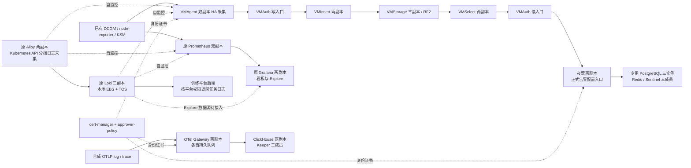

# VKE 可观测性部署与运维手册

本文面向训练平台维护人员，说明当前组件由谁部署、在哪里修改配置、如何使用 UI，以及怎样升级和回退。范围仅为训练平台 VKE；原 Prometheus、Grafana、Alloy、Loki 继续运行，新 VictoriaMetrics、夜莺、OTel、ClickHouse 是增量建设。

当前发布记录以 [DEPLOYMENT_RUNBOOK.md](DEPLOYMENT_RUNBOOK.md) 的 **2026-10-09 及后续章节**为准。各产品 README 和迁移方案中保留了早期 `observability-*` 命名空间、单副本 bootstrap 和“尚未部署”的历史描述；这些不是当前执行入口，不要照抄旧 namespace 或旧发布命令。原四个 `observability-*` 命名空间和专属云盘已经退场，原业务的 `monitoring` / `loki` 未删除。

## 1. 从哪里维护

本次已验证源码位于独立分支 `codex/observability-additive`，本机工作树为：

```text
/Users/ashersu/.codex/worktrees/observability-additive/ray-train-platform
```

不要把本机原主目录中的未提交文件当作线上版本。源码提交、镜像 digest、Helm revision、线上 CR 配置是不同版本，需要一起记录。2026-10-09 首波指标的已验证候选是 `a88f4d0`；本轮 UI 发布源码为 `12a986668489a7a3176ad3f47f71f6b4e7ecd400`，Helm release `nightingale/observability-ui` revision 1。后续文档提交不表示所有组件重新部署。

测试、渲染和构建在既有构建机 `root@14.103.49.106` 执行。正式构建目录是 `/opt/guofeng/vke-cluster/ray-platform-main`；本轮通过 Git bundle 进入**独立 detached 候选目录** `/root/raytrain-observability-ui-20261009T081922Z/green-candidate` 后验证和部署。可观测性源码仍在独立分支，本轮未推送 main、未更新正式构建目录；不能从旧正式目录覆盖当前已验收配置。

以下路径均相对上述源码根目录。`ops/observability/next/` 是新体系配置根目录；旧监控仍在 `ops/observability/` 下对应产品目录。

## 2. 部署归属、Chart 与配置文件

并非所有组件都是一个 Helm release。Helm 管理的资源用同一 release 升级；Operator 管理的工作负载应修改上层 CR；Kustomize/独立清单则通过其原声明式入口维护。不要手改 Operator 生成的 StatefulSet、ConfigMap 或 Secret，下一次协调可能覆盖手改。

| 组件 / namespace | 安装和持续管理方式 | 固定 Chart / 应用版本 | 主要维护文件 |
|---|---|---|---|
| 原 Prometheus、Grafana、Alertmanager、KSM、node-exporter / `monitoring` | Helm release `prometheus`；Prometheus Operator 协调 CR | `kube-prometheus-stack 87.18.1`；Prometheus `3.13.1`、Grafana `13.1.1`、Alertmanager `0.33.1` | `helm/vendor/kube-prometheus-stack-87.18.1.tgz`；`ops/observability/prometheus-operator/20-values-production.yaml`；同目录 `deploy.sh` / `render-test.sh` / `verify.sh` |
| 原 Alloy / `monitoring` | Helm release `alloy`，两副本 StatefulSet，Kubernetes API 日志采集 | `grafana/alloy 1.11.1`；Alloy `v1.18.1` | `ops/observability/alloy/20-values-cpu-ha.yaml`、`deploy-ha.sh`；采集规则在 values 的 `alloy.configMap.content` |
| 原 Loki / `loki` | Helm release `loki-cpu`；3 个 single-binary 副本和网关 | `loki 18.7.5`；Loki `3.7.6` | `ops/observability/loki/20-values-cpu-ha.yaml`、`deploy-ha.sh`；脚本默认 Chart 包 `/opt/guofeng/vke-cluster/loki/loki-18.7.5.tgz` |
| cert-manager / `cert-manager` | Helm `cert-manager` 和 `cert-manager-approver-policy`；单独声明 Issuer/Certificate/审批策略 | `v1.21.2`、`v0.28.0` | `next/cert-manager/{versions.yaml,cert-manager-values.yaml,harbor-values.yaml,approver-policy-values.yaml,approver-policy-harbor-values.yaml,render.py}` |
| VM Operator / `victoriametrics` | Helm `victoriametrics-operator`；仅协调该 namespace | `victoria-metrics-operator 0.68.1`；Operator `v0.75.0` | `next/victoriametrics/{versions.yaml,operator-values.yaml,operator-cluster-read.yaml}`；必须使用完整 post-renderer 链 |
| VM 数据面 / `victoriametrics` | Helm `victoriametrics-cluster`，生成 VMCluster/VMAgent/VMAuth/VMAlert/VMAlertmanager 等 CR；Operator 再生成 Pod | 本地 `victoriametrics-cluster 0.1.0`；VM `v1.153.0`、新 Alertmanager `v0.34.1` | `next/victoriametrics/resources/{Chart.yaml,values.yaml,templates/}`；叠加 `resources-hub-values.yaml`；线上须保留 `businessScrape.enabled=true` |
| ClickHouse Operator / `clickhouse` | Helm `clickhouse-operator` | `altinity-clickhouse-operator 0.27.4` | `next/clickhouse/operator-values.yaml`、`operator-post-render.py`；镜像和拓扑也在该目录清单内 |
| ClickHouse / Keeper / `clickhouse` | Kustomize 提交 CHI/CHK、配置和 Service；Altinity Operator 协调 CH 2 副本、Keeper 3 副本 | ClickHouse / Keeper `26.8.20.9` LTS | `next/clickhouse/kustomization.yaml`、`clickhouse.yaml`、`keeper.yaml`、`proxy-*.yaml`、`schema.sql`；`bootstrap-job.yaml` 是独立一次性 schema 操作 |
| OTel / `opentelemetry` | Kustomize 管理 `otel-gateway` StatefulSet；没有 OTel Operator 或 OTel Helm release | OTel Contrib `0.162.0` | `next/otel/{kustomization.yaml,gateway.yaml,collector.yaml,proxy-otel.yaml,network-policy.yaml}` |
| PostgreSQL Operator / `nightingale` | Helm `cloudnative-pg-operator`，只协调夜莺的专用数据库 | `cloudnative-pg 0.29.1`；基于 `1.30.1` 的受审认证派生镜像 | `next/nightingale/{10-cnpg-values.yaml,scope-cnpg-webhooks.py,versions.yaml,cnpg-hardening/}` |
| PostgreSQL / `nightingale` | 独立 Cluster CR `nightingale-postgres`，CNPG 协调 1 主 2 备 | PostgreSQL `17.11` | `next/nightingale/20-postgres.yaml`；数据库不是训练平台的 PostgreSQL |
| Redis / Sentinel / `nightingale` | Helm `nightingale-redis`，3 个 Redis/Sentinel Pod | `redis-ha 4.39.0`；Redis `8.8.0-alpine` | `next/nightingale/30-redis-values.yaml`、`scope-redis.py` |
| 夜莺 / `nightingale` | 受审 ConfigMap + Deployment/Service/PDB 清单；不是单独的夜莺 Helm release | Nightingale `9.1.1` 的 Sentinel 兼容派生镜像 | `next/nightingale/{40-nightingale.yaml,50-ha-patch.yaml,45-networkpolicy.yaml,config/}`；`35-bootstrap.yaml` 只用于全新空库初始化 |
| 首波业务监控声明 / 多 namespace | 本地 Chart 渲染后创建的 **15 个声明对象**；当前没有对应 Helm release | 本地 `raytrain-business-metrics 0.1.0` | `next/business-metrics/{Chart.yaml,values.yaml,templates/,dashboard.yaml}`；包括 VMServiceScrape、ServiceMonitor、发现 RBAC 和 Grafana 看板 |
| 临时浏览器入口 / `nightingale` | 独立 Helm release `observability-ui`；11 个新增声明、2 个代理 Pod，无 PVC | 本地 `observability-ui 0.1.0`；Envoy `v1.39.3` | `next/ui-access/{Chart.yaml,values.yaml,templates/,README.md}`；本 chart 直接声明 SDS，不额外叠加 VM/CNPG post-renderer |
| 证书消费与续期 | cert-manager + Envoy filesystem SDS；另有受控原生组件轮转 Job | Envoy `v1.39.3`，镜像以清单 digest 为准 | `next/mtls/{sds_post_render.py,rotation-cronjob.yaml,rotation-policy.json,rotation.py,ROTATION.md}` |

表中 `next/` 是 `ops/observability/next/` 的简写。完整镜像摘要见版本文件、values 和最终渲染结果，不能仅凭 Chart `appVersion` 推断实际运行镜像。标准镜像优先使用 Harbor `hub` 缓存；CNPG / 夜莺是专用派生镜像，Jetstack / PostgreSQL 的部分镜像因源站可达性使用保留源摘要的独立副本。

2026-10-09 本轮核对的 release revision：`prometheus=4`、`alloy=7`、`loki-cpu=4`；旧零副本 `loki=3` 仍保留其三个 PVC。新 `cert-manager=2`，`cert-manager-approver-policy`、`victoriametrics-operator`、`victoriametrics-cluster`、`clickhouse-operator`、`cloudnative-pg-operator`、`nightingale-redis` 均为 revision 1；本轮独立安装 `observability-ui` revision 1。后续升版以现场为准。

新体系四个外部 Chart 包已锁定并保留在构建机：

```text
/root/raytrain-observability-additive-20261008T065709Z/charts/
  victoria-metrics-operator-0.68.1.tgz
  altinity-clickhouse-operator-0.27.4.tgz
  cloudnative-pg-0.29.1.tgz
  redis-ha-4.39.0.tgz
```

cert-manager 的仓库、Chart 名、版本与镜像摘要见 [cert-manager/versions.yaml](cert-manager/versions.yaml)。现有包复用前核对记录的 SHA256；下载更新时固定版本并核对官方 index。历史证据目录是审计与恢复材料，不是任意新版本下载的替代品。

## 3. 当前架构与数据流

完整展示图：[PNG](../../../docs/architecture/raytrain-observability-vke-20261009.png) · [可编辑 SVG](../../../docs/architecture/raytrain-observability-vke-20261009.svg) · [缩放页面](../../../docs/architecture/raytrain-observability-vke-20261009.html)。以下简图强调当前已经接通的路径：



- 新 VMAgent 是两个实例各抓全部首波目标的 HA 双采，VM 按 30 秒去重；不是两实例分片。VMStorage RF2 是另一层存储副本保护。
- 首波新增 VM 采集范围为 DCGM、node-exporter、KSM、Alloy、Loki 五组 27 个端点。Grafana 新看板目前从**原 Prometheus**读取；尚不能把它写成“Grafana 已切到 VM”。夜莺内部只读代理已经能查 VM 中的真实 GPU/节点指标。
- 训练日志保持 Alloy → Loki → 平台后端；不会因新增 ClickHouse 自动复制一份。两个 Grafana 实例已交付的 provisioning 数据源仅有 **Prometheus、Alertmanager**，没有 Loki、VM 或 ClickHouse；Loki Explore 仍待受控数据源接入，平台自身的 Loki 日志查询继续正常使用。OTel → ClickHouse 目前为合成 canary，真实后端/Worker/Portal 埋点、业务日志分析表和 Grafana ClickHouse 数据源还要按接入合同建设。
- 夜莺承担后续正式告警，通知渠道由管理员在 UI 配置。新 VMAlert / Alertmanager 保留，当前 Alertmanager 接收器仍为 `blackhole-canary`，不能当作已经接通真实告警。
- 当前 CNI 不执行 NetworkPolicy。新组件用原生回环监听、精确身份 mTLS、HTTP 路径权限及数据库权限限制访问；NetworkPolicy 清单是后续防护配置，不能当作已经生效的隔离。

## 4. 可以配置和查看的 UI

| UI / 产品 | 可以做什么 | 配置保存在哪里 | 当前维护边界 |
|---|---|---|---|
| **夜莺** | 数据源、业务组、成员、告警规则、通知渠道、订阅/屏蔽与告警事件 | 夜莺专用 PostgreSQL；Redis 保存会话/协调等状态 | 适合作为正式告警管理入口；本地账号/验证码/JWT 保留，目前未接 Portal SSO；通知由管理员配置后单独验收 |
| **Grafana** | 看板、PromQL、Explore、数据源与用户管理；LogQL 需后续接入 Loki 数据源 | 当前声明式看板/数据源由 Kubernetes ConfigMap provisioning；UI 本地库的持久化情况另见下文 | 现有 Prometheus 看板可使用；当前两副本不能仅凭 Pod 数量认定所有 UI 配置已经共享持久化 |
| VMUI / VM 诊断页 | 指标查询、时序诊断；并非整个 VMCluster 的配置后台 | 查询本身不改集群部署配置 | 本轮未直接开放；当前受控 VMAuth 路由只开放指定 API，不能直接把 VMSelect 改 NodePort 绕过身份和租户边界 |
| 原 Prometheus / Alertmanager | Target、规则、PromQL、告警/静默等排查 | CR / 配置及相应持久化 | 现有规则链路继续保留；正式新告警配置集中到夜莺，不为方便而同时维护两份重复通知 |
| Alloy | 组件图、运行状态和采集排查 | 配置在 Helm values 中 | UI 不是完整配置编辑器；当前不直接开放无认证的 12345 端口 |
| Loki、OTel、ClickHouse、Keeper、CNPG、Redis、cert-manager | 主要由 API / SQL / CR / 清单维护 | 各自数据盘、数据库和声明式配置 | 本轮未暴露原生管理端口。Loki Explore 与 ClickHouse 分析后续通过受控只读数据源接入 |

### 夜莺如何配置

先使用夜莺自身管理员账号登录，再按“数据源 → 业务组/权限 → 规则 → 通知渠道/订阅 → 测试事件”配置。当前已有 VM 数据源使用夜莺 Pod 内的 `http://127.0.0.1:18427` 只读代理，再通过 mTLS + Bearer 连接 VMAuth；**这个 localhost 指夜莺容器，不是浏览器或个人电脑**。不要替换为裸 VMSelect 地址，也不要把 read token 复制到浏览器脚本。

夜莺初始管理员为 `root`；初始化凭据引用 `nightingale/n9e-bootstrap-admin`。仅授权管理员可在受信终端读取对应密码键，凭据不写入本文、截图、shell history 或工单。首次登录后通过 UI 管理密码；初始化 Secret 不是数据库中当前密码的实时副本。已初始化数据库不能重跑 `35-bootstrap.yaml`，修改 bootstrap Secret 也不等于修改已有用户密码。

### Grafana 配置持久化注意

本轮现场确认 Grafana **2 副本各自使用 SQLite + emptyDir，没有 PVC 或共享外部数据库**，与源码 `persistence.enabled=false` 一致。声明式 ConfigMap 中的看板和数据源会由 sidecar 重建；仅在 UI 中保存的新用户、数据源和看板，不具备跨副本一致性和重建后持久化保证。正式新增看板应导出 JSON、纳入 Git 和带 `grafana_dashboard: "1"` 标签的 ConfigMap；数据源也按现有 provisioning 声明维护。临时入口的 ClientIP 粘连用于减少同一客户端切到不同 SQLite 实例，**不等于共享数据库、HA 会话或持久化修复**。

Grafana 初始管理员 Secret 引用为 `monitoring/grafana-admin`，键为 `admin-user` / `admin-password`。同样只在授权受信终端读取，不在文档公布密码。后续如果要把 Grafana 当作多人长期编辑后台，应独立规划共享数据库、备份和迁移；本次临时 UI 入口不自动解决该问题。

## 5. 临时 NodePort 与后续 Ingress

本轮用户授权在**公司内网 / VPN 可达的节点 IP**上临时开放配置 UI，后续切换 Ingress。入口应保留产品登录和新组件的内部 mTLS，不把数据库、VM 写入或 Envoy 管理接口直接暴露。NodePort 是集群节点上的入口，并不因为没有公网域名就自动具有源地址隔离。

### 现有云入口与临时代理的关系

现场已有火山 ALB：`internal-alb` 私网地址 `172.28.6.171` / HTTP 80；`raytrain-prod-alb` 地址 `172.28.6.180` / HTTP 80 和 HTTPS 443。`alb`、`internal-alb`、`raytrain-prod-alb` 三个 IngressClass 使用 `ingress.vke.volcengine.com/alb`。ALB 控制器属于托管组件，不能把集群中 `apig-controller:v0.4.0` 当成 ALB 版本。

APIG 控制器虽已安装，但 `APIGInstance` 当前为空；没有 APISIX、NGINX Ingress 或 Gateway API 控制器/资源。Loki 自带的 nginx gateway 仅服务 Loki，不是通用集群入口。

新增的两个 Pod 是**一个反向代理的两个副本**，为临时独立 IP:port 页面提供浏览器 HTTPS、夜莺上游客户端证书以及入口 Cookie 处理。它不参与训练、采集或数据库写入链路，也不是再安装两套网关。

火山 [ALB 后端协议](https://www.volcengine.com/docs/6460/132415?lang=zh)支持 HTTPS，但其[双向认证说明](https://docs.volcengine.com/docs/vke/Configure_HTTPS_mutual_authentication_for_ALB_Ingress?lang=zh)描述的是浏览器与 ALB 之间的客户端证书验证。当前尚未取得 ALB 能以指定客户端证书连接夜莺并校验其身份的证据，不能把前端双向认证等同于上游 mTLS。Grafana 的普通后端可以单独评估直接接现有 ALB。

[APISIX 支持上游 mTLS](https://apisix.apache.org/docs/apisix/mtls/)，可以承担统一入口；但当前使用它需要新建数据面、控制和配置维护流程，不属于“复用已安装网关”。用户比较方案后选择先完成临时 NodePort，再评估 ALB 整合。如果后续统一 Ingress/API 网关能完成夜莺上游 mTLS，可直接承担代理职责并撤掉临时专用 Pod，不必长期叠加。

以下四个 HTTPS 地址均已从构建机完成有效 CA / IP SAN 校验和页面检查。浏览器所在电脑仍需要公司内网 / VPN 路由以及对公开 CA 的信任。

| 入口 | 临时访问地址 | 登录 / TLS | 发布状态 |
|---|---|---|---|
| Grafana | `https://172.28.2.65:31701/`，备用 `https://172.28.1.232:31701/` | 原 Grafana 登录；专用 `monitoring/grafana-ui-backend` ClientIP 粘连 | 已发布；真实管理员登录、看板、GPU 72 和 WebSocket 验证通过 |
| 夜莺 | `https://172.28.2.65:31700/`，备用 `https://172.28.1.232:31700/` | 浏览器入口代理 → 夜莺 mTLS Service，继续要求夜莺验证码 / JWT 登录 | 已发布；页面 / JS / 验证码与未登录拒绝验证通过；本轮未执行该新入口的真人验证码登录 |

实际安装为独立 Helm release `nightingale/observability-ui` revision 1，新增 **11 个声明对象、2 个代理 Pod**，分别调度到 `172.28.1.229` / `172.28.1.232`，无 PVC。Deployment / ServiceAccount / ConfigMap 名为 `observability-ui`；两个入口 Service 为 `nightingale-ui`、`grafana-ui`，另有 `monitoring/grafana-ui-backend` 粘性后端 Service。NodePort 可由没有代理 Pod 的节点转发，入口 IP 不等于代理所在节点。

浏览器 Certificate 为 `nightingale/obs-ui-browser-server`，由 cert-manager 使用现有内部 mesh CA 管理；IP SAN 为 `172.28.2.65` / `172.28.1.232`，不是浏览器默认信任的公网域名证书。应先经受信渠道核对并安装**公开 CA 证书**，再进行真实登录；[公开 CA 导出与信任指引](ui-access/README.md#首次使用信任公开-ca)不包含私钥。节点当前没有 ExternalIP，但 NodePort 本身不是来源 ACL，实际访问范围还取决于公司 VPN、路由和云安全组。Grafana 网关到原服务的上游仍是集群内 HTTP，不能称为全链路 TLS。

维护入口为 [ui-access/Chart.yaml](ui-access/Chart.yaml)、[values.yaml](ui-access/values.yaml)、[templates/](ui-access/templates/) 和 [UI 运维说明](ui-access/README.md)。本轮通过 Helm 实际安装，不是仅 `helm template` 后另行 apply。`values.yaml` 管理副本、资源、NodePort 与 IP SAN；此 Chart 已直接声明 filesystem SDS，不额外套用 VM/CNPG 的 post-renderer。

本轮 **33 项现场检查通过**：四个 HTTPS 地址证书与页面、Grafana 真实管理员登录和带 Origin 请求、业务看板 / GPU 72 查询、WebSocket `101` 与 Secure cookie；夜莺原版 HTML / JS hash、验证码 `dat.show=true`、未登录和伪造身份头请求 `401`。夜莺新 NodePort 的真实验证码登录本轮未执行，不能将页面 / 负向认证检查写成该入口完整登录 E2E。前后 **2536 个存量保护对象无差异**；用户并发创建的 yolo 训练和 storage-sync 记录不计作本次创建或改动。证据为构建机 `/root/raytrain-observability-ui-20261009T081922Z/live-ui-acceptance-v2.json`、`protected-comparison.json`。

切换 Ingress 可以保留这个受控 UI 网关，也可以在统一网关验证支持夜莺上游 mTLS 后撤掉临时代理。申请正式域名证书，配置 backend、协议、根路径和所需 WebSocket/超时，检查转发头及 Grafana `root_url` 等应用外部 URL，实际验证登录、CSRF、跳转、静态资源和查询。保留临时网关时还要为 Ingress → 网关配置正确 CA / SNI / Service DNS SAN 证书和精确审批策略；当前只有 IP SAN 的证书不能直接当作 Service DNS 证书。确认新入口正常后，再用 `service.type: ClusterIP` 的最小覆盖升级临时 Chart并关闭 NodePort。只改 Service 类型不等于完成 Ingress 迁移。夜莺的上游 mTLS 必须继续保持，不能直接连接其原生 17000 回环端口，也不要通过关闭证书校验、验证码或产品认证解决入口问题。

## 6. 资源与存储账目

本轮 UI 发布后最终只读快照时间为 **2026-10-09 16:43:36 北京时间（08:43:36 UTC）**，72 个 Pod 全部 Running / Ready，metrics 采样齐全。范围为 `monitoring`、`loki`、`cert-manager`、`victoriametrics`、`clickhouse`、`opentelemetry`、`nightingale` 七个 namespace 的非 terminal Pod，不包括 `kube-system` 的 9 个既有 DCGM exporter、其他集群系统服务或 TOS 桶容量；node-exporter 已包含在 `monitoring`。

| 统计项 | 新增体系 | 原 `monitoring` + `loki` | 合计 |
|---|---|---|---|
| 常驻 Pod | 45，含 2 个 UI 代理 | 27 | 72 |
| CPU requests | 12.34 核 | 4.90 核 | 17.24 核 |
| 内存 requests | 27.16Gi | 11.25Gi | 38.41Gi |
| 已设置 CPU limits 的有限值合计 | 56.75 核 | 14.00 核，另有未设置项 | 70.75 核，**不是整体硬上限** |
| 已设置内存 limits 的有限值合计 | 60.69Gi | 28.00Gi，另有未设置项 | 88.69Gi，**不是整体硬上限** |
| 实际 CPU / 内存采样 | 0.505 核 / 9.78Gi | 0.683 核 / 7.53Gi | **1.189 核 / 17.31Gi** |
| 活跃 PVC 申请容量 | 21 块 / 670Gi | 5 块 / 250Gi | 26 块 / 920Gi |
| 保留但无活跃 Pod 使用的 PVC | 0 | 旧 `storage-loki-0/1/2`，3 块 / 150Gi | 3 块 / 150Gi |
| 所有 PVC 申请容量 | 21 块 / 670Gi | 8 块 / 400Gi | **29 块 / 1070Gi** |

| namespace | Pod | CPU / 内存 requests | 实际 CPU / 内存 | PVC / 申请容量 |
|---|---|---|---|---|
| `monitoring` | 22 | 1.40 核 / 4.75Gi | 0.624 核 / 6.07Gi | 2 / 100Gi |
| `loki` | 5 | 3.50 核 / 6.50Gi | 0.060 核 / 1.46Gi | 6 / 300Gi，含 150Gi 保留卷 |
| `cert-manager` | 8 | 0.80 核 / 2.00Gi | 0.004 核 / 0.28Gi | 0 |
| `victoriametrics` | 17 | 3.43 核 / 5.56Gi | 0.081 核 / 1.48Gi | 8 / 250Gi |
| `clickhouse` | 6 | 3.45 核 / 10.50Gi | 0.295 核 / 6.62Gi | 5 / 260Gi |
| `opentelemetry` | 2 | 0.70 核 / 1.25Gi | 0.002 核 / 0.12Gi | 2 / 40Gi |
| `nightingale` | 12 | 3.96 核 / 7.84Gi | 0.123 核 / 1.27Gi | 6 / 120Gi |

本次两个 UI 代理已包含在上述总数中，合计 requests `0.10 CPU / 128Mi`、limits `0.60 CPU / 256Mi`，无 PVC / GPU；该时点实际合计约 **0.98m CPU / 37.26Mi 内存**。这只是低负载瞬时值，不是请求或内存上限。

统计口径：requests 按应用容器与 restartable init 合计、初始化峰值及 Pod overhead 计算；实际值取 metrics API 的 CPU / memory working set 瞬时采样，不是压测结果。原 `monitoring` 的 24 个、`loki` 的 3 个应用容器没有设置 CPU/内存 limits；有限 limits 之和不能代表全部负载上限，没有设置也不能理解为真实限制为 0。PVC 申请容量不是实际文件/数据库占用量；TOS 的 Loki 历史对象不包含在 EBS 容量中。临时验收 Pod/Job 单列，既有 exporter 不重复计入新体系。上述七 namespace 的 GPU requests 合计为 0。

最终非敏感资源证据位于构建机 `/root/raytrain-observability-final-resources-20261009T084336Z/` 的 `summary.json` 及同目录逐项清单，无需读取 Secret 内容即可复核。UI 发布前快照另保留在 `/root/raytrain-observability-ui-inventory-20261009T081904Z/`，不混用两个时点的瞬时值。

新增体系不申请 GPU，可以使用普通 GPU 节点的 CPU/内存，负优先级且不可抢占；显式避让 algorithm 专属节点和已核对的高内存节点。它仍会消耗共享 CPU、内存、网络和磁盘，低负载采样不是峰值容量承诺。

新数据卷使用 `ebs-ssd-observability-retain`，允许扩容、延迟绑定、Retain。原 Loki 活跃 EBS 用于本地 WAL/缓存等，chunks/index 在 TOS `vke-cluster`；旧 Loki 保留卷需要单独盘点，不能因旧工作负载副本为 0 就自动删除。Retain 不等于备份，也不能只保存 PV 而不保存其恢复所需元数据。

## 7. 配置变更与升级流程

### 配置依据与维护入口

1. **先核对现场**：实际 release revision、CR、镜像 imageID、当前 replicas/selector、手工运行参数和 UI 数据库配置决定正在运行什么；历史文档是证据，不是实时状态。
2. **形成受审目标配置**：部署拓扑、资源、镜像、采集规则、证书身份和网络入口写入 Git。夜莺规则/联系人/通知等 UI 配置保存在专用 PostgreSQL，按 UI/API 管理并备份数据库；不要用初始化 SQL覆盖它。
3. **按原管理者发布**：Helm release 用固定 Chart + values + 完整 post-renderer；CR 用其声明式入口；不要同时让 Helm 和 `kubectl apply` 争夺同一组资源。
4. **同步关键现网覆盖项**：当前 VMAgent `businessScrape.enabled=true`、夜莺双副本和受管证书必须进入下次最终渲染；不能拿早期默认 values 恢复掉已验收功能。

### 当前必须保留的三个差异

- VM `resources/values.yaml` 的 `businessScrape.enabled` 默认 `false`，用于保护全新安装；现网通过定向 patch 已启用。下一次 VM release 更新，**显式传入 `--set businessScrape.enabled=true` 或受版本管理的生产 overlay**，再用 `validate_component_contract.py --business-wave1` 验证 Operator、VM 和业务声明三份渲染结果。只看 `helm get values` 不足以发现现网定向 patch。
- 首波 15 个业务声明由本地 Chart 渲染后 `kubectl create`，**没有 Helm release**。修改时对比当前对象与新渲染，按已存在的清单管理方式更新；不要直接 `helm install` 同名 Chart来抢所有权。
- 夜莺 `40-nightingale.yaml` 保留首次启动 1 副本，现网已由 `50-ha-patch.yaml` 扩为 2。日常重新渲染必须包含双副本结果；不能单独重套初始化 Deployment 后宣称仍是 HA。

### 升级操作顺序

只在构建机隔离候选执行测试和渲染。**不要对 `next/` 递归 apply**：其中混有 values、模板、补丁、一次性初始化和测试文件。

1. 获取干净候选 SHA，检查用户/并行改动；保存受限权限的当前版本与关键配置备份，记录训练 Pod/RayJob/RayCluster UID、规格、重启数及原日志/监控基线。
2. 检查官方版本兼容性，固定 Chart SHA256 / 镜像 digest；涉及 CRD 时独立评审 schema 与 ownership，不用 `--take-ownership`、`--force` 或删 CRD消除报错。
3. 在构建机运行适用的合同测试、真实 Helm/Kustomize 渲染、组件配置校验和 server-side dry-run，审阅完整差异。已有 Helm 升级保留现有 values，并加本次最小覆盖；涉及 Secret 的备份和 Helm 输出只进受限目录，不能直接粘贴完整 manifest。
4. 保留完整后处理顺序：VM → SDS；CH Operator 专用处理器 → SDS；CNPG webhook/代理处理器 → SDS；CH/OTel Kustomize 和夜莺配置 → SDS。Redis 使用 `scope-redis.py`，不要丢掉该链路、改成 stock Chart直发。
5. 按组件小范围发布，等待所有预期副本就绪和数据/协议验收，再处理下一组。证书和必要代理配置先就绪；CH 等 Keeper / schema，OTel 等 CH；夜莺等 PG / Redis。当前系统已经安装，日常维护不重跑 bootstrap 或重新导入 CA。
6. 用查询、目标状态、队列、数据库复制和真实入口验证本次行为；对比训练和旧监控基线。记录源码 SHA、Chart/revision、镜像 digest、修改对象、验证结果和回滚点。

当前名称及 7 条渲染链可查 [迁移操作记录](../../../docs/superpowers/plans/2026-10-09-observability-migration-runbook.md#render-and-post-renderer-chain)；其中原始安装命令是历史方案，复用时必须叠加本节生产差异，不能整段当作当前升级脚本执行。首波声明的专属验证流程见 [business-metrics/README.md](business-metrics/README.md)。

### 常用只读检查

以下命令在具备受控集群访问权限的构建机执行，不输出 Secret 内容：

```bash
obs_context='cd9q3b7rf9aidnnbd0je0@81533555-kd9q3q0frjmp21sk5lklg'
helm --kube-context "$obs_context" list -A
kubectl --context "$obs_context" get nodes
kubectl --context "$obs_context" top nodes
for obs_ns in monitoring loki cert-manager victoriametrics clickhouse opentelemetry nightingale; do
  kubectl --context "$obs_context" -n "$obs_ns" get deployment,statefulset,pod,service,pvc
  kubectl --context "$obs_context" -n "$obs_ns" top pods --containers
done
kubectl --context "$obs_context" get certificate -A
kubectl --context "$obs_context" get clusterissuer
kubectl --context "$obs_context" -n victoriametrics get vmcluster,vmagent,vmauth,vmalert,vmalertmanager,vmservicescrape
kubectl --context "$obs_context" -n clickhouse get clickhouseinstallation,clickhousekeeperinstallation
kubectl --context "$obs_context" -n nightingale get cluster.postgresql.cnpg.io
kubectl --context "$obs_context" -n cert-manager get cronjob native-certificate-rotation
```

## 8. 日常维护、备份与回滚

| 周期 / 触发 | 检查内容 | 处理原则 |
|---|---|---|
| 日常健康 | 原平台日志查询、Prometheus targets、新 VM targets、GPU/节点数量、OTel/VM 队列、存储水位、数据库复制、证书到期 | 关注趋势与持续异常；不能只看 Pod Running |
| 增加采集目标 | 修改 `business-metrics` 的明确范围、RBAC和指标/标签白名单，评估 API/网络/序列量 | 新 exporter 版本或标签裁剪变化重新做 series key 冲突检查；避免 headless 重复抓取 |
| 增加看板 | 在已有数据源上验证表达式、导出 JSON、提交 ConfigMap provisioning | UI 手改需回写声明；新 VM / ClickHouse 数据源须独立只读身份和安全通路 |
| 增加正式告警 | 夜莺 UI 配置业务组、规则、通知和订阅，验证 firing → 收到通知 → resolved | 当前黑洞接收器不是通知成功；避免与原告警重复发送 |
| 证书续期 | Certificate Ready / renewalTime / expiry、Envoy/原生消费者实际证书和失败通知 | cert-manager 更新 Secret ≠ 所有客户端热加载；周期原生轮转当前仍暂停 |
| 容量或版本调整 | 先查看峰值 CPU/内存、TSDB序列量、查询耗时、Loki拒收、CH复制/合并和队列积压 | requests/limits/副本/PVC/保留期分开调整；先验证单组变更 |

**备份内容不能只有 YAML。** 至少保留：固定版本清单与声明式配置、必要的受限 Secret/PKI 恢复材料、夜莺 PostgreSQL 数据库与隔离恢复验证、正式数据接入后的 VM / CH 数据备份策略、Loki TOS保留和恢复边界。队列卷有积压时不能删除。私钥/数据库备份仅进受限位置，不上传 Git或把证据目录整体分享。

目前保留过已验证的夜莺 PostgreSQL 备份，但它是一个时点；后续 UI 变更需要持续备份与恢复演练，不能把该旧备份视为自动保护新规则。原生证书轮转 CronJob 仍 `suspend: true`，真实续签与受控消费已经验收；正式失败通知闭环接通前不自动解除暂停。详见 [mtls/ROTATION.md](mtls/ROTATION.md)。

回退优先恢复本次最小配置差异：临时 UI 入口可关闭对应 NodePort/网关；采集改动恢复 selector 和本次声明；组件镜像/配置按其版本回退。UI release 的 `helm uninstall` 只针对该 Chart拥有的新增声明，不能删除现有 `obs-mtls-n9e-ui-gateway` Certificate / Secret、夜莺、Grafana或数据库；新 browser Certificate 生成的 Secret 依 cert-manager owner-reference 策略核对保留/回收，不盲删同 namespace 资源。Helm rollback **不会**回滚已经执行的 PostgreSQL迁移或 ClickHouse schema。删除 namespace、CR、PVC、PV或云盘不是通用回退步骤，尤其不能为处理 Pending / join / 拉镜像失败而删除有数据的卷或未知 Job。

已知待完善项包括：Alloy 旧日志回读拒收、资源配置位置及持久化队列加固；Grafana 多副本共享配置持久化；夜莺真实通知与原生证书轮转失败告警；OTel真实业务接入和备份恢复演练。这些要分别验证，本次 UI 开放不等同于它们已经完成。
